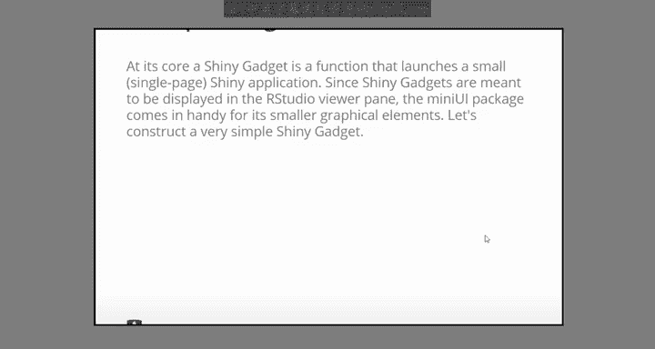
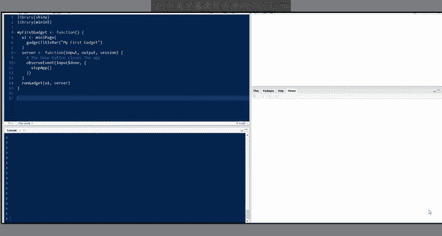
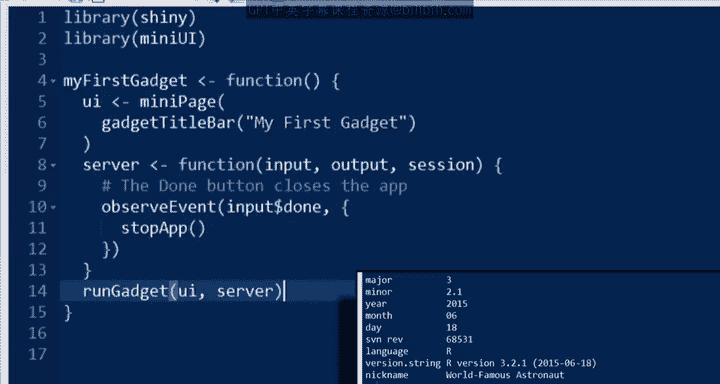
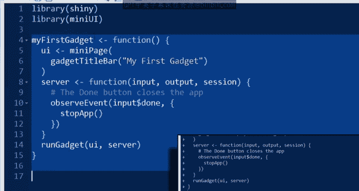
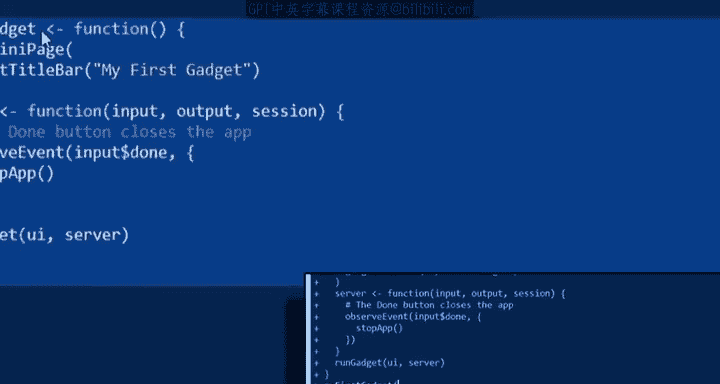
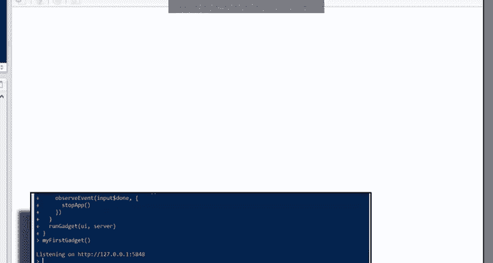

# 120：Shiny Gadgets 入门教程 🚀

在本节课中，我们将学习如何使用 Shiny Gadgets 在 R 环境中创建简单的交互式数据分析工具。Shiny Gadgets 是 Shiny 框架的一个轻量级扩展，它允许我们在 RStudio 的查看器窗格中快速构建和运行小型交互式应用，非常适合用于探索性数据分析。

## 概述与背景 📖

上一节我们介绍了 Shiny 框架用于构建完整的网络应用。本节中，我们来看看如何利用 Shiny Gadgets 在 R 环境中进行快速、交互式的数据分析。

Shiny Gadgets 提供了一种在数据分析中使用 Shiny 交互功能的方法。这是一种更简单、更快捷的使用方式，不同于我们构建面向他人使用的完整网络应用。Shiny Gadgets 更适合我们自己或少数合作者进行数据分析。

由于应用将在 RStudio 程序的小屏幕中显示，我们将使用 **`miniUI`** 包来帮助我们为小屏幕创建界面。

**核心概念**：一个 Shiny Gadget 是一个函数，它会在 RStudio 的查看器窗格中启动一个单页的 Shiny 应用程序。

## 构建第一个 Shiny Gadget 🛠️

接下来，我们将创建一个最简单的 Shiny Gadget，并将其分解为基本元素，以便理解。

以下是创建第一个 Gadget 所需的步骤：

1.  **加载必要的包**：确保 `shiny` 和 `miniUI` 包已安装并加载。
2.  **定义 Gadget 函数**：Gadget 本身是一个 R 函数。
3.  **构建用户界面 (UI)**：使用 `miniUI` 的函数（如 `miniPage` 和 `gadgetTitleBar`）定义布局。
4.  **定义服务器逻辑 (Server)**：编写处理交互的服务器函数，使用 `input`, `output`, `session` 参数。
5.  **运行 Gadget**：使用 `runGadget()` 函数将 UI 和 Server 部分组合并启动应用。



现在，让我们通过代码演示来具体实现。



## 代码演示与解析 💻

首先，确保已加载 `shiny` 和 `miniUI` 包。如果尚未安装，请使用 `install.packages()` 命令安装。

```r
library(shiny)
library(miniUI)
```

接下来，我们定义 Gadget 函数。这是最简单的示例，目前没有参数。

```r
myFirstGadget <- function() {
    # 用户界面定义
    ui <- miniPage(
        gadgetTitleBar("My First Gadget")
    )
    # 服务器逻辑定义
    server <- function(input, output, session) {
        # 观察‘done’按钮的点击事件
        observeEvent(input$done, {
            stopApp() # 停止应用
        })
    }
    # 运行Gadget
    runGadget(ui, server)
}
```

**代码解析**：
*   `miniPage()`: 来自 `miniUI` 包，用于创建小屏幕的基本页面布局。
*   `gadgetTitleBar()`: 添加一个标题栏，其中默认包含“完成”(Done)和“取消”(Cancel)按钮。
*   `observeEvent(input$done, ...)`: 这是一个**响应式表达式**。它监听 `input$done` 的变化（即用户点击“完成”按钮），当事件发生时，执行 `stopApp()` 来关闭 Gadget。

定义好函数后，需要先**运行**它（在 RStudio 中选中代码并按 Ctrl+Enter，或使用 `source()` 函数），然后**调用**它。

```r
# 运行函数定义（如果在脚本中）
# source("your_script.R")

# 调用函数，启动Gadget
myFirstGadget()
```

执行后，RStudio 的查看器窗格会显示一个标题为 “My First Gadget” 的小应用。点击 “Done” 按钮，应用会关闭并返回到 R 提示符。





这个简单的 Gadget 虽然功能有限，但它是理解 Shiny Gadgets 工作原理的重要第一步。正如你已经接触过 Shiny，许多更复杂的概念（如响应性）在深入学习 Gadgets 时会自然迁移过来。



## 总结与练习 📝

本节课中我们一起学习了 Shiny Gadgets 的基本概念和创建流程。

我们了解到 Shiny Gadgets 是用于快速交互式数据分析的工具，它运行在 RStudio 内部，使用 `miniUI` 包来适配小屏幕界面。我们成功构建并运行了一个最简单的 Gadget，它包含一个标题栏和一个用于退出的“完成”按钮。

**建议练习**：在继续学习下一个视频前，请从课程资料中获取这段代码，在 RStudio 中亲自运行一次，熟悉基本流程。尝试修改标题栏的文字，观察变化。



掌握了这个基础框架后，在接下来的课程中，我们就可以为其添加更丰富的输入控件（如滑块、下拉菜单）和输出（如图表、表格），从而构建真正有用的数据分析工具。