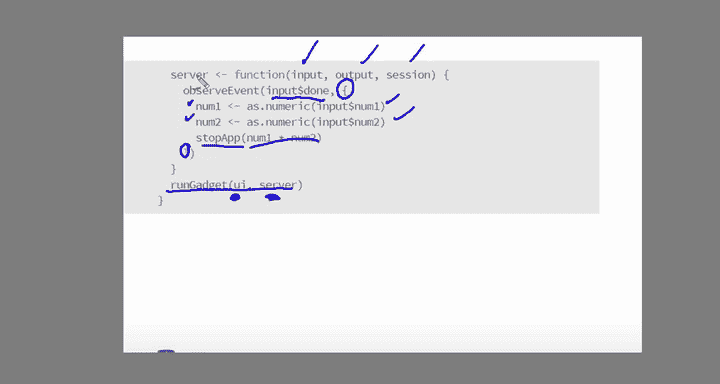
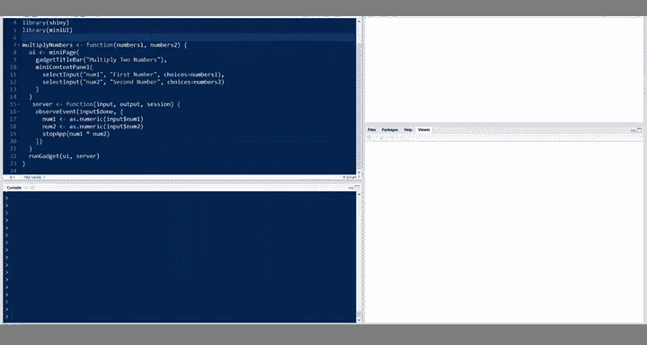
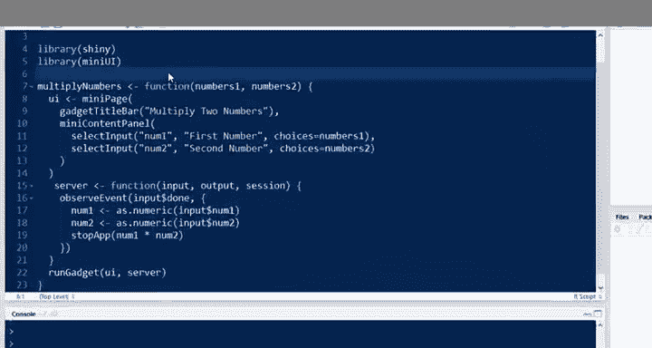
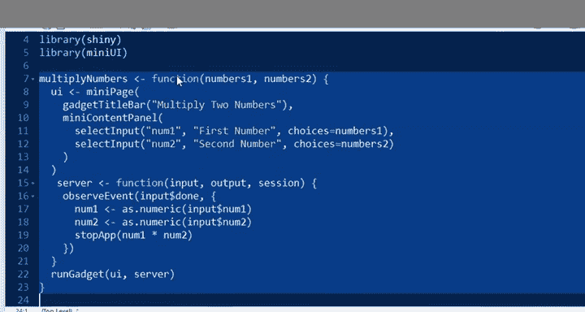
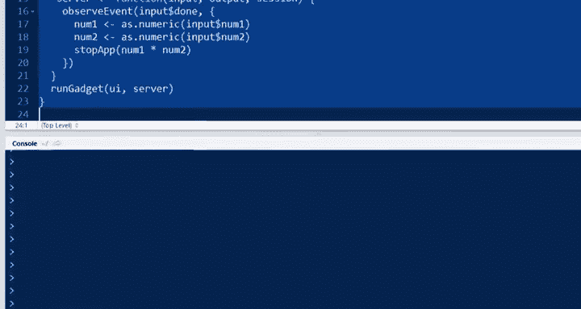
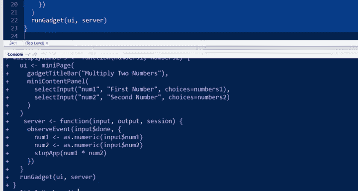
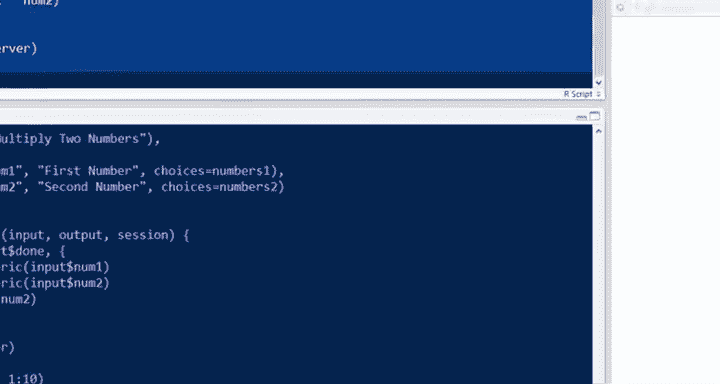
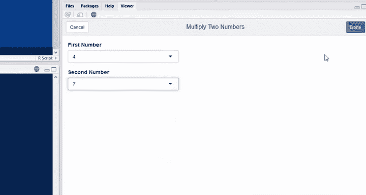
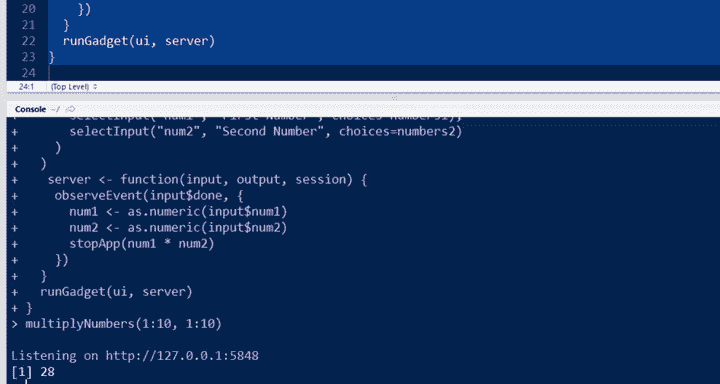

# 121：13_Shiny Gadgets 1 2 🧮

在本节课中，我们将学习如何为 Shiny Gadget 添加参数，并实现一个简单的数字乘法交互应用。我们将通过一个具体的例子，演示如何构建一个包含下拉选择框和计算功能的小工具。

---

上一节我们介绍了一个功能简单的 Shiny Gadget。本节中，我们来看看如何为 Gadget 添加参数，使其能够接收用户输入并进行计算。

我们的目标是创建一个函数，它允许用户从两个下拉列表中选择数字，然后计算这两个数字的乘积。

以下是构建此应用所需的代码，分为两部分以便于展示。

首先，我们需要加载必要的库并定义 Gadget 的用户界面（UI）部分。

```r
library(shiny)
library(miniUI)

multiplyNumbers <- function(numbers1, numbers2) {
  ui <- miniPage(
    gadgetTitleBar("Multiply Two Numbers"),
    miniContentPanel(
      selectInput("num1", "First Number:", choices = numbers1),
      selectInput("num2", "Second Number:", choices = numbers2)
    )
  )
```

接下来，我们定义服务器（Server）逻辑部分。

```r
  server <- function(input, output, session) {
    observeEvent(input$done, {
      num1 <- as.numeric(input$num1)
      num2 <- as.numeric(input$num2)
      result <- num1 * num2
      stopApp(result)
    })
  }
  runGadget(ui, server)
}
```

代码解析：
1.  **UI部分**：使用 `miniPage` 创建界面，包含一个标题栏和内容面板。内容面板内有两个 `selectInput` 控件，分别对应两个数字的选择，其选项来自函数参数 `numbers1` 和 `numbers2`。
2.  **Server部分**：使用 `observeEvent` 监听名为 `done` 的按钮（由 `gadgetTitleBar` 自动提供）。当按钮被点击时，获取两个输入值，将它们转换为数值型，计算乘积，最后通过 `stopApp()` 函数停止 Gadget 并返回结果。
3.  **运行Gadget**：`runGadget(ui, server)` 负责启动整个应用。

---

现在，让我们运行这个函数，看看它的实际效果。



首先，确保已加载 `shiny` 和 `miniUI` 库。然后定义 `multiplyNumbers` 函数。

```r
# 定义函数后，调用它
multiplyNumbers(numbers1 = 1:10, numbers2 = 1:10)
```







执行上述调用后，会弹出一个交互窗口。



以下是操作步骤：
1.  在第一个下拉框中选择一个数字（例如 4）。
2.  在第二个下拉框中选择另一个数字（例如 7）。
3.  点击 **Done** 按钮。

点击后，Gadget 窗口关闭，控制台会输出计算结果 `28`。

这个例子虽然简单，但它展示了 Shiny Gadget 的核心工作流程：**构建界面 -> 处理输入 -> 执行计算 -> 返回结果**。通过这个“婴儿学步”式的示例，你可以理解如何利用参数化输入和事件驱动逻辑来构建交互工具。

---









本节课中我们一起学习了如何为 Shiny Gadget 添加参数并实现基础计算功能。我们构建了一个乘法计算器，它允许用户通过下拉菜单选择数字并查看乘积结果。这为创建更复杂、更有用的交互式数据分析工具奠定了基础。下一节，我们将尝试创建一个交互式图形应用。