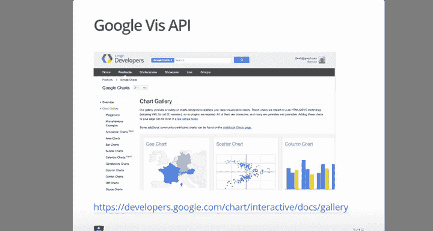
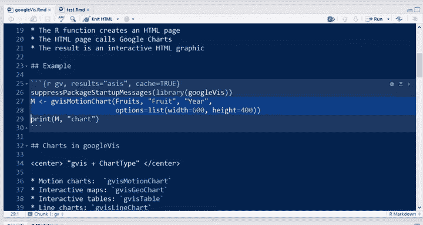
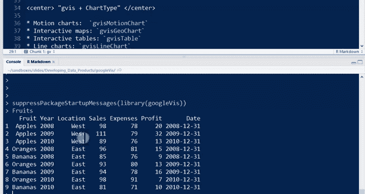
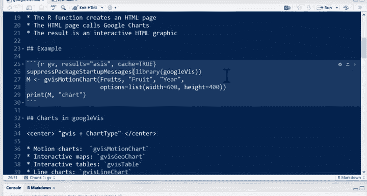
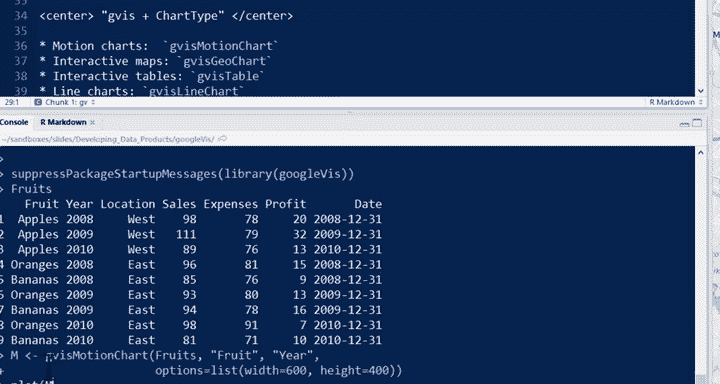
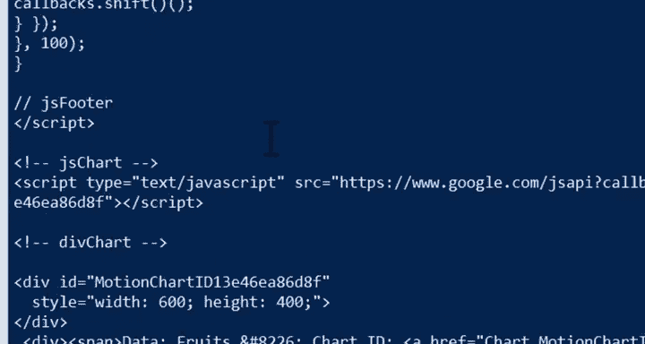

# 123：GoogleVis 入门教程 📊

在本节课中，我们将学习如何使用 R 语言中的 GoogleVis 包。GoogleVis 是一个功能强大的 R 包，它能将 R 与谷歌的可视化 API 连接起来。这个包开发完善，文档齐全，非常值得在本课程中探讨。我们将通过几个示例来展示 GoogleVis 的功能，希望你能通过这些例子掌握其基本用法，并在此基础上进行扩展。它提供了一种非常出色的方式来创建交互式图表，充分利用了谷歌已有的交互式图形资源。

接下来，我们将从一些基础用法开始，逐步介绍地图、图表以及动态图等可视化形式。这些图表如果仅靠自己创建会非常困难，但通过 R 与 GoogleVis 的结合，一切变得简单易行，尤其对于熟悉 R 的用户而言。

---

## 创建动态图

上一节我们介绍了 GoogleVis 的基本概念，本节中我们来看看如何创建一个动态图。



首先，我们需要加载 GoogleVis 库。以下是加载库并抑制包启动消息的代码：

```r
library(GoogleVis)
suppressPackageStartupMessages(library(GoogleVis))
```

接下来，我们使用一个名为 `fruits` 的数据框来创建动态图。这个数据框的结构如下：

```
   fruit  year location sales expenses profit        date
1  apples  2008     West    98       78     20 2008-12-31
2  apples  2009     West   111       79     32 2009-12-31
3  apples  2010     West    89       76     13 2010-12-31
4 oranges  2008     East    96       81     15 2008-12-31
5 bananas  2008     East    85       76      9 2008-12-31
6 bananas  2009     East   100       80     20 2009-12-31
7 bananas  2010     East    97       78     19 2010-12-31
```



数据框包含了水果种类、年份、地区、销售额、支出、利润和日期等信息。要创建动态图，你的数据最好也组织成类似的格式。

现在，我们运行以下代码来生成动态图：



```r
M <- gvisMotionChart(fruits, idvar="fruit", timevar="year")
```



我们将 `gvisMotionChart` 函数的输出赋值给变量 `M`。要查看图表，只需输入：

```r
plot(M)
```

执行这行代码会打开一个浏览器窗口，展示生成的动态图。这个图表类似于汉斯·罗斯林风格的动态图，你可以点击播放按钮来观察数据随时间的变化。此外，你还可以根据数据框的列来设置图表的各个尺度。

例如，我们可以将时间轴设置为年份，将利润作为度量之一。这样，你就能看到不同水果的利润随时间变化的情况。图表中，数据点会上升或下降，你可以选择显示单个或多个水果的数据，也可以高亮显示特定水果。



这个图表非常巧妙，它还在同一个图形中集成了条形图和折线图等多种图表类型。所有这些功能都是由 GoogleVis R 包组织的一系列 JavaScript 代码实现的。

如果你想获取生成图表所需的原始 HTML 和 JavaScript 代码，可以输入：

```r
print(M)
```


这会在控制台输出相关的 HTML 页面代码，包括 JavaScript 数据定义和页面结构。例如，你可以看到 HTML 的头部和主体部分。

你还可以将图表保存为 HTML 文件：



```r
print(M, file="test.html")
```

这会在当前工作目录下创建一个名为 `test.html` 的文件，其中包含了完整的图表页面。

通常，使用 GoogleVis 的流程是：先通过 `plot` 函数创建并调试图表，确保其外观和功能符合预期；然后，提取相关的 HTML 和 JavaScript 代码，将其嵌入到其他网页中。如果你想了解如何将图表嵌入到幻灯片或 R Markdown 文档中，可以参考本讲座的原始 R Markdown 文档。

---

## 课后练习

在第一个示例之后，你的课后练习是重新创建这个动态图。请确保你能成功可视化图表，并在浏览器窗口中查看它。首先，安装 GoogleVis 包，并进行一些简单的尝试和调整。

---

本节课中我们一起学习了如何使用 GoogleVis 包在 R 中创建交互式图表，特别是动态图。我们涵盖了从加载库、准备数据、生成图表到查看和导出代码的完整流程。通过掌握这些基础，你可以利用 GoogleVis 强大的功能，轻松创建出各种复杂的交互式可视化效果。