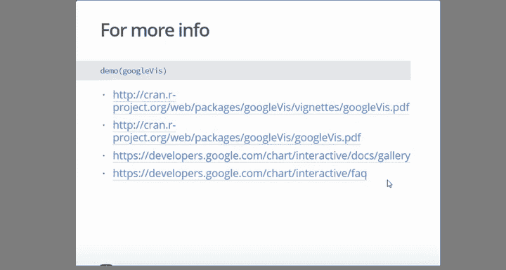
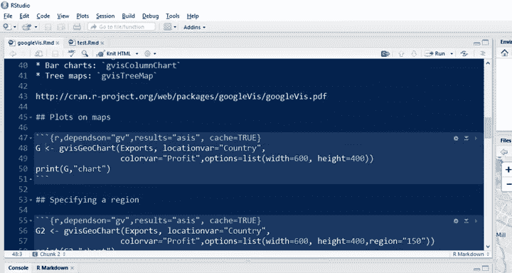
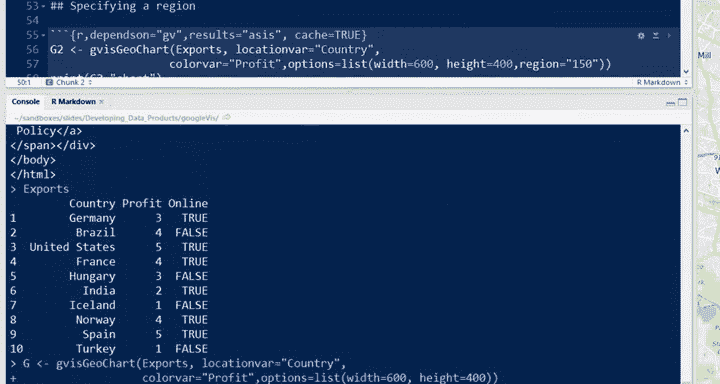
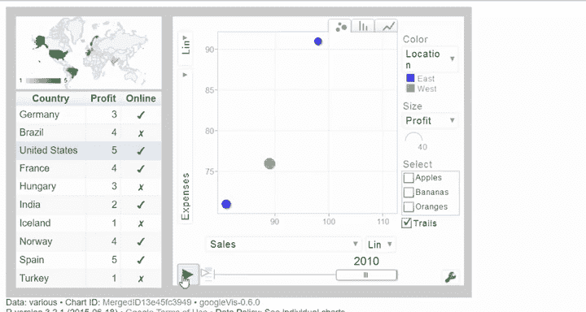

# 124：GoogleVis 入门教程 📊

在本节课中，我们将学习如何使用 R 语言中的 **GoogleVis** 包来创建交互式图表。GoogleVis 包允许我们便捷地调用谷歌丰富的可视化工具，例如动态图表、交互式地图、折线图、柱状图，甚至是基于指标的仪表盘等。我们将通过具体的代码示例，学习如何创建这些图表并将其嵌入到文档或演示文稿中。

---

## 1. GoogleVis 包简介与文档

GoogleVis 是一个功能强大的 R 包，它为我们提供了访问谷歌大部分可视化工具的接口。这些工具包括动态图表、交互式地图、交互式表格、折线图和柱状图等。谷歌甚至提供了可以创建基于图表或指标的“速度计”等小工具。

要了解所有可用的图表类型，你可以查阅 GoogleVis 的官方文档。该文档非常完善，既包含概述性的“vignette”，也提供了详细的包文档。

上一节我们介绍了 GoogleVis 的基本概念，本节中我们来看看为什么交互式图表是其一大亮点。

---

## 2. 交互式图表的优势

交互式图表是 GoogleVis 的一大优势，尤其是在地图绘制方面。创建带有指定国家弹出窗口、并可嵌入网页或演示文稿的 JavaScript 地图通常很复杂，但谷歌已经为我们完成了大部分繁重的工作。

以下是一个在 Markdown 演示文稿中实现交互性的示例。你可以看到，它确实支持交互功能，并且可以根据需要缩放。

现在，在讨论选项的同时，我们来看看如何配置这些图表。

---

## 3. 图表选项的配置

图表的选项非常多。我会在下方提供一个链接，展示所有可用的选项页面，这些选项可以作为参数传递给 GoogleVis 图表。

其工作原理是使用一个名为 `options` 的列表。你需要正确命名选项并赋予其相应的值。其语法类似于 JSON 语法，但你实际上不需要了解 JSON。你只需要查看一两次示例，熟悉一下，应该就没有问题了。

以下是创建一个简单折线图的示例。

在学习了单个图表的创建后，接下来我们看看如何将多个图表合并在一起。

---

## 4. 合并多个图表

最后要讨论的是，你可以使用 `gvisMerge` 函数将多个图表合并在一起。

以下是一个示例。合并后，你可以在左侧看到我们的图表，一个表格和一个图表全部整合在一起。

接下来，我们将通过代码示例详细讲解所有这些内容。

---

## 5. 代码示例与嵌入

以下是查看代码的方法，当然，我们之前已经讨论过，只需打印出来即可。

正如我们提到的，你可以将结果嵌入到 Markdown 文档中，就像我们在这个文档中所做的一样。

我认为有两个重要事项需要注意：
1.  确保你使用的所有工具（如 slidify、knitr 等）都是最新版本。
2.  在代码块的选项中设置 `results = ‘asis’`，否则将无法正常工作。

这个过程有时可能比较棘手，通常需要稍作调整。我经常需要重新安装一些包，并确保清空 knitr 缓存。最终你总能成功，虽然这似乎有点因人而异，但一旦成功一次，以后就会顺利了。

现在，让我们开始浏览一些代码，并生成一些有趣的图表。

---

## 6. 生成地理图表

首先，让我们生成这个地理图表。在展示任何内容之前，让我先展示我们将要使用的数据框。

数据框包含国家名称、一个将显示在弹出窗口中的值，以及一个在线状态（真/假）。目前，我们只使用国家和利润变量。

查看我们的代码，我们看到使用了 `gvisGeoChart` 函数。`Exports` 是数据框，`locationvar` 设置为 `‘Country’`，这意味着它会寻找包含国家标签名称的文本字段。`colorvar` 设置为 `‘Profit’`。`options` 参数则用于设置格式选项。

让我们执行这段代码并绘制它。

它会打开一个网页。看，这几乎不费吹灰之力就做出了相当精美的效果。

现在，让我们尝试指定一个区域。再次使用 `gvisGeoChart`，但这次我们设置 `region=‘150’`，这将缩放到该区域。

如果我们绘制 G2，就会看到西欧地区的地图。

---

## 7. 创建简单折线图

现在，让我们通过一些选项设置来创建一个非常简单的折线图。

首先创建这个数据框。数据框包含美国、英国、巴西等国家，以及 value1 和 value2 两列数据。

现在创建我们的 GoogleVis 图表，称之为 `Line`。然后绘制它。

它会显示“Hello, world”并呈现这个简单的图表。观察我们设置选项的方式，并将其与图表联系起来，这对你来说应该很清楚。如果你不习惯，JavaScript 符号可能有点烦人，但要知道，你实际上是在按照谷歌图表的要求直接传递选项，中间没有进行任何转换。

了解这一点很有好处，因为将来你可能想使用谷歌文档等工具创建谷歌图表，并以相同的方式设置选项。

---

## 8. 创建合并图表

最后我们要做的是将多个图表合并在一起。这里我们像之前一样创建了地理图表，还创建了一个表格（这只是创建表格的一个示例，它直接使用我们的数据创建表格），以及我们之前用过的动态图表。

然后，我将使用 `gvisMerge` 把地理图表和表格合并到一个图中，`horizontal=FALSE` 意味着将它们上下堆叠。接着，我将这个新图与另一个图（动态图表）合并，`horizontal=TRUE` 表示并排显示。

现在，如果我绘制 `GTM`，它会显示出来。看，现在看起来很不错，上面是图表，中间是数据框的交互式表格，右边是动态图表。

你可以设置一些选项，比如背景颜色等。用相对较少的代码就能做出这样漂亮的小图表，这主要是因为谷歌的绘图库在后台完成了所有繁重的工作。

---

## 总结

本节课中，我们一起学习了如何使用 R 的 **GoogleVis** 包。我们介绍了如何创建交互式地理图表和折线图，如何通过 `options` 参数配置图表样式，以及如何使用 `gvisMerge` 函数将多个图表合并展示。尽管初始设置可能有些繁琐，但一旦掌握，你就能轻松创建出专业、交互性强的可视化内容。请尝试使用 GoogleVis 创建一些图表，你会发现它让制作谷歌图表变得异常简单。