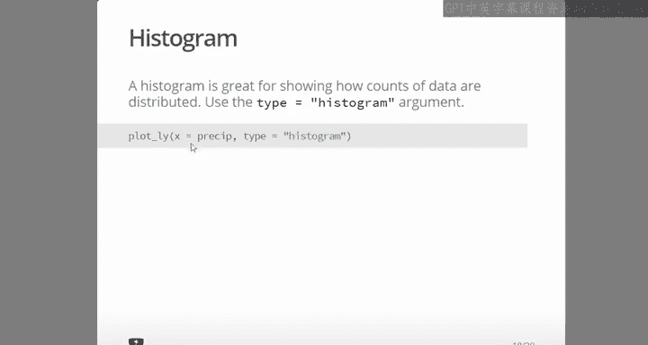
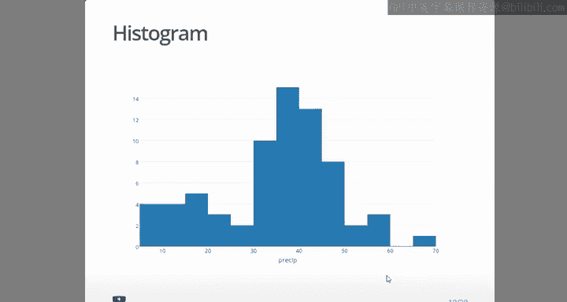
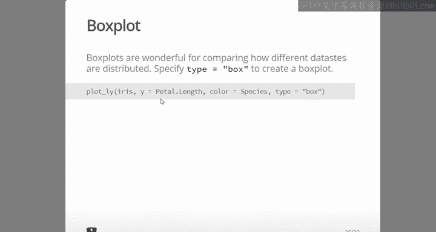
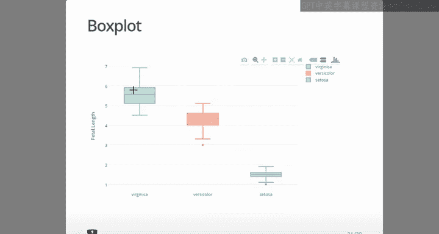
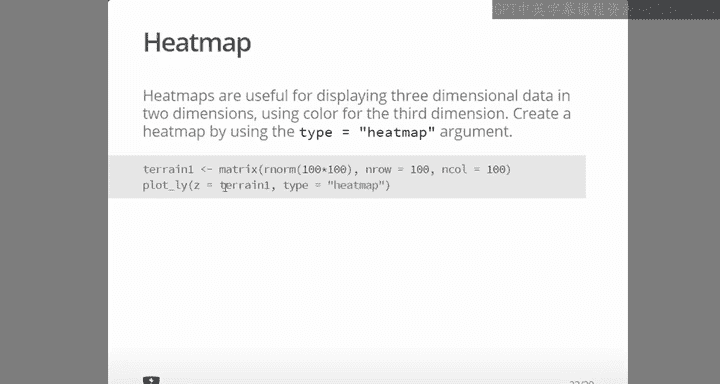
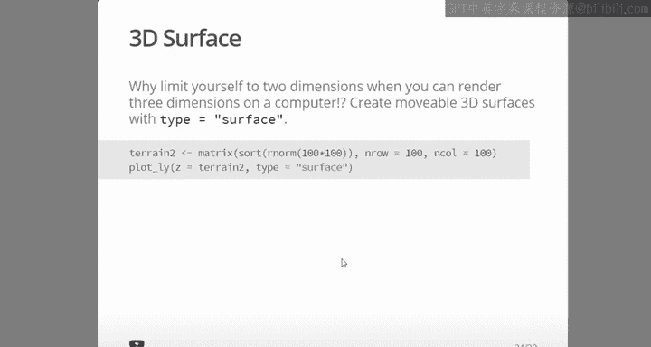
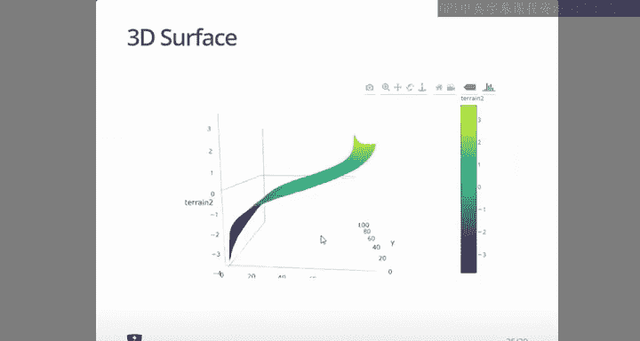
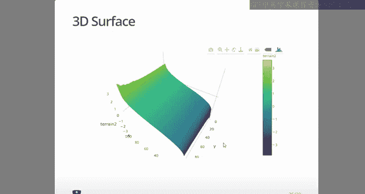

# 129：Plotly 基础图表绘制教程

在本节课中，我们将学习如何使用 Plotly 库创建几种基础但功能强大的交互式图表，包括直方图、箱线图、热图和三维曲面图。这些图表是数据可视化的核心工具，能够帮助我们直观地理解数据分布与关系。

---



## 📈 直方图

上一节我们介绍了 Plotly 的基本概念，本节中我们来看看如何绘制直方图。直方图用于展示单个连续变量的分布情况。

绘制直方图非常简单，只需指定一个 `x` 变量并设置图表类型为 `histogram`。



```python
fig = px.histogram(data_frame=df, x='variable_name')
```

以下是直方图的关键特性：
*   图表是交互式的，当鼠标悬停在条形上时，会显示该条形的高度等具体数值。
*   可以轻松更改条形颜色。
*   支持并排绘制多个直方图以进行比较。




---

## 📦 箱线图

了解了单变量分布的可视化后，我们来看看如何比较不同类别数据的分布，箱线图是完成此任务的理想工具。

使用 Plotly 绘制分组箱线图时，需要指定数据框、数值变量（`y`）、分组变量（`color`）并将类型设置为 `box`。

```python
fig = px.box(data_frame=iris, y='petal_length', color='species')
```

此代码将为 `species` 列的每个类别生成一个独立的箱线图。




以下是箱线图的交互细节：
*   悬停在箱体上会显示四分位数（第25百分位、中位数、第75百分位）的具体数值。
*   须线（whiskers）通常延伸至 **1.5倍四分位距（IQR）** 的范围，这是基于正态分布的经验法则。
*   如果存在超出此范围的异常值，图表会以点的形式单独显示。


当类别较多时，图表可能会显得拥挤，但整体而言，这是一种用极少代码生成信息丰富图表的高效方法。

---



## 🔥 热图

接下来，我们将从展示分布转向展示矩阵数据。热图是可视化矩阵数据的绝佳方式，它将矩阵中每个位置的值映射为一种颜色。

本质上，任何栅格图像都可以看作是一个矩阵，其中行和列对应像素位置，矩阵值对应像素强度。在 Plotly 中，我们创建一个矩阵作为 `z` 参数，并将图表类型设置为 `heatmap`。

```python
import numpy as np
# 创建一个 100x100 的随机矩阵
z_data = np.random.randn(100, 100)
fig = px.imshow(z_data)
# 或使用通用接口
# fig = go.Figure(data=go.Heatmap(z=z_data))
```


以下是热图的优势：
*   生成的本质上是一幅图像。
*   交互性强：移动鼠标会显示当前位置的 `x`、`y` 坐标和 `z` 值（强度值）。
*   右侧自动生成颜色标尺（color key），无需手动设置。


---

## 🏔️ 三维曲面图

最后，我们将把二维热图提升一个维度。如果我们不仅想用颜色表示矩阵值，还想将其高度在三维空间中可视化，那么就需要用到曲面图。

我们使用与热图类似的数据，但将图表类型改为 `surface`。`z` 矩阵值将决定曲面在第三维（高度）上的形状。

```python
z_data = np.random.randn(100, 100) # 使用新的随机数据
fig = go.Figure(data=[go.Surface(z=z_data)])
```




绘制三维曲面图时需要注意：
*   Plotly 会自动对曲面进行平滑处理，以呈现更美观的视觉效果。
*   在实际应用中，理解平滑算法对数据真实形态的影响非常重要。




---

## 📝 总结



本节课中我们一起学习了使用 Plotly 创建四种基础交互式图表的方法。我们掌握了用直方图分析单变量分布，用箱线图比较组间差异，用热图展示矩阵数据，以及用三维曲面图进行立体可视化。这些工具是数据探索和结果展示的基石，通过 Plotly 的交互特性，我们可以更深入地洞察数据。