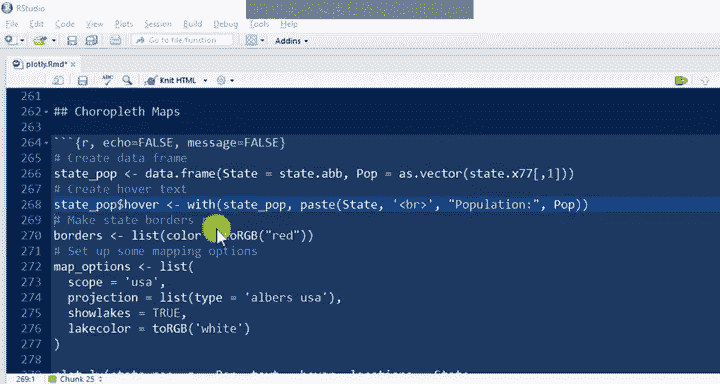
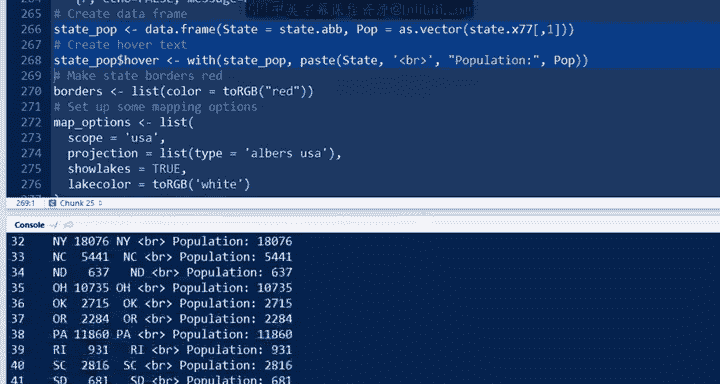
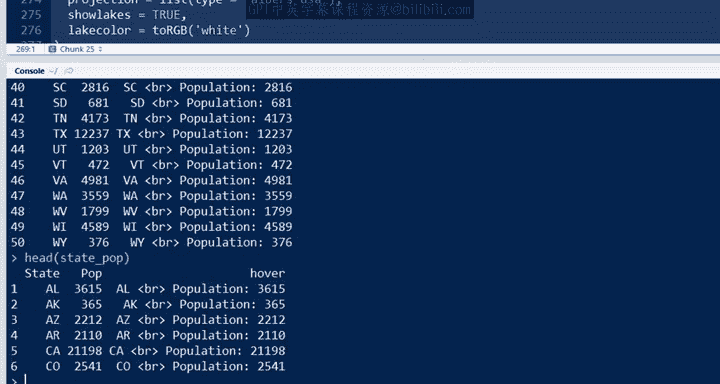
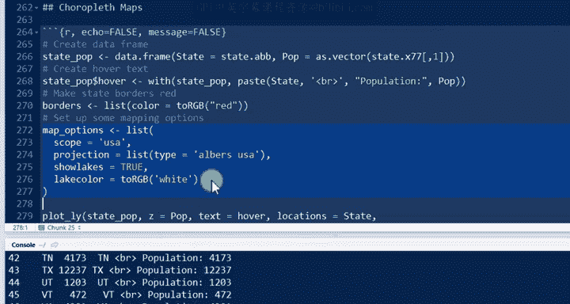
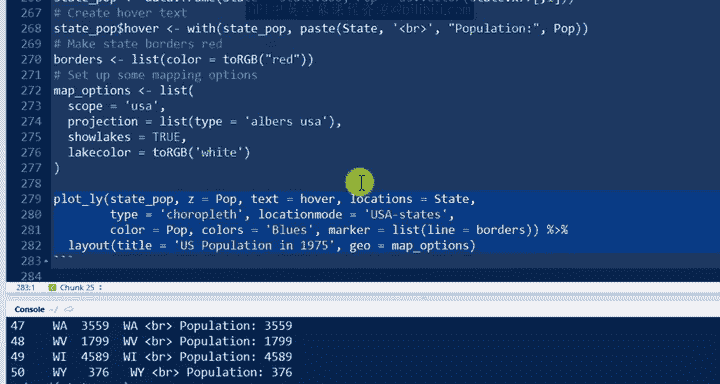
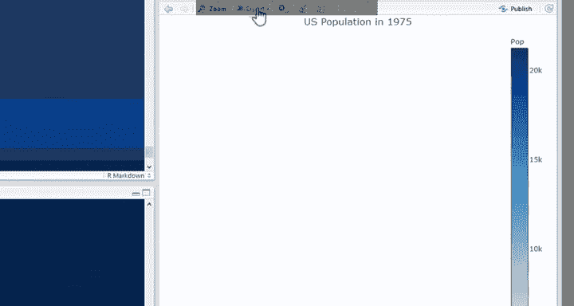
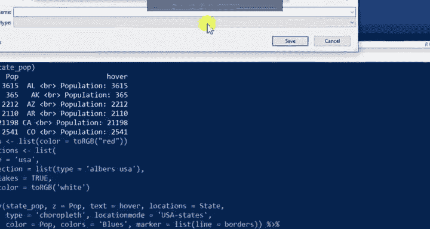
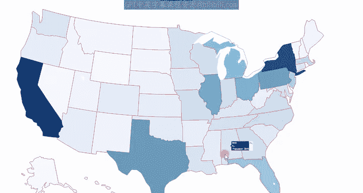
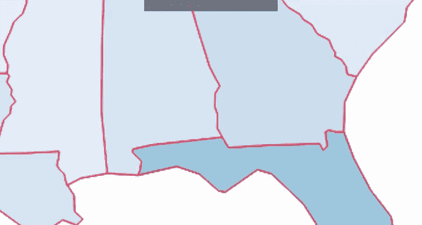

# 130：使用 Plotly 创建交互式地图 🌍



在本节课中，我们将学习如何使用 Plotly 库创建一个带有悬停效果的交互式美国人口地图。我们将从准备数据开始，逐步配置地图的各个选项，并最终生成一个可交互的网页。

---

## 准备数据



首先，我们需要创建一个数据集。这个数据集包含美国各州的缩写、人口数量以及用于悬停显示的文本。

以下是创建数据集的代码示例：

```python
# 示例数据结构
data = {
    'state': ['AL', 'AK', 'AZ', ...],  # 州缩写
    'population': [3.615, 0.302, 1.771, ...],  # 人口（百万）
    'hover_text': ['AL<br>Population: 3,615,000', ...]  # 悬停文本
}
```



数据集包含50个州的信息。以阿拉巴马州为例，它包含州缩写“AL”、人口数量（以百万计）以及悬停文本。悬停文本将显示州缩写和具体人口数字（例如，1975年的人口为3,615,000）。

## 设置地图选项

接下来，我们需要配置地图的显示选项。这些选项决定了地图的视觉样式和交互行为。

地图选项是一个列表，其中包含多个参数。例如，我们将地图范围设置为美国，并调整湖泊的显示颜色，以避免与用蓝色编码的人口数据混淆。

以下是关键的地图选项配置：

```python
map_options = {
    'scope': 'usa',
    'showlakes': True,
    'lakecolor': 'white'
}
```



- `scope: 'usa'` 将地图范围限定为美国。
- `showlakes: True` 表示在地图上显示湖泊。
- `lakecolor: 'white'` 将湖泊颜色设置为白色，使其与代表人口深浅的蓝色区分开来。

## 绘制地图

在准备好数据和选项后，我们使用 Plotly 的 `plot_ly` 函数来绘制地图。

以下是绘制地图的核心代码：

```python
import plotly.graph_objects as go

fig = go.Figure(data=go.Choropleth(
    locations=df['state'],        # 州缩写列
    z=df['population'],           # 用于颜色编码的数据列（人口）
    text=df['hover_text'],        # 悬停文本列
    locationmode='USA-states',    # 指定地理位置模式为美国州
    colorscale='Blues',           # 使用的颜色标尺
    marker_line_color='red'       # 州边界的颜色
))

fig.update_layout(
    title_text='1975年美国各州人口',
    geo=map_options               # 应用之前定义的地图选项
)
```

- `type: 'choropleth'` 指定图表类型为等值区域图。
- `colorscale: 'Blues'` 使用蓝色系的连续色阶来根据人口值着色各州。
- `marker_line_color: 'red'` 将各州的边界线设置为红色。

## 输出与交互



运行上述代码后，Plotly 会生成一个交互式图表。有时图表可能无法直接在查看器中显示，这时可以将其保存为网页文件。



保存为网页的代码如下：



```python
fig.write_html("us_population_map.html")
```

在生成的网页中，你可以将鼠标悬停在任何州上，查看该州的详细信息。例如，将鼠标悬停在阿拉巴马州上，会显示我们预设的文本“AL<br>Population: 3,615,000”。


## 练习与探索



为了加深理解，建议你进行以下练习：

- 首先，完全复现本教程中的地图。
- 然后，尝试使用数据集中其他变量（而非人口）来创建地图，并改变颜色编码的含义。
- 通过调整 `map_options` 中的参数，尝试改变地图的显示区域或样式。

通过动手实践，你会更好地掌握 Plotly 创建交互式地图的各种选项，并发现这是一种非常便捷的可视化工具。

---

## 总结



本节课我们一起学习了如何使用 Plotly 创建交互式等值区域图。我们从构建包含州名、人口和悬停文本的数据集开始，然后配置了地图的视觉和交互选项，最后使用 `plot_ly` 函数生成了地图并输出为网页。掌握这个方法后，你可以轻松地将任何地理数据转化为直观、可交互的可视化图表。