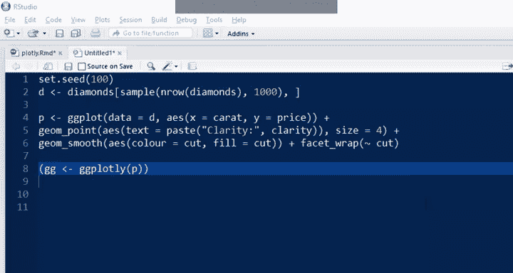
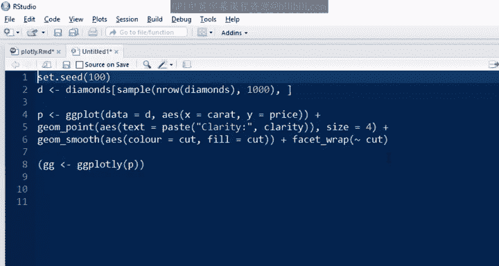
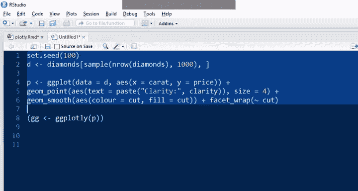
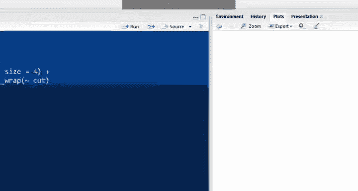
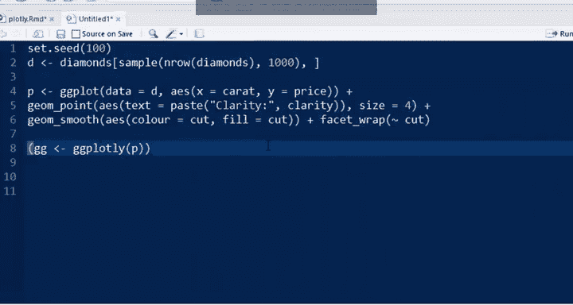
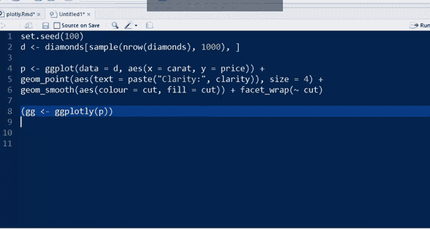

# 131：Plotly 基础与ggplot转换 🎨

在本节课中，我们将学习如何利用Plotly库，将静态的ggplot图形转换为交互式的HTML图表。我们将重点介绍`ggplotly()`函数的使用方法，并展示其在RStudio环境中的不同显示效果。



---

上一节我们介绍了Plotly的基本概念，本节中我们来看看如何将ggplot图形转换为Plotly交互式图表。

首先，我们从钻石数据集中创建一个基础的ggplot散点图，展示克拉重量与价格的关系。

```r
# 加载必要的库
library(ggplot2)
library(plotly)



# 使用diamonds数据集创建ggplot对象
p <- ggplot(diamonds, aes(x = carat, y = price)) +
  geom_point()
```



执行上述代码后，我们得到一个静态的散点图，横轴为克拉重量，纵轴为价格。



---

接下来，我们将这个静态的ggplot对象转换为Plotly交互式图表。

以下是转换的核心步骤，只需使用一个函数：

```r
# 使用ggplotly()函数进行转换
interactive_plot <- ggplotly(p)
```

`ggplotly()`函数接收一个ggplot对象作为输入，并返回一个Plotly交互式图形对象。



---



现在，让我们观察转换后的图表在RStudio环境中的显示效果。

在RStudio中，转换后的图表有两种显示方式：
1.  在RStudio的绘图面板中，它显示为R图形。
2.  在RStudio的查看器面板中，它显示为HTML交互式图形，其效果与在网页浏览器中查看一致。

底部查看器面板中的HTML图形支持交互操作，例如鼠标悬停查看数据点详情、缩放和拖拽等。

---

本节课中我们一起学习了如何使用Plotly的`ggplotly()`函数，轻松地将静态的ggplot图形转换为功能丰富的交互式HTML图表。这个工具极大地增强了数据可视化的探索性和呈现能力。