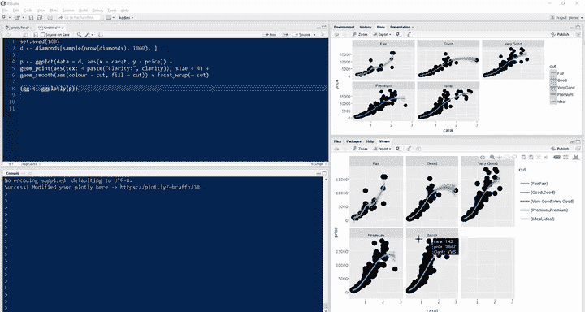
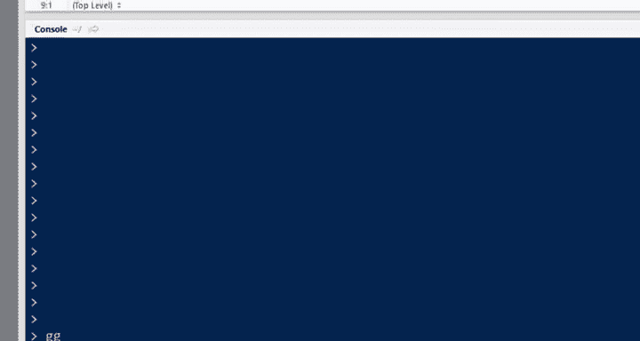
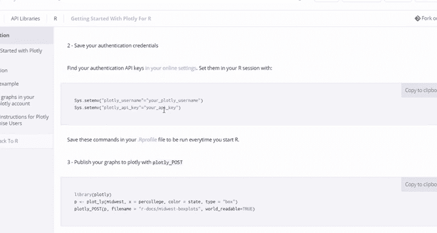

# 132：24_Plotly 1 8 - 如何将图形直接发布到 Plotly 🌐

在本节课中，我们将学习如何将 R 语言中创建的图形直接发布到 Plotly 在线平台。我们将介绍发布图形的基本步骤，以及如何配置环境变量以实现无缝发布。

---

上一节我们介绍了如何在 R 中创建图形。本节中，我们来看看如何将图形发布到 Plotly 网站。

首先，假设我们已经创建了一个名为 `GG` 的图形对象。在 R 控制台中输入 `GG`，该图形会显示在查看器面板中。



若要将此图形发布到 Plotly，我们需要使用 `plotly_post()` 函数。

以下是发布图形的核心代码：

```r
plotly_post(GG)
```

执行此代码后，图形将被上传至您的 Plotly 账户。在 Plotly 网站上，您可以对图形进行多种操作。

Plotly 平台功能丰富且直观。网站提供了基于网页的图形用户界面，允许您直接编辑图形。

以下是您可以在 Plotly 网站上执行的一些操作：
*   点击“编辑”按钮，使用各种工具调整图形。
*   修改坐标轴。
*   更改变量名称。

Plotly 官网还提供了视频教程和大量指南，帮助您更好地使用其功能。建议您尝试将图形导出到 Plotly，并使用其界面进行探索和调整。

---

在结束之前，还有一点需要说明。为了让 `plotly_post()` 函数能够顺畅工作，您需要预先设置两个环境变量。

如果您在谷歌搜索“从 R 发布到 Plotly”，相关指南会引导您进行设置。您需要设置的是 `plotly_username` 和 `plotly_api_key`。



要获取您的 API 密钥，请登录 Plotly 网站，进入“设置”页面，从中复制您的密钥。

设置这两个环境变量的核心方法如下：

```r
Sys.setenv("plotly_username" = "您的用户名")
Sys.setenv("plotly_api_key" = "您的API密钥")
```

一个特别实用的建议是：将这两行代码放入您的 `.Rprofile` 文件中。这样，每次启动 R 时这些变量都会自动设置，系统就不会再提示您输入凭证了。

---



本节课中我们一起学习了如何将 R 图形发布到 Plotly 平台。关键步骤包括使用 `plotly_post()` 函数，以及预先设置好用户名和 API 密钥这两个环境变量。掌握这些后，您就能轻松地将交互式图形分享到线上，并利用 Plotly 强大的网页工具进行进一步编辑和美化。