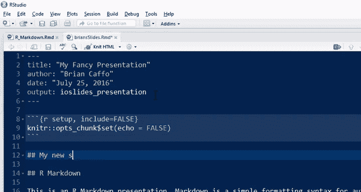
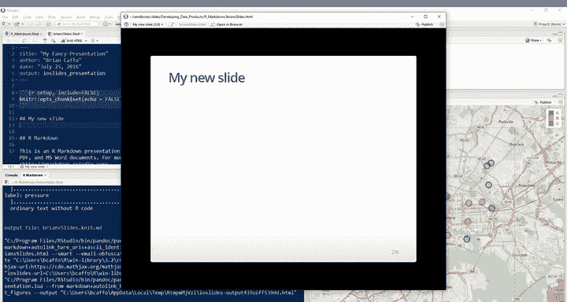
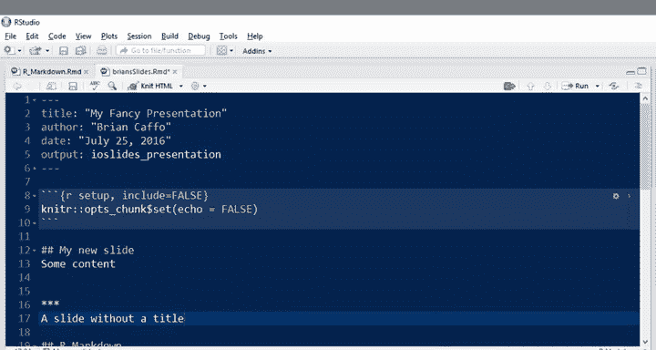
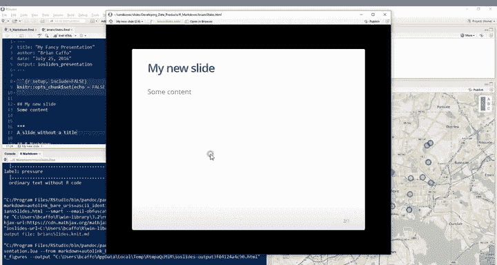
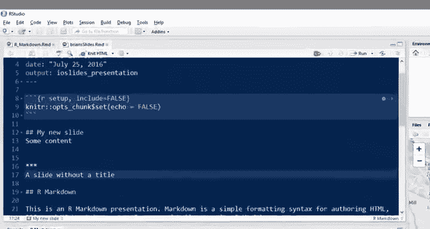
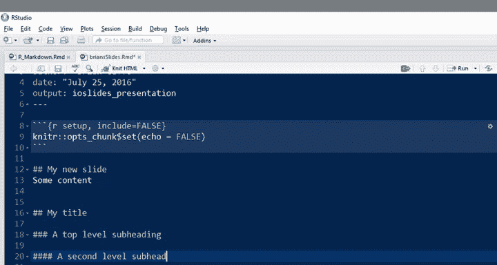
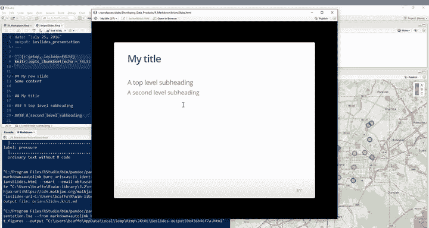
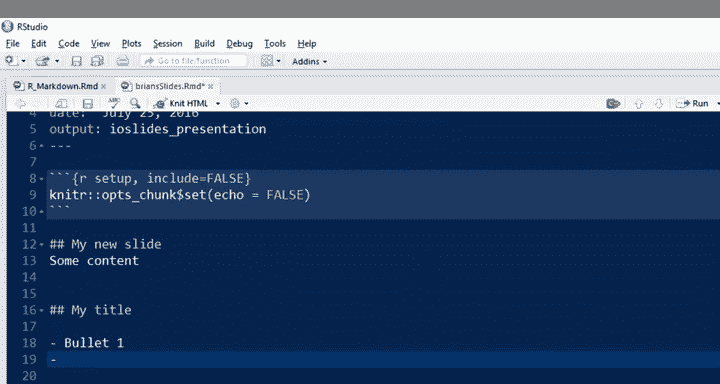
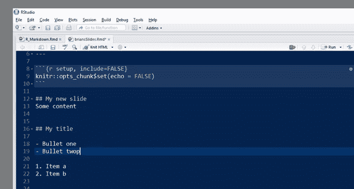
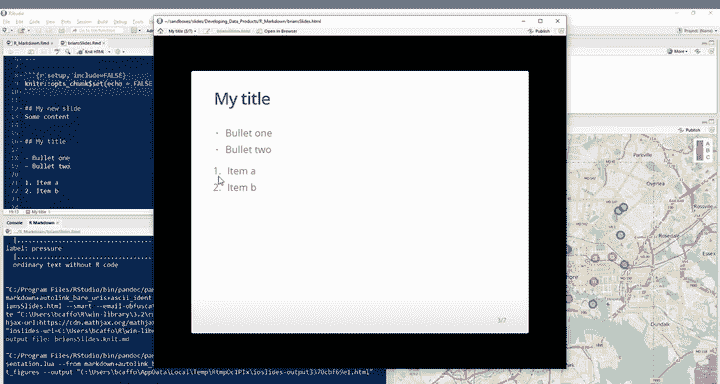

# 135：R Markdown基础教程（一）📝

在本节课中，我们将学习如何使用R Markdown创建演示文稿。我们将从了解YAML前言开始，逐步学习如何创建幻灯片、添加标题、子标题、列表以及如何编译文档。

---

## 概述：认识R Markdown的YAML前言

首先，我们来看一下R Markdown文档开头的YAML前言部分。这部分内容被三个短横线 `---` 包围，用于设置文档的元数据。

例如，你可以在这里修改标题、作者、日期和输出格式。`output: ioslides_presentation` 表示文档将被编译为幻灯片格式。`knitr` 选项中的 `echo: FALSE` 意味着默认情况下，文档中嵌入的代码块不会在输出中显示其代码本身。

```yaml
---
title: "我的演示文稿"
author: "你的名字"
date: "2024-01-01"
output: ioslides_presentation
knitr:
  echo: FALSE
---
```

---

## 创建新幻灯片 🆕

上一节我们介绍了YAML前言，本节中我们来看看如何创建新的幻灯片。

在R Markdown中，创建新幻灯片非常简单。使用两个井号 `##` 即可开始一个新幻灯片。

```
## 我的新幻灯片
```

编译后，这将生成一张标题为“我的新幻灯片”的幻灯片。



---

## 无标题幻灯片

现在，让我们尝试创建一张没有标题的幻灯片。

要创建无标题幻灯片，只需使用三个星号 `***` 作为分隔符。在这三个星号之后输入的内容，将出现在一张独立的、没有标题的幻灯片上。

```
***



这是一张没有标题的幻灯片上的内容。
```

---

## 添加子标题



接下来，我们学习如何在幻灯片内添加不同层级的子标题。

*   使用两个井号 `##` 定义幻灯片主标题。
*   使用三个井号 `###` 定义一级子标题。
*   使用四个井号 `####` 定义二级子标题。



```
## 幻灯片主标题



### 这是一级子标题

#### 这是二级子标题
```

---

## 添加列表内容

上一节我们学习了标题结构，本节中我们为幻灯片添加一些实际内容，例如列表。

以下是添加列表的方法：



**无序列表（项目符号列表）**
使用短横线 `-` 或星号 `*` 后跟一个空格来创建无序列表项。

```
- 项目一
- 项目二
```

**有序列表（编号列表）**
使用数字后跟一个点 `.` 和空格来创建有序列表项。



```
1. 项目A
2. 项目B
```

你可以将上述内容添加到你的幻灯片中，例如：

```
## 带有列表的幻灯片



以下是一个无序列表：
- 要点一
- 要点二

以下是一个有序列表：
1. 第一项
2. 第二项
```

---

## 编译与查看结果

在编辑完R Markdown文档后，你需要将其“编织”（Knit）成最终格式（如HTML幻灯片）。

你可以点击RStudio中的“Knit”按钮，或者使用快捷键 `Ctrl + Shift + K`（Windows/Linux）或 `Cmd + Shift + K`（Mac）来编译整个文档并查看结果。

编译完成后，系统会自动生成并打开最终的演示文稿文件，你可以检查标题、子标题、列表等内容的显示效果。



---

## 总结与练习 🎯

本节课中我们一起学习了R Markdown创建演示文稿的基础知识。

我们首先认识了用于设置文档属性的YAML前言，然后学习了如何创建新幻灯片、制作无标题幻灯片、添加不同层级的子标题，以及插入无序和有序列表。最后，我们掌握了使用快捷键编译文档的方法。

**下一步练习建议：**
请尝试创建一个包含以下元素的简短演示文稿：
1.  一个自定义标题和作者的YAML前言。
2.  至少三张幻灯片，其中一张没有标题。
3.  在其中一张幻灯片上使用主标题和子标题。
4.  在幻灯片中添加包含项目符号和编号的列表。



通过动手实践，你将更好地掌握R Markdown制作幻灯片的基本技能。