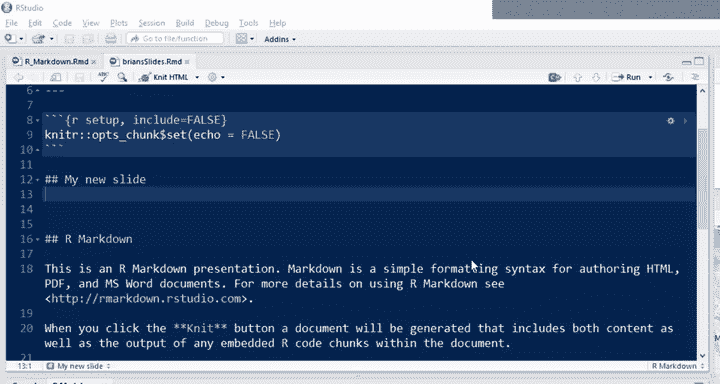
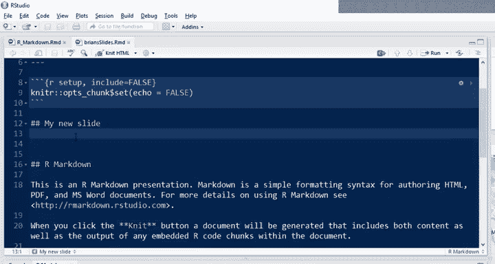
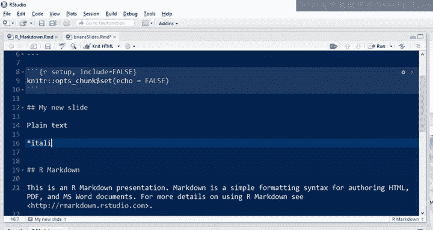
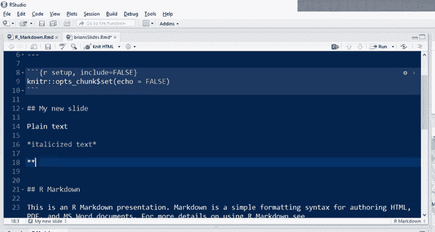
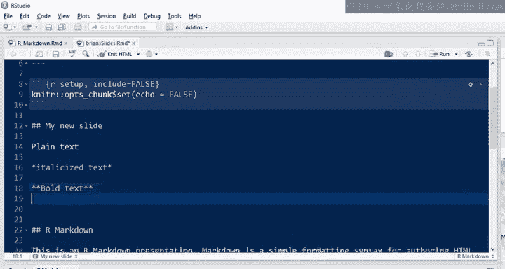
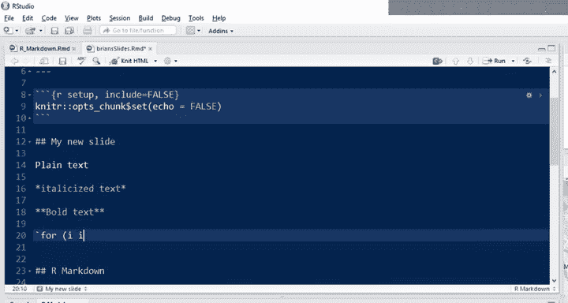
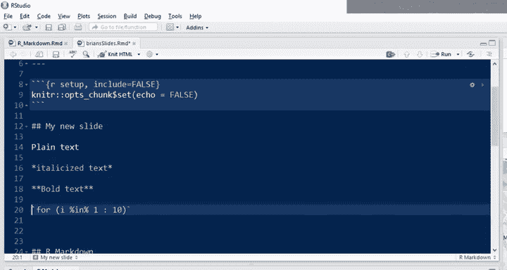
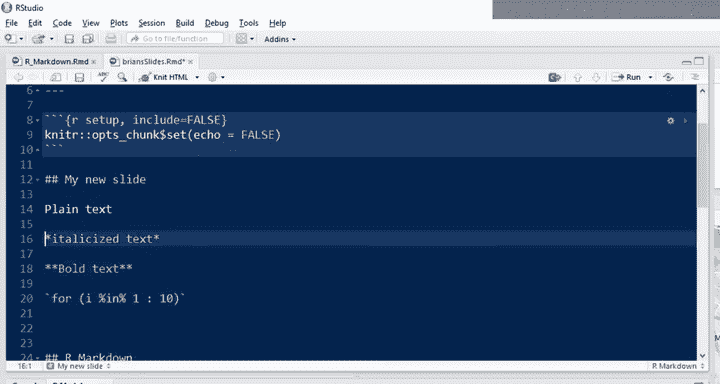
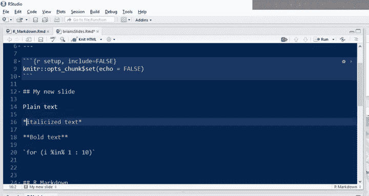
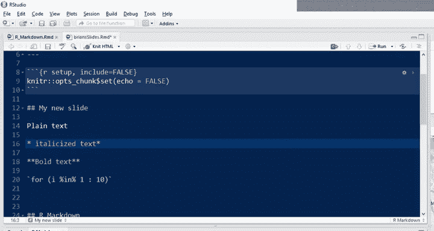

# 136：R Markdown 基础文本格式化教程



在本节课中，我们将学习如何在 R Markdown 文档中进行基础的文本格式化。我们将了解如何将普通文本转换为斜体、粗体，以及如何插入代码块，并掌握这些格式化的正确语法规则。



---



上一节我们介绍了 R Markdown 的基本界面，本节中我们来看看具体的文本格式化选项。



如果我在文档中输入纯文本，它会保持原样显示。

**斜体文本**的格式化方式是使用单个星号 `*` 包裹文本。请注意，编辑器会自动对其进行格式化。





**粗体文本**的格式化方式是使用两个星号 `**` 包裹文本。

或者，更准确地说，编辑器会对这些语法进行高亮显示。


以下是插入代码块的方法：





```r
# 这是一段代码
```

代码块使用三个反引号（```）来包裹。

星号必须紧挨着文本的首尾字符。如果你像这样留有空格，有时会无法正常工作。因此，让星号紧邻文本字符是必要的。

最后，让我们运行这个文档来查看效果。



---



本节课中我们一起学习了 R Markdown 的三种基础文本格式化方法：使用 `*文本*` 创建斜体，使用 `**文本**` 创建粗体，以及使用 ``` 创建代码块。同时，我们强调了语法符号必须紧贴文本字符这一重要规则。