# 137：R Markdown 基础 - 代码块与编织选项

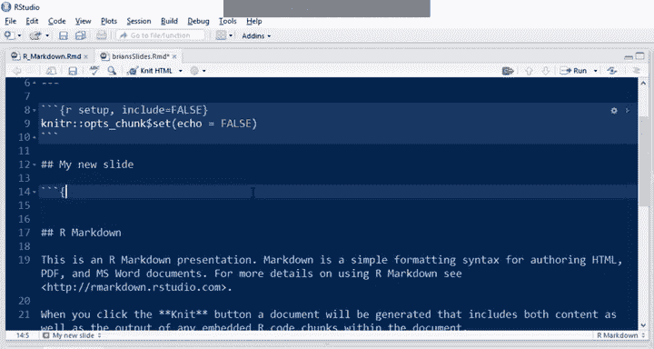

在本节课中，我们将学习如何在 R Markdown 文档中嵌入和运行 R 代码，并探索如何通过“编织选项”来控制代码及其输出的显示方式。

---

## 嵌入并运行 R 代码

上一节我们介绍了 R Markdown 的基本结构。本节中我们来看看如何在文档中嵌入可执行的 R 代码。

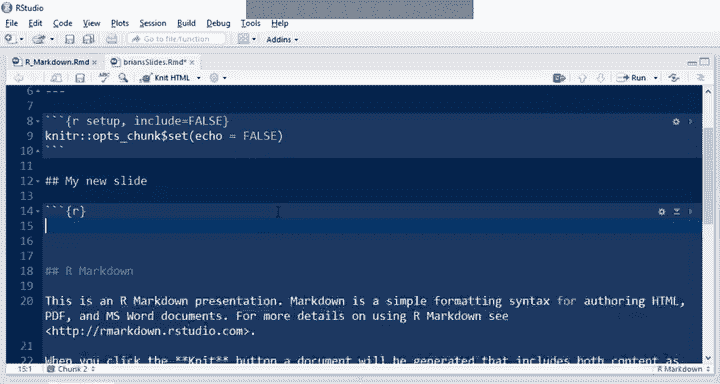

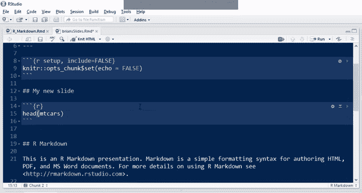

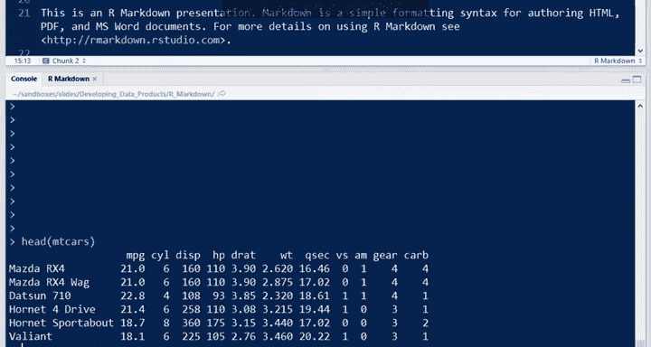

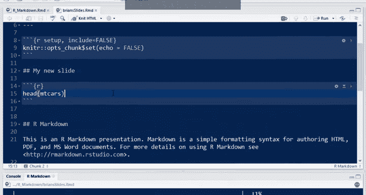

在 R Markdown 中，我们可以创建“代码块”。代码块以三个反引号开头，并在花括号中指定语言为 `r`。

以下是创建一个 R 代码块的基本语法：

```r
` ` `{r}
# 这里是你的 R 代码
` ` `
```

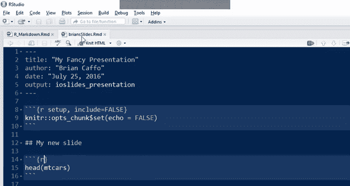

例如，我们可以创建一个代码块来查看 `mtcars` 数据集的前几行：

```r
` ` `{r}
head(mtcars)
` ` `
```

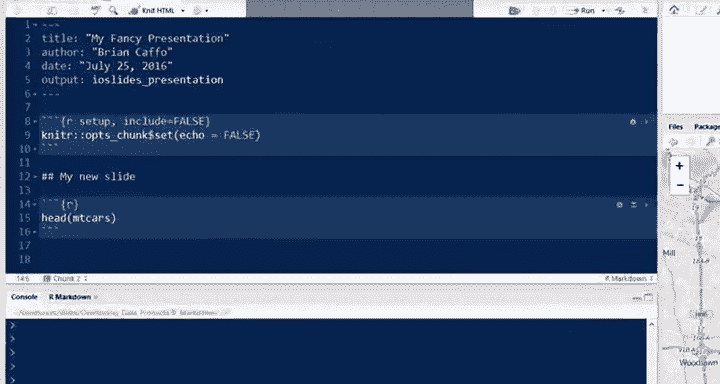

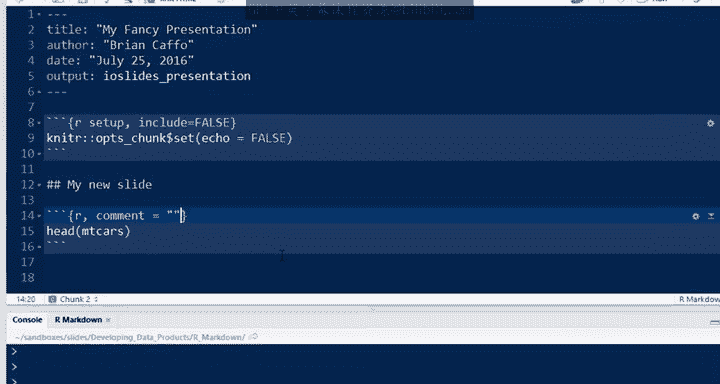

当你在 RStudio 中点击“运行”按钮时，代码会在当前交互式环境中执行，结果会显示在代码块下方。若要“编织”整个文档（即生成最终报告），可以使用快捷键 **Ctrl + Shift + K**。

---

## 理解与使用编织选项

我们注意到，默认的代码块输出有时会包含一些我们不需要的格式，例如输出结果前的注释符号。为了控制代码块的渲染行为，我们需要使用“编织选项”。

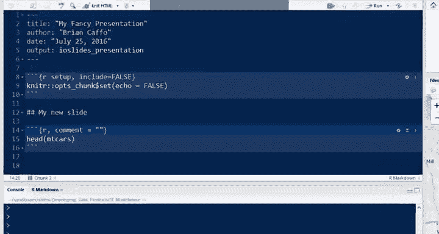

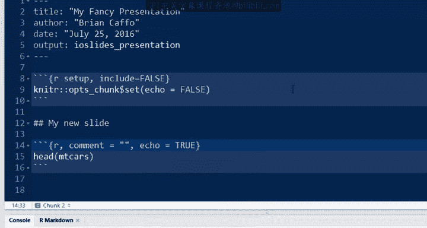

编织选项写在代码块开头的花括号内，格式为 `{r option1=value1, option2=value2}`。

以下是几个常用的编织选项及其作用：

*   **`comment`**：此选项用于设置输出结果前的注释字符。若不想显示任何注释字符，可设置为 `comment=''`。
    *   示例：`{r comment=''}`

*   **`echo`**：此选项控制是否在最终输出中显示代码本身。
    *   `echo=TRUE`（默认值）：同时显示代码和运行结果。
    *   `echo=FALSE`：只显示运行结果，不显示代码。

*   **`eval`**：此选项控制是否执行（评估）代码块中的代码。
    *   `eval=TRUE`（默认值）：执行代码并输出结果。
    *   `eval=FALSE`：不执行代码，仅将代码作为文本显示。

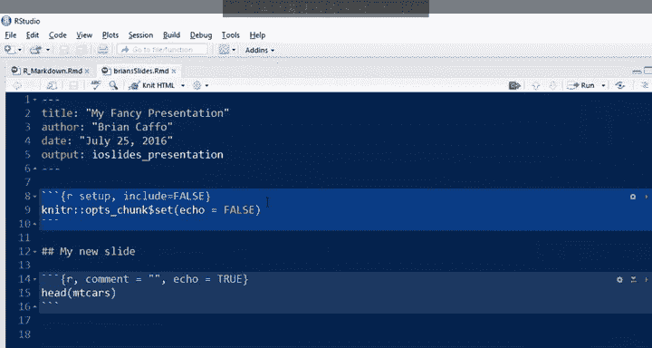

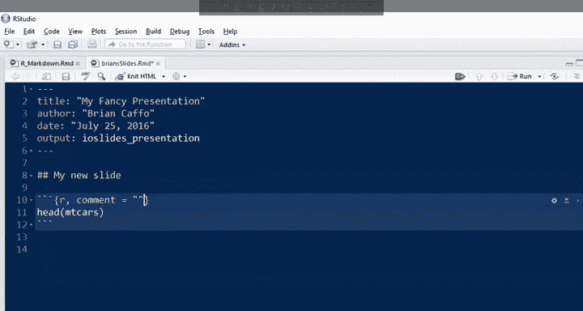

在 RStudio 中编写时，输入选项名称时会自动弹出提示，帮助你了解所有可用的选项。这些选项与 `knitr` 包的功能一致，其中许多选项用于控制图形输出，我们将在后续课程中介绍。

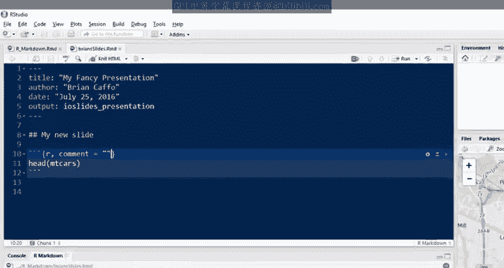

---

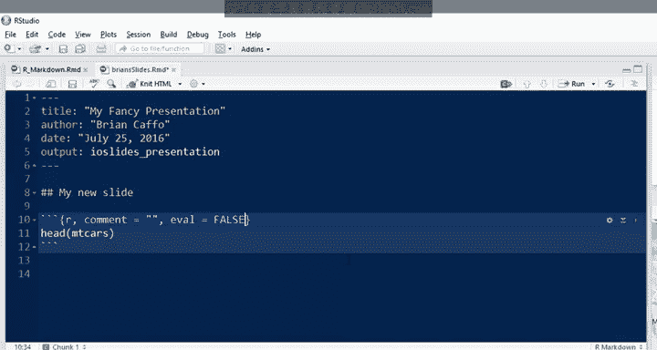

## 实践练习

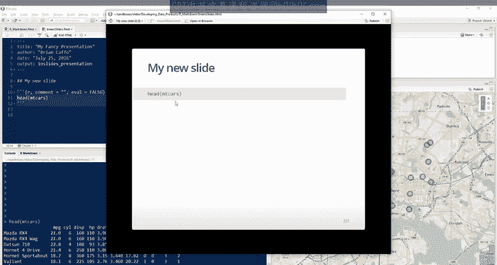

现在，请尝试完成以下练习来巩固所学知识：

1.  创建一个新的 R Markdown 幻灯片。
2.  添加一个 R 代码块，其中包含 `head(mtcars)` 代码，并设置选项使其**不执行**代码，仅显示代码文本。
3.  添加另一个 R 代码块，同样包含 `head(mtcars)`，设置选项使其**执行**代码并显示结果，但**不显示**结果前的注释字符。
4.  尝试调整 `echo` 选项，观察代码显示与隐藏的效果。
5.  随意尝试其他你看到的编织选项，熟悉它们的作用。

完成这些练习后，你将能熟练控制 R Markdown 中代码的显示与执行。下一节，我们将学习如何在 R Markdown 中创建和定制图形。

---

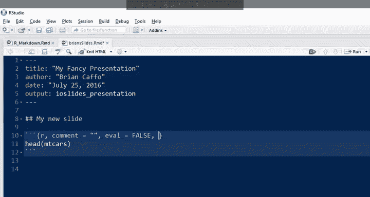

本节课中我们一起学习了在 R Markdown 中插入 R 代码块，并通过关键的编织选项（如 `comment`、`echo`、`eval`）精确控制了代码执行与输出的格式。这是生成可重复、可定制报告的基础。