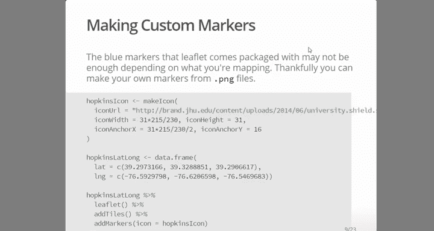
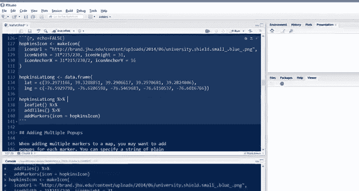

# 142：34_Leaflet 1 4 🗺️

在本节课中，我们将要学习如何使用Leaflet库创建交互式地图，重点包括如何添加自定义标记图标，以及如何为每个标记设置独立的弹出窗口。



## 概述

上一节我们介绍了Leaflet的基础地图创建。本节中我们来看看如何在地图上使用自定义图标作为标记，并让每个标记在被点击时显示包含特定信息的弹出窗口。

## 添加自定义标记图标

首先，我们需要定义一个自定义图标来替换默认的标记。以下是实现步骤：

以下是定义自定义图标的代码示例：
```r
hopkinsIcon <- makeIcon(
  iconUrl = "图标URL地址",
  iconWidth = 宽度值,
  iconHeight = 高度值,
  iconAnchorX = 锚点X坐标,
  iconAnchorY = 锚点Y坐标
)
```
在这段代码中，`makeIcon`函数用于创建图标对象。`iconUrl`参数指定图标图片的网络地址。`iconWidth`和`iconHeight`参数控制图标显示的大小。`iconAnchorX`和`iconAnchorY`参数用于精确定位图标在地图上的位置。

定义好图标后，我们需要准备一组约翰霍普金斯大学建筑的经纬度坐标。

以下是创建地图并添加自定义标记的完整代码：
```r
hopkinsLALong <- data.frame(
  lat = c(纬度1, 纬度2, ...),
  lng = c(经度1, 经度2, ...)
)

leaflet(hopkinsLALong) %>%
  addTiles() %>%
  addMarkers(icon = hopkinsIcon)
```
运行这段代码后，地图上将显示自定义的霍普金斯大学盾形徽章图标，而非默认的蓝色气泡标记。



## 为标记添加独立弹出窗口

现在，我们的标记已经显示为自定义图标。接下来，我们需要让每个标记在被点击时能弹出对应的信息窗口。

首先，我们需要创建一个文本向量，其中包含每个标记对应的超链接信息。这个向量的顺序必须与之前定义的经纬度坐标顺序完全一致。

以下是添加弹出窗口的代码：
```r
hopkinsSites <- c(
  '<a href="网站地址1">地点名称1</a>',
  '<a href="网站地址2">地点名称2</a>',
  ...
)

leaflet(hopkinsLALong) %>%
  addTiles() %>%
  addMarkers(
    icon = hopkinsIcon,
    popup = hopkinsSites
  )
```
在这段代码中，`popup`参数被设置为`hopkinsSites`向量。Leaflet会自动将向量中的第一个HTML链接分配给第一个坐标点对应的标记，第二个链接分配给第二个坐标点，依此类推。

运行以上代码后，点击地图上的任意一个标记，例如“皮博迪学院”，就会弹出一个包含“皮博迪学院”文本的超链接窗口。点击该链接，浏览器将跳转到皮博迪学院的官方网站。

## 总结

本节课中我们一起学习了Leaflet的两个高级功能。我们首先掌握了如何使用`makeIcon`函数和`addMarkers`参数来设置自定义标记图标。接着，我们学习了如何通过`popup`参数为每个标记绑定独立的HTML弹出内容，从而创建出信息丰富且可交互的地图应用。