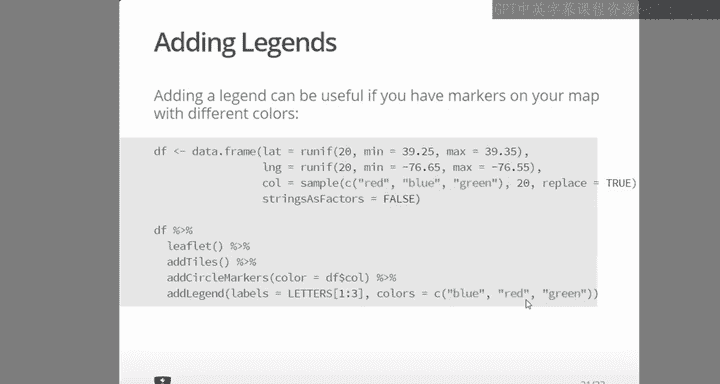
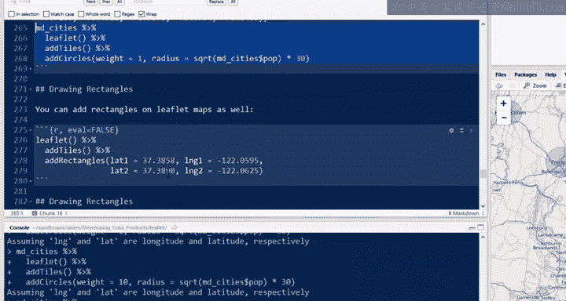
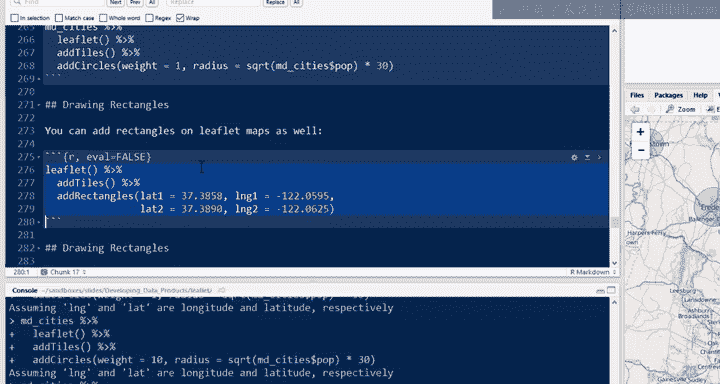
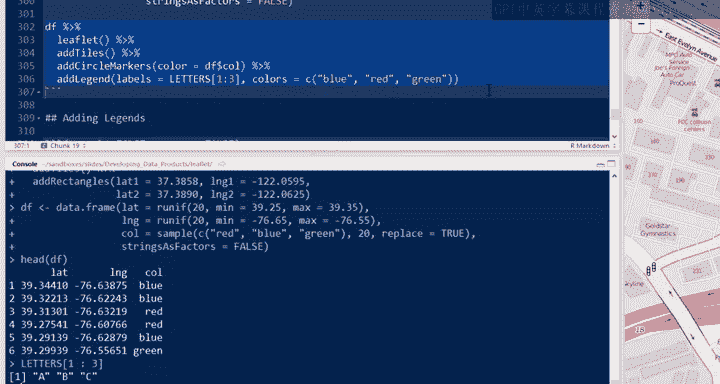

# 144：36_Leaflet 1 6 🗺️

在本节课中，我们将学习如何在 Leaflet 地图上手动绘制图形，包括圆形和矩形，以及如何为地图添加图例。这些功能对于在地图上进行注释和可视化数据非常有用。

---



上一节我们介绍了如何向地图添加标记和弹出窗口。本节中，我们来看看如何在地图上绘制自定义图形。

首先，我们将学习如何绘制圆形。以下是一个实际应用场景的示例：我们有一个包含多个城市信息的数据集，我们希望根据城市的人口规模来绘制不同大小的圆形。

以下是实现此功能的核心代码：

```r
leaflet(city_data) %>%
  addTiles() %>%
  addCircles(weight = 1, radius = ~sqrt(pop) * 30)
```

在这段代码中：
*   `city_data` 是包含城市名称、人口、纬度和经度的数据集。
*   `addCircles` 函数用于添加圆形。
*   `radius` 参数根据人口（`pop`）的平方根进行缩放，使得圆形大小与人口规模成比例。
*   `weight` 参数控制圆形轮廓线的粗细。通过将其值调大（例如设为10或100），可以清楚地看到它只影响边框，而不影响填充。

接下来，我们看看如何绘制矩形。绘制矩形比圆形更简单，因为只需要提供两个对角的坐标。

以下是绘制矩形的代码示例：

```r
leaflet() %>%
  addTiles() %>%
  addRectangles(
    lng1 = -76.61, lat1 = 39.28,
    lng2 = -76.59, lat2 = 39.29
  )
```



在这段代码中，`addRectangles` 函数接受两对经纬度坐标（`lng1, lat1` 和 `lng2, lat2`），它们定义了矩形的两个对角。

---



在学习了如何绘制图形后，一个常见的需求是为不同颜色的图形添加图例，以便用户理解其含义。

假设我们有一个包含20个点的数据集，每个点都被随机分配了红、蓝或绿三种颜色。我们首先根据颜色添加圆形标记。

以下是添加彩色标记和图例的步骤：

首先，创建带有颜色标记的地图：

```r
leaflet(df) %>%
  addTiles() %>%
  addCircleMarkers(color = ~color)
```

然后，为这张地图添加图例。添加图例的操作与 R 基础绘图系统中的 `legend` 命令非常相似。

以下是添加图例的代码：

```r
addLegend("bottomright",
          labels = letters[1:3],
          colors = c("blue", "red", "green")
)
```

在这段代码中：
*   `labels` 参数定义了图例的标签。示例中使用了 `letters[1:3]` 来生成 “A”, “B”, “C” 标签。在实际应用中，你应该将其替换为有意义的分类，例如“民主党”、“共和党”、“其他”。
*   `colors` 参数指定了与标签对应的颜色。
*   图例被放置在地图的“右下角”（`bottomright`）。

运行完整代码后，地图的右上角会出现一个图例，清晰地说明了每种颜色点所代表的类别。



---

本节课中我们一起学习了 Leaflet 的三个高级功能：根据数据比例绘制圆形、绘制矩形以及添加图例。掌握这些技能，你就能在地图上进行丰富的数据注释和可视化。Leaflet 是 R 语言中最易用且功能强大的交互式绘图工具之一，结合 Shiny 可以创建出非常出色的应用程序，值得你花时间深入学习。

希望本课对你有用，我们下节课再见。