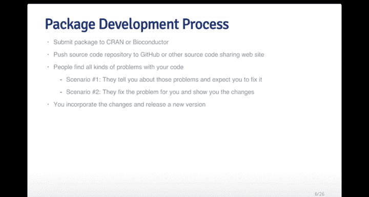

# 145：R 包开发 第1部分 📦

在本节课中，我们将要学习如何构建 R 包。这是将您开发的任何统计或其他方法进行产品化并分发给其他 R 用户的关键方式。我们将讨论构建 R 包的基本组成部分，以便您了解其构成和实现方法。

## 什么是 R 包？

R 包是一种扩展 R 基础功能的机制。当您下载 R 时，会获得一些基础包，例如图形和图形设备，它们实现了核心功能。然而，许多功能并未包含在基础的 R 发行版中，因为将所有可能需要的功能都集成到一个包中是不现实的。因此，R 提供了一个名为“包系统”的扩展机制，允许其他人编写函数和其他功能，以便其他用户可以将其添加到基础的 R 安装中。

一个 R 包通常是 R 函数或数据对象的集合，并与文档等其他元素打包在一起。R 包系统的目标是系统地组织这些内容，确保所有包都具有一致的格式和访问方式，例如帮助文件的位置和调用方式。目前，全球有成千上万个由不同开发者编写的 R 包。

## 在哪里可以找到 R 包？

您通常可以在中央代码库找到 R 包，例如综合 R 存档网络（CRAN）。另一个大型代码库是 Bioconductor，它包含大量用于生物信息学和基因组学等领域的工具。

此外，许多包也托管在源代码共享网站上，如 GitHub、Bitbucket 和 GitLab。您也可以尝试从这些代码库安装包。

从 CRAN 或 Bioconductor 安装包可以使用 R 自带的 `install.packages` 函数，您只需指定包名和代码库来源即可。例如，从 GitHub 安装包可以使用 DevTools 包中的 `install_github` 函数，这是一个非常方便的工具。

## 为什么要制作 R 包？

您可能会问，为什么费心制作 R 包，而不是直接发送代码文件？制作 R 包有几个优势。

首先，它是一种结构化的格式，其他使用过 R 包的用户能够理解。其次，R 包要求提供文档，这迫使您编写说明，解释函数的使用方法、参数和返回值。

此外，它允许您创建一个定义良好的应用程序编程接口（API）。您可以指定用户应该调用哪些函数，以及哪些函数不应该被用户直接调用。这样，您可以将实现细节隐藏和抽象起来，未来如果需要修改内部代码，可以在不破坏公开接口的情况下进行。

通常，维护一个 R 包也更容易，因为它具有结构化的格式和必需的文档。如果您将来无法继续维护，也可以将其移交给他人，因为结构已经存在。另一个优势是，用户会对包的可靠性和健壮性更有信心，特别是如果它通过了 CRAN 的检查并能够正常加载。

## 基本的包开发流程

包开发流程可能因人而异，但通常包含以下环节。

您通常会先在脚本或 R 文件中编写一些 R 代码，编写函数、调试和测试。当您觉得这些代码对自己非常有用，或者希望以更结构化的方式供自己或他人使用时，您可能会决定将其制作成 R 包。

接下来，您需要将编写好的 R 代码整合到 R 包的结构中。然后，您需要为用户函数（即公开给用户使用的函数）编写文档。之后，您可能还需要考虑包含其他材料，如示例、演示、数据集、教程或小插图。

完成所有这些步骤后，您就可以打包并生成您的 R 包了。

## 发布与维护

生成 R 包后，您可以就此停止，将其安装在您的系统上，或者通过电子邮件发送给朋友。但更常见的做法是将其提交到 CRAN 或 Bioconductor 等代码库。您也可以将源代码推送到 GitHub 等代码共享网站，以便他人查看和修改。

一旦您的包对公众可用，通常会遇到两种情况。第一种是其他用户使用您的代码，他们可能会报告遇到的问题，并期望您进行修复。第二种可能是其他用户查看您的代码，如果发现问题，他们可能会自行修复并向您展示更改，然后您可以整合这些修复。

无论是哪种情况，让其他用户查看您的代码并帮助改进都是有益的。整合了这些修复后，您可以发布新版本的包。

---

本节课中，我们一起学习了 R 包的基本概念、优势、开发流程以及发布维护的环节。理解这些是构建和分享您自己 R 工具的第一步。