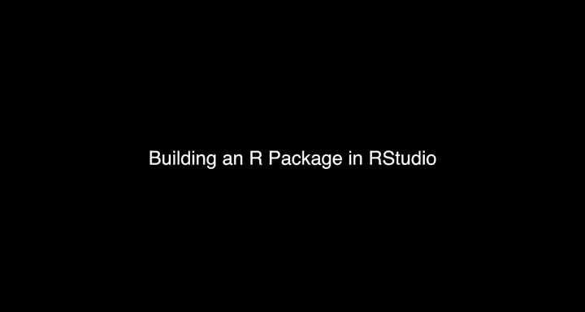
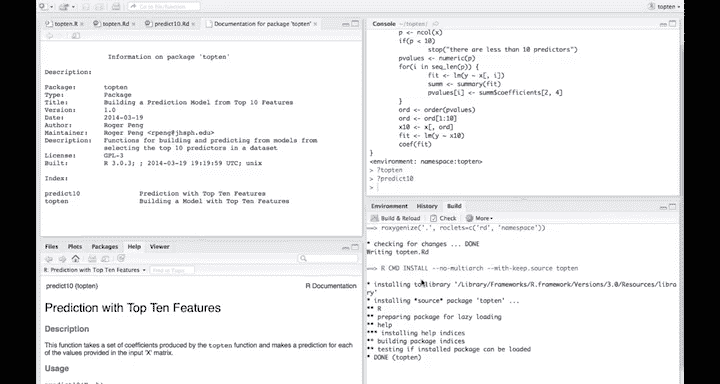

# 147：构建R包演示 🛠️



## 概述

在本节课中，我们将学习如何从零开始构建一个完整的R包。我们将通过一个具体的例子，演示如何将代码、文档和元数据等各个部分组合在一起，并利用RStudio提供的便捷工具来完成整个过程。

---

## 1. 创建新项目

首先，我们需要在RStudio中启动一个新的项目。打开RStudio后，点击菜单栏的“File”，选择“New Project”。

接下来，选择“New Directory”，因为我们将在新目录中创建项目。

然后，选择项目类型为“R Package”。为包命名，例如“top10”。最后，点击“Create Project”完成创建。

---

## 2. 编辑描述文件

项目创建后，RStudio会自动生成一些默认文件。其中，`DESCRIPTION`文件包含了包的元数据。我们需要编辑这个文件，填写包的详细信息。

以下是需要填写的字段：
*   **Title**: 包的标题，例如“Building a Prediction model From the top 10 features”。
*   **Version**: 版本号，例如“1.0”。
*   **Author**: 作者姓名。
*   **Maintainer**: 维护者姓名和邮箱地址。
*   **Description**: 包的详细描述，例如“Building and predicting from Models From selecting The top 10 predictors”。
*   **License**: 许可证，例如“GPL-3”。

填写完成后，保存并关闭文件。

---

## 3. 编写核心函数

现在，我们来编写包的核心功能代码。我们将创建两个函数，保存在`R/`目录下的文件中。

第一个函数是`top10`，它用于从高维数据中筛选出与响应变量关联最强的10个预测变量，并建立预测模型。

```r
top10 <- function(x, y) {
  p <- ncol(x)
  if(p < 10) stop("There must be at least 10 predictors")
  pvalues <- numeric(p)
  for(i in 1:p) {
    fit <- lm(y ~ x[, i])
    summ <- summary(fit)
    pvalues[i] <- summ$coefficients[2, 4]
  }
  ord <- order(pvalues)
  ord10 <- ord[1:10]
  x10 <- x[, ord10]
  fit <- lm(y ~ x10)
  coef(fit)
}
```

第二个函数是`predict10`，它利用`top10`函数得到的模型系数对新数据进行预测。

```r
predict10 <- function(x, b) {
  x <- cbind(1, x)
  drop(x %*% b)
}
```

---

## 4. 使用roxygen2添加文档

为了给函数添加文档，我们将使用`roxygen2`包。它允许我们将文档直接写在代码文件里，然后自动生成帮助手册（man pages）。

以下是`top10`函数的文档示例：

```r
#' Building A model with top 10 features
#'
#' This function develops a prediction algorithm based on the top 10 features in x that are most predictive of y.
#'
#' @param x An N by P matrix of N observations and P predictors.
#' @param y A vector of length N representing the response.
#'
#' @return A vector of coefficients from the final fitted model with the top 10 features.
#'
#' @details This function runs a univariate regression of y on each predictor in x to calculate p-values indicating the significance of association. The final set of predictors is taken from the 10 smallest p-values.
#'
#' @author Your Name
#' @export
#' @importFrom stats lm
top10 <- function(x, y) {
  # ... 函数体代码
}
```

以下是`predict10`函数的文档示例：

```r
#' Prediction With the top 10 features
#'
#' This function takes a set of coefficients produced by the top10 function and makes a prediction for each of the values in the input x matrix.
#'
#' @param x An N by 10 matrix containing new observations.
#' @param b A vector of coefficients obtained from the top10 function.
#'
#' @return A numeric vector containing the predicted values.
#' @export
predict10 <- function(x, b) {
  # ... 函数体代码
}
```

---

## 5. 构建与检查包

在RStudio中，切换到“Build”标签页。首先，我们需要配置构建工具，确保勾选“Generate documentation with Roxygen”选项，并选中“Build & Reload”时自动更新文档和命名空间。

配置完成后，点击“Build & Reload”按钮。RStudio将编译包、生成文档，并将其加载到当前会话中。

构建成功后，我们可以通过`?top10`和`?predict10`来查看生成的帮助文档。

最后，点击“Check”按钮运行`R CMD check`。这个过程会执行一系列检查，确保包的结构和代码符合CRAN标准。如果所有测试都通过，说明包已基本构建完成。



---

## 总结

本节课中，我们一起学习了构建一个完整R包的完整流程。我们从创建新项目开始，编辑了包的描述信息，编写了核心功能函数，并使用`roxygen2`为函数添加了内联文档。最后，我们利用RStudio的构建工具完成了包的编译、加载和检查。虽然我们构建的`top10`包功能简单，但它完整展示了R包的核心组件和开发步骤。你可以尝试将之前作业中编写的函数打包，利用这些工具快速创建属于自己的R包。