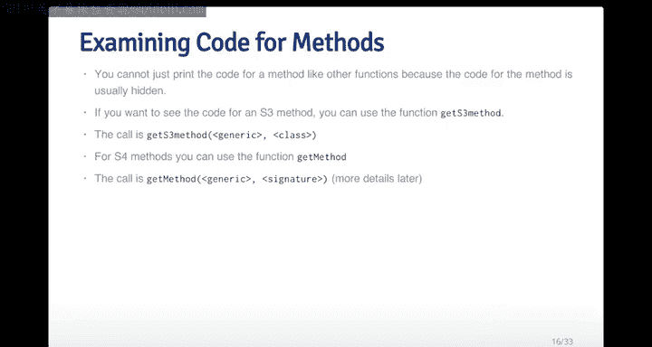

# 148：R 中的类与方法（第一部分）📊


在本节课中，我们将学习如何在 R 语言中编写类和方法。R 的类和方法的核心理念是，它允许我们表示 R 默认不支持的、新型的数据或数据类型。例如，当一个新的研究领域出现并带来了其特有的数据结构时，我们就需要开发新的结构来支持这种数据，并编写一系列新的函数来处理它。这正是 R 中类和方法的用武之地，它让 R 系统能够适应并支持新的数据类型和结构。

## 概述：R 中的面向对象编程

上一节我们介绍了课程的目标。本节中，我们来看看 R 中面向对象编程的基本背景。

R 中的类和方法系统本质上是一个面向对象编程的系统。R 语言的一个有趣之处在于，它既是一个交互式系统，又支持形式化的面向对象编程。这与当时许多其他语言（如 C++ 和 Java）不同，后者通常不被认为是交互式语言。R 中支持类和方法的许多代码是由 S 语言的创始人 John Chambers 亲自编写的，其基本思想记录在他的著作《Programming with Data》中。

R 中类和方法的理念是，让用户能够逐渐过渡成为程序员。随着用户对语言越来越熟悉，他们可以定制系统，开发新的功能，这就是类和方法的基石。

## R 中两种风格的类与方法

在 R 中，主要有两种风格的类和方法，这是历史发展的结果。

*   **S3 类与方法**：这是较旧的风格，对应于 S 语言的第 3 版。它们是非正式的，有些“笨拙”，缺乏严格的正式性，但非常实用。R 中许多基础函数都构建在 S3 类和方法之上，因此它们非常有用且短期内不会消失。
*   **S4 类与方法**：这是更正式、更严格的系统，通常被称为 S4 系统，它随 S 语言第 4 版引入 R。对于新项目，通常鼓励开发者使用 S4 类和方法来开发新的类型。

这两种系统在可预见的未来将并存。虽然 S3 和 S4 系统是独立的，开发者通常不会混合使用它们，但 S3 因其快速、简易的特点，在某些短期项目中仍有其用处。本节课我们将主要关注 S4 系统的开发。

## 核心概念：类、对象、方法与泛型函数

理解了两种风格后，我们来看看构成这个系统的几个核心概念。R 中面向对象编程的所有实现都包含在 `methods` 包中，该包通常默认加载。

以下是核心概念的简要说明：

*   **类**：对某种事物的描述，通常代表一种新的数据类型或概念。可以使用 `methods` 包中的 `setClass` 函数来定义。
*   **对象**：某个类的具体实例。可以使用 `new` 函数或其他函数创建。
*   **方法**：对特定类对象进行操作的函数。它是泛型函数针对特定类的具体实现。
*   **泛型函数**：一个 R 函数，其职责是“分派”方法。它本身不进行计算，而是根据传入对象的类来调用相应的方法。例如，`plot` 函数就是一个泛型函数。

因此，基本的工作流程是：泛型函数检查传入对象的类，然后寻找并调用适用于该类的具体方法。

## 查看对象的类

在 R 中，每个对象都有一个类，可以使用 `class()` 函数来确定。

```r
class(1)          # 返回 "numeric"
class(TRUE)       # 返回 "logical"
class("hello")    # 返回 "character"
```

除了基本的原子类（如数值型、逻辑型、字符型），R 还有很多其他类。例如，拟合线性模型的结果就是一个特定的类：

```r
fit <- lm(mpg ~ wt, data = mtcars)
class(fit)        # 返回 "lm"
```

`lm` 类封装了线性模型拟合结果的所有相关信息，这体现了为特定概念创建专属数据类型的价值。

## 泛型函数与方法分派机制

我们已经知道泛型函数负责分派方法。让我们看看一些实际的例子。

以下是几个 S3 风格的泛型函数：

```r
mean
print
```

如果你在控制台输入这些函数名，会发现它们的函数体代码非常少，核心通常只是一句 `UseMethod("函数名")`。这说明它们的主要工作就是寻找合适的方法。

你可以使用 `methods()` 函数查看一个泛型函数有哪些可用方法：

```r
methods(mean)
```

随着你加载不同的 R 包，这个列表可能会增长，因为包可以为现有的泛型函数添加新的方法。

S4 风格的泛型函数与之类似，但结构更正式。例如，`show` 函数是 S4 系统中的 `print`：

```r
show
```

大多数时候，我们不需要直接调用 `print` 或 `show`，因为对象在命令行中会被自动打印。

## 方法分派的工作流程

现在，我们来详细看看泛型函数分派方法的具体流程：

1.  **检查类**：泛型函数首先检查传入的第一个对象的类。
2.  **寻找特定方法**：它搜索是否存在专门为该类定义的方法。
    *   如果找到，则调用该方法，工作完成。
3.  **寻找默认方法**：如果没有找到特定方法，则寻找是否存在一个默认方法（`default`）。
    *   如果找到默认方法，则调用它。
4.  **报错**：如果既没有特定方法，也没有默认方法，则泛型函数会报错，因为它不知道该如何处理。

## 如何查看方法的代码

有时你可能想查看某个方法的具体实现代码。需要注意的是，不能像查看普通函数那样直接输入方法名来查看代码。

以下是查看方法代码的正确方式：

*   对于 **S3 方法**，使用 `getS3method()` 函数。
*   对于 **S4 方法**，使用 `getMethod()` 函数。

这两个函数的基本用法是：第一个参数是泛型函数名，第二个参数是对象的类。

```r
# 假设查看针对 lm 类的 print 方法代码 (S3)
getS3method("print", "lm")

# 假设查看针对某个 S4 类的 show 方法代码
getMethod("show", "你的类名")
```

## 总结



本节课中，我们一起学习了 R 语言中类和方法的初步知识。我们了解到 R 通过类和方法的机制支持面向对象编程，这使我们能够定义新的数据类型并为其编写特定的操作函数。我们介绍了 S3 和 S4 两种不同风格的类系统，并解释了类、对象、方法和泛型函数这四个核心概念。我们还学习了如何使用 `class()` 函数查看对象类，以及泛型函数如何根据对象类来分派具体的方法。最后，我们知道了查看方法实现代码的正确方式。在接下来的课程中，我们将深入探讨如何实际创建自己的类和泛型函数。