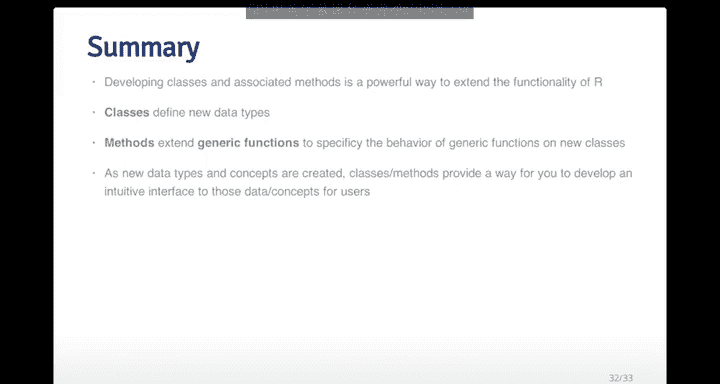

# 149：R 类和方法 第 2 部分 🧬


在本节课中，我们将继续学习 R 语言中的类和方法系统，特别是 S3 和 S4 系统。我们将通过具体示例，了解如何创建新类、定义方法，以及它们如何扩展 R 的功能，使处理新型数据变得更加直观和高效。

---

## S3 类与方法的简单示例

上一节我们介绍了 S3 系统的基本概念。本节中，我们来看一个具体的 S3 类和方法示例。

以下代码生成了一些随机正态数据并计算其均值：
```r
x <- rnorm(100)
mean(x)
```
输出结果可能类似于 `-0.0307`。这个计算看似简单，但背后涉及了 R 的类和方法派发机制。

首先，向量 `x` 的类是 `numeric`。当我们调用泛型函数 `mean` 时，R 会检查是否存在针对 `numeric` 对象的特定 `mean` 方法。在本例中，没有专门的方法，因此 R 会调用 `mean` 的默认方法。默认方法计算所有元素的总和，然后除以向量的长度。

我们可以使用 `getS3method` 函数查看 `mean` 的默认方法：
```r
getS3method("mean", "default")
```
你会看到该函数包含 `trim`、`na.rm` 等参数，并最终调用内部的 C 代码以提高效率。

---

## 数据框与 S3 方法派发

现在，我们来看一个稍微复杂一点的例子，涉及数据框。

以下代码创建了一个数据框，并使用 `sapply` 对每列应用 `mean` 函数：
```r
df <- data.frame(a = rnorm(100), b = 1:100)
sapply(df, mean)
```
数据框的每一列可以属于不同的类。例如，第一列是 `numeric`，第二列是 `integer`。当 `sapply` 对每列调用 `mean` 函数时，`mean` 会检查该列的类，并寻找合适的方法。对于 `numeric` 和 `integer` 列，都没有特定的方法，因此都会调用默认方法。

这意味着，如果一个数据框有很多列，且每列类都不同，`mean` 函数会为每一列检查并派发合适的方法。

---

## 调用方法的注意事项

在某些情况下，可以直接调用 S3 方法。例如，`mean.default` 函数是可见的，可以直接调用。

然而，**一般规则是永远不要直接调用方法**。你应该始终调用泛型函数（如 `mean`），让 R 自动派发合适的方法。这样写出的代码更清晰、更健壮。如果未来方法名称发生微小变化，你的代码也不会受到影响。

在 S4 系统中，这通常不是问题，因为你大部分时候根本无法直接调用方法。

---

## 泛型函数 `plot` 的方法派发

让我们以 `plot` 函数为例，进一步理解方法派发。

首先，我们生成一些随机正态数据并绘图：
```r
x <- rnorm(100)
plot(x)
```
`plot` 函数会寻找 `numeric` 对象的绘图方法。由于没有特定方法，它调用了默认的 `plot` 方法，生成了一个散点图。

现在，我们做一个变化，将数据转换为时间序列对象：
```r
x_ts <- as.ts(rnorm(100))
plot(x_ts)
```
我们以完全相同的方式调用 `plot` 函数，但生成的图形却完全不同。它不再是一堆圆点，而是一个时间序列图，点之间用线连接，并且 X 轴标签变成了 “Time”。

这是因为存在一个专门为 `ts`（时间序列）对象定义的 `plot` 方法。当 `plot` 函数遇到 `ts` 类的对象时，就会自动调用这个特定方法，而不是默认方法。

---

## 为何以及如何创建新类

到目前为止，我们都在使用 R 内置的类。那么，为什么需要创建新类呢？向量、列表、数值型、整型等基本数据类型不够用吗？

虽然使用基本数据类型也能完成任务，但为更复杂的数据创建新类，通常能让思维和代码更简洁、更高效。

以下是创建新类的几个原因：
*   **表示新型数据**：例如基因表达数据、时空数据、层次结构数据或稀疏矩阵。这些数据类型在 R 中不存在，需要新类来表示。
*   **封装新概念**：例如，虽然 R 有线性模型类，但你可能需要为点过程模型、混合效应模型等尚未在 R 中实现的概念创建新类。
*   **隐藏实现细节**：你可能用列表和向量组合来表示一种新数据类型，但其中包含许多用户无需了解的复杂细节。创建一个类可以将这些细节封装起来，为用户提供更简洁的接口。

需要强调的是，“创建新数据类型”并不意味着发明前所未有的东西，而是指创建 R 尚未知晓、没有特殊处理规则的数据类型。

---

## 创建 S4 类：`polygon` 示例

在 S4 系统中，使用 `setClass` 函数创建新类。至少需要指定新类的名称，但通常还会定义与类关联的数据元素，这些称为“槽”。

从概念上讲，一个类就像一个列表，每个“槽”就像是列表的一个元素。但槽更严格：每个槽必须存放特定类别的对象，不能随意放入任意数据。

以下是一个创建 `polygon`（多边形）类的简单示例。R 中没有原生的多边形数据对象。
```r
setClass("polygon",
         representation(x = "numeric",
                        y = "numeric"))
```
在这个定义中，我们创建了一个名为 `polygon` 的类，它有两个槽：`x` 和 `y`，分别用于存储多边形所有顶点的 X 坐标和 Y 坐标，并且规定这两个槽必须存放 `numeric` 类型的数据。

---

## 为 S4 类创建方法

创建类之后，通常需要为其定义方法，例如绘图方法。

使用 `setMethod` 函数来创建方法。你需要指定：
1.  泛型函数名（例如 `plot`）。
2.  签名：即该方法将作用于哪些类（本例中是 `polygon`）。

以下是为 `polygon` 类创建 `plot` 方法的代码：
```r
setMethod("plot", "polygon",
          function(x, y, ...){
            plot(x@x, x@y, type = "n", ...)
            xp <- c(x@x, x@x[1])
            yp <- c(x@y, x@y[1])
            lines(xp, yp)
          })
```
在这个方法函数中：
*   参数 `x` 是 `polygon` 对象。
*   参数 `y` 在此方法中未使用（缺失）。
*   我们首先调用 `plot` 设置绘图区域（`type = "n"` 表示不画点）。
*   然后，我们将顶点坐标首尾相连，形成闭合多边形。
*   最后，使用 `lines` 函数画出多边形的边。

**注意**：在 S4 对象内部，使用 `@` 符号（而不是列表的 `$`）来访问对象的槽。

由于 `plot` 已经是泛型函数，我们无需创建新的泛型，只需为其添加对新类 `polygon` 的支持。

---

## 使用新类和方法

创建类和方法后，我们就可以使用它们了。

首先，使用 `new` 函数创建一个 `polygon` 对象：
```r
p <- new("polygon", x = c(1, 2, 3, 1), y = c(1, 2, 1, 1))
```
然后，对其调用 `plot` 函数：
```r
plot(p)
```
此时，R 不会调用默认的 `plot` 方法，而是会自动派发到我们刚刚为 `polygon` 类创建的方法，从而绘制出一个三角形。

---

## 总结与回顾

本节课中，我们一起深入学习了 R 的类和方法系统，特别是 S4 系统。

我们了解到：
*   **类**定义了新的数据类型，允许 R 表示和处理前所未有的数据形式。
*   **方法**扩展了泛型函数，规定了这些函数在特定新类上的行为。
*   通过创建新类和新方法，开发者可以为用户提供更友好、更直观的接口，让用户无需深入底层实现细节就能轻松操作新型数据。
*   创建和分发新类、新方法最流行的方式是通过 **R 包**。大多数你遇到的高级数据分析工具，其核心都是通过定义巧妙的类和与之配套的方法来实现的。



总而言之，类和系统是扩展 R 功能的强大机制。它们将数据（类）和对数据的操作（方法）优雅地绑定在一起，是面向对象编程思想在 R 中的核心体现，也是构建复杂、可维护、用户友好的 R 软件包的基础。