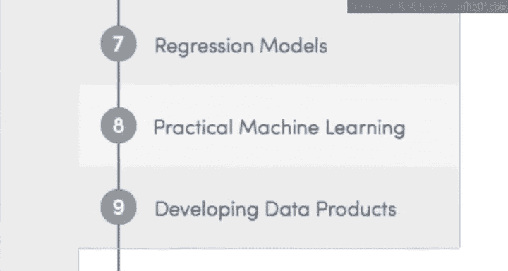

# 153：毕业项目介绍 🎓

在本节课中，我们将要学习毕业项目的整体介绍、目标以及你将如何运用在之前九门课程中学到的技能来完成一个完整的数据科学项目。

---

大家好，欢迎来到约翰霍普金斯大学数据科学专项课程的毕业项目。至此，你已经完成了从“数据科学家工具箱”到“开发数据产品”的全部九门课程，并掌握了一套在数据科学领域非常有用的技能。我们希望通过这个项目，为你提供一个机会，让你能够整合并应用所学的全部技能。

上一节我们回顾了你的学习历程，本节中我们来看看毕业项目的具体内容。这个项目要求你从一个原始数据集开始，从头构建一个可用的产品。

---

为了实现这个目标，我们与一家非常出色的公司——Swiftkey——建立了合作。该公司在预测性文本分析领域处于世界领先地位。他们以其在安卓平台上的定制键盘应用和在iOS平台上的Swiftkeynote应用而闻名。如果你想了解更多关于这家公司的信息，可以访问他们的网站。这是一家非常出色的公司。

在与Swiftkey的合作下，我们设计了一个非常有趣的毕业项目。该项目涉及开发一个文本预测模型，其起点是一个庞大的、非结构化的英语语言数据库。

在项目进行过程中，Jeff Bryan和我将全程陪伴大家，协助制定项目里程碑并进行评估。此外，Swiftkey的工程师也将加入我们，在论坛上帮助解答问题，并通过定期的Google Hangouts与我们交流。

我知道，完成九门课程是一段漫长的旅程，而这是整个过程的最后一步。我相信，通过完成这个毕业项目，你不仅能获得很多乐趣，还能学到很多新知识。

期待在那里见到大家。

---

本节课中我们一起学习了毕业项目的背景、目标以及与Swiftkey公司的合作详情。你了解了项目将如何让你整合所学技能，并从一个原始数据集开始，最终开发出一个实用的文本预测产品。