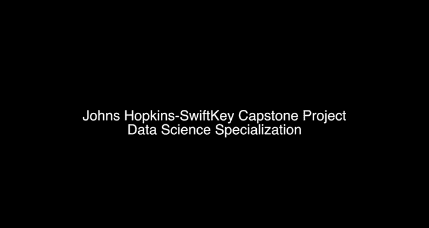

# 155：2_你现在是一名数据科学家 🧑‍💻

在本节课中，我们将介绍约翰霍普金斯大学数据科学专项课程的顶点项目。这个项目旨在模拟真实数据科学家的工作体验，让你能够综合运用在之前九门课程中学到的所有技能。

大家好，欢迎来到约翰霍普金斯大学数据科学专项课程的顶点项目。此时，你已经完成了专项课程中的所有九门课程，而这是一个可以真正展示你所学知识的巅峰体验。

我们非常激动地看到，有如此多的学员成功完成了全部九门课程。我们对该专项课程所获得的反馈感到无比振奋。

这个顶点项目的设计旨在模拟成为一名真实数据科学家的体验。因此，你可能会遇到在之前课程中未曾见过的新型数据，但你可以运用所学的全部技能来解决这个新问题，并真正展示你的创造力和独立性。

在上一节中，我们了解了顶点项目的总体目标。本节中，我们来看看项目将如何模拟真实工作场景。

在整个顶点项目中，我们确实希望模拟数据科学家的真实工作状态。但我们不会让你在整个课程中完全独自摸索。杰夫·布莱恩和我将为你提供帮助，我们还会邀请其他专家参与课程，协助你完成项目，并在你遇到困难时提供支持。

以下是项目进行过程中的关键支持环节：
*   课程讲师将全程提供指导。
*   领域专家会参与课程并提供帮助。
*   当你遇到困难时，可以获得及时的协助。

当你完成项目并毕业后，我们非常希望听到你的反馈，了解这个项目对你的职业发展有何帮助。因此，如果你愿意，可以在推特或其他社交媒体上给我们发送消息，让我们知道。这有助于我们持续改进这个项目。

祝你在顶点项目中一切顺利。

本节课中，我们一起学习了约翰霍普金斯大学数据科学顶点项目的核心目标：模拟真实数据科学工作，并综合运用所学技能。我们也了解了在项目进行过程中能够获得的指导与支持。现在，你已经准备好开始你的数据科学家实践之旅了。