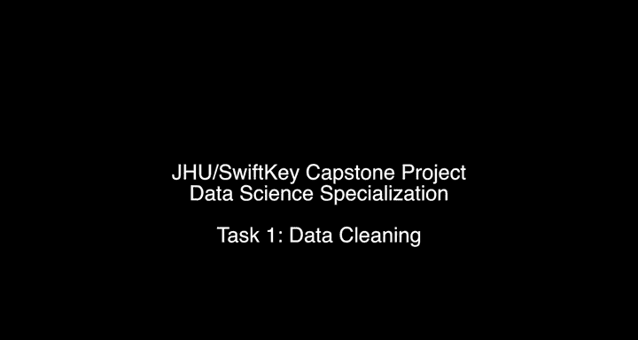

# 157：任务1介绍 - 获取和清理数据 📊

在本节课中，我们将学习数据科学流程中的第一个关键任务：获取和清理数据。我们将重点讨论如何处理文本数据，特别是**分词**和**不雅内容过滤**这两个基本目标。

---

## 概述

你已经获取了数据，并且学习了自然语言处理和文本挖掘的相关知识。现在，是时候开始深入分析这些数据了。本节课程将引导你思考如何将原始文本转化为可供分析的结构化单元。

---

## 分词：从文本到单词

上一节我们介绍了任务的目标，本节中我们来看看第一个核心目标：**分词**。其基本思想是，你需要能够接收一段文本，并将其分割成我们称之为“单词”的单元。

在实现分词方案时，你需要处理一系列问题。以下是几个关键考虑因素：

*   **标点符号处理**：例如，如何处理句号、逗号、引号等。
*   **大小写字母**：是否需要区分或统一大写和小写字母。
*   **数字**：数字是作为独立单词处理，还是与字母组合处理。
*   **拼写错误**：人们可能会拼写错误，你的方案需要有一定的容错性。

在编写解决方案时，你需要构思一个最优策略来处理所有这些问题。这个策略需要在**性能**和**准确性**之间取得平衡。

---

## 数据科学中的决策权衡

请记住，在这个过程中你将需要做出大量决策。什么是最佳决策并不总是显而易见的，因为很多情况下并没有绝对正确的答案。

然而，作为数据科学家，为了推动项目前进，你必须做出这些艰难的决策。不要犹豫，做出决策、思考你认为的最佳方案、并考虑用户可能从软件中获得什么，这正是你的职责所在。

---

## 开始探索数据

现在，开始深入挖掘数据吧。我们非常期待你能提出创新的解决方案。

---

## 总结

本节课中，我们一起学习了数据清理初始阶段的核心任务。我们明确了**分词**和**不雅内容过滤**的目标，并讨论了实现分词时需要权衡的各种因素，例如标点、大小写和拼写错误。同时，我们认识到在数据科学实践中，经常需要基于判断做出决策以推动项目发展。