# 158：正则表达式 第1部分（可选）🔍

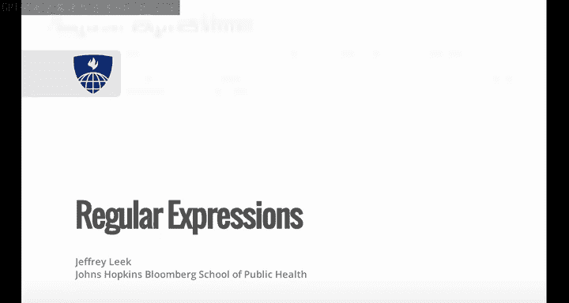

在本节课中，我们将要学习正则表达式的基础概念。正则表达式是一种强大的工具，用于在文本中搜索和匹配特定模式。我们将从字面量匹配开始，逐步引入元字符，以构建更灵活和复杂的搜索模式。

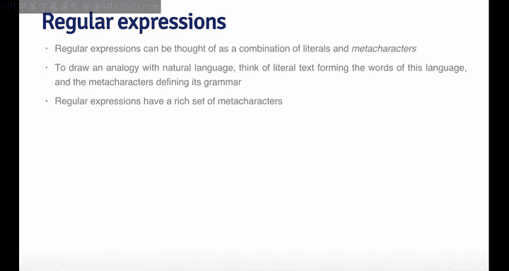

---

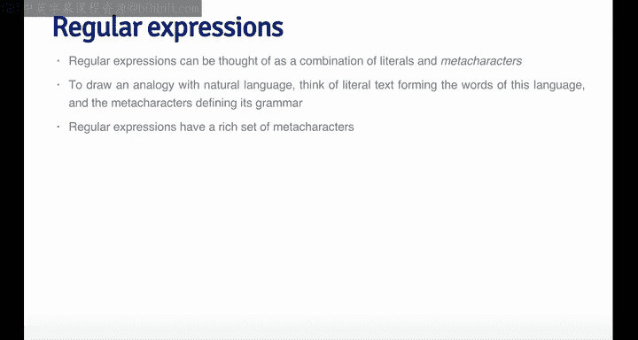

上一节我们介绍了正则表达式的基本概念，本节中我们来看看字面量匹配。

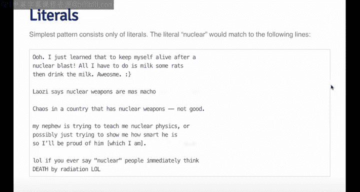

字面量由完全匹配的单词组成。例如，字面量 `nuclear` 会匹配所有包含该单词的行，因为 `nuclear` 在这些行中精确出现。同样，字面量 `Obama` 也会匹配所有包含该单词的行。

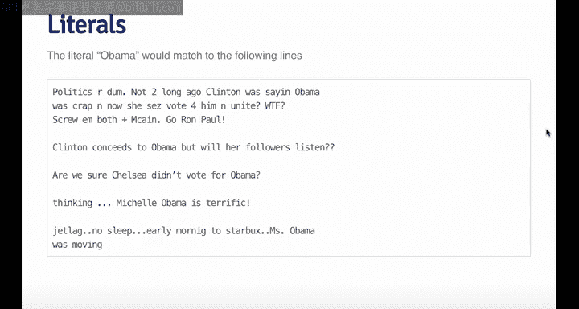

正则表达式在最简单的形式下仅由字面量构成。只有当被测试的文本中出现了完全相同的字面量序列时，才会发生匹配。

---

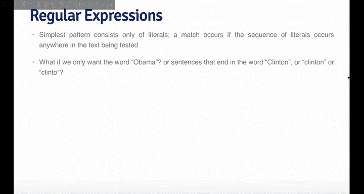

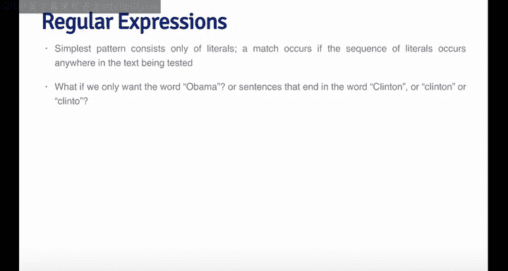

然而，如果我们只想匹配单词 `Obama`，或者匹配以单词 `Clinton` 结尾的句子，又或者匹配像 `Clintoninto` 这样更短的短语呢？我们需要一种方法来表达空白、单词边界、字面量集合、行首行尾，或者像 `war` 或 `peace` 这样的备选项。

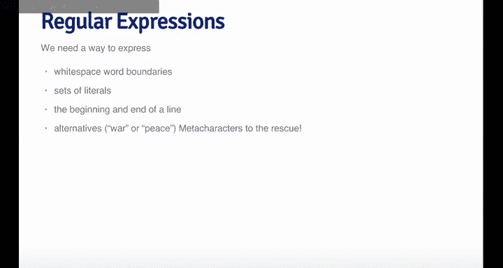

为了指定这些我们想要识别的、更通用的搜索项，我们将使用元字符。

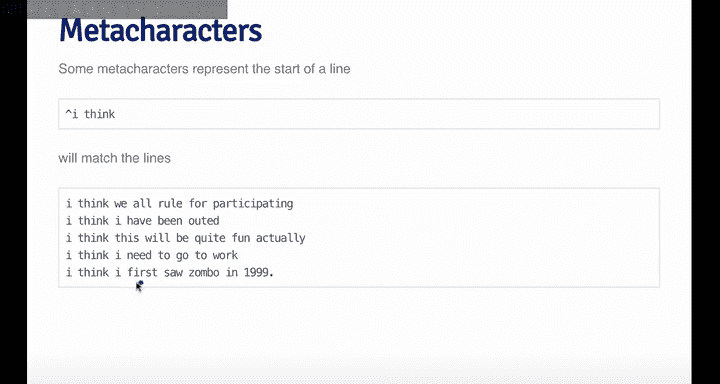

---

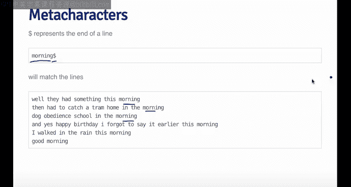

以下是用于指定文本位置和字符集合的元字符：

*   **`^`**：匹配一行的开始。例如，`^I think` 会匹配所有以 “I think” 开头的行。
*   **`$`**：匹配一行的结束。例如，`morning$` 会匹配所有以 “morning” 结尾的行。
*   **`[ ]`**：匹配方括号内列出的任意一个字符。例如，`[Bb][Uu][Ss][Hh]` 会匹配 “Bush” 单词的任何大小写组合形式（如 Bush, BUSH, bUsH 等）。

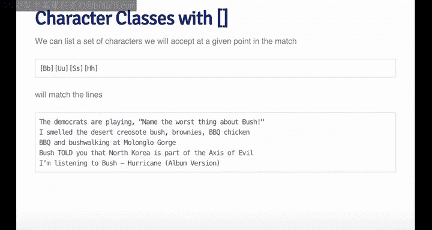

---

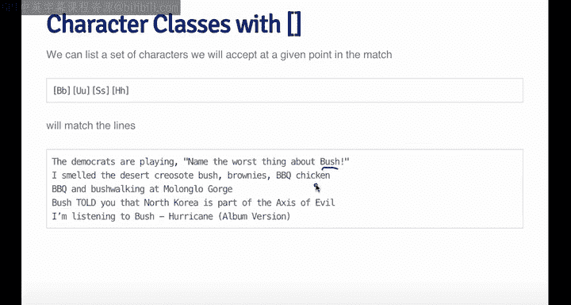

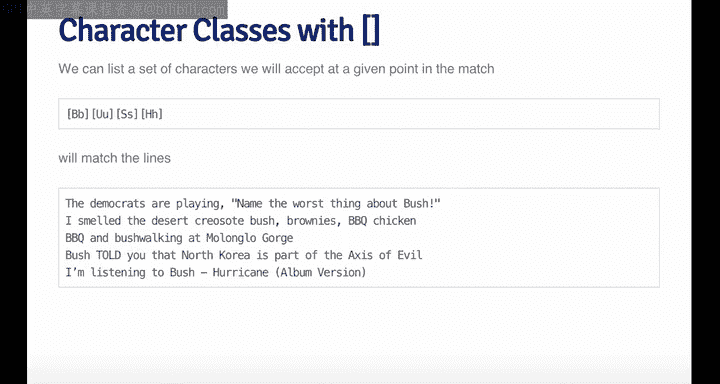

我们可以将元字符组合起来使用。例如，`^[Ii] am` 会匹配所有以 “I am” 或 “i am” 开头的行。它首先匹配行首 `^`，然后匹配 `[Ii]`（即大写或小写的 I），最后匹配字面量 “am”。

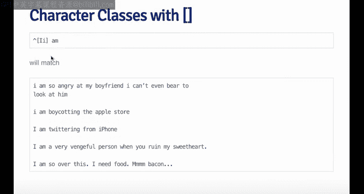

此外，我们还可以在方括号内指定字符范围。例如：
*   `[a-z]` 匹配任意小写字母。
*   `[a-zA-Z]` 匹配任意字母（无论大小写）。
*   `[0-9][a-zA-Z]` 会匹配一个数字后紧跟一个字母的模式。例如，它会匹配所有以数字开头且第二个字符是字母的行。

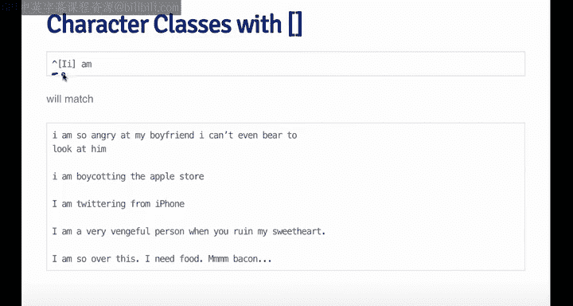

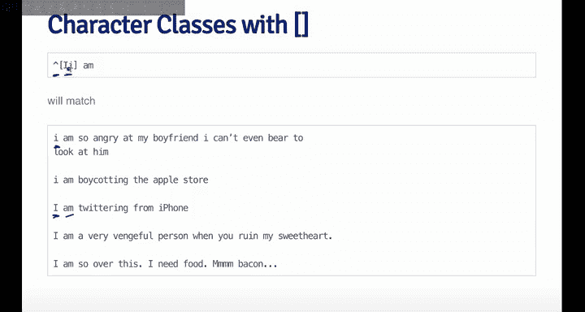

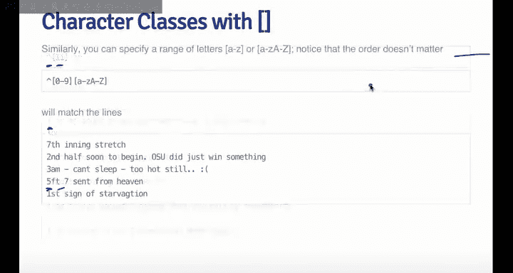

---

当脱字符 `^` 用在字符类（即方括号 `[ ]`）的开头时，它是一个元字符，表示匹配**不在**指定字符类中的任意字符。

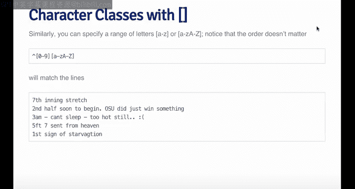

例如，正则表达式 `[^\.?]$` 用于匹配行尾 `$`。它查找的是以**非**句点 `.` 也**非**问号 `?` 的字符结尾的行。因此，它会匹配所有以其他字符（如字母、数字或感叹号）结尾，或者没有任何标点结尾的行。

---

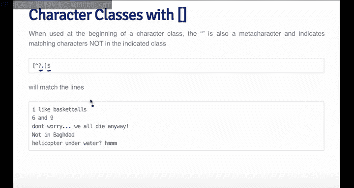

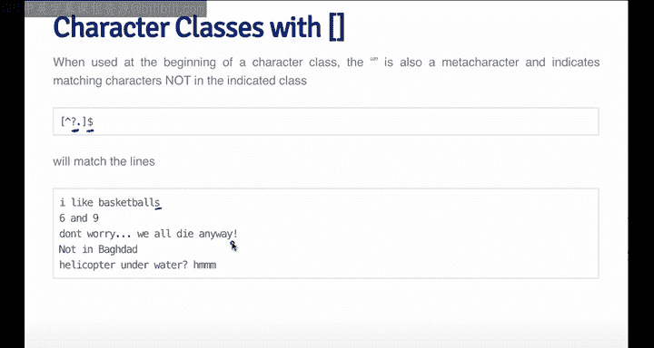

本节课中我们一起学习了正则表达式的基础知识。我们从简单的字面量匹配开始，然后引入了用于定位（`^` 和 `$`）和定义字符集合（`[ ]`）的元字符。我们还学习了如何在字符类中使用 `^` 来表示否定，以及如何组合这些元素来构建更精确的搜索模式。掌握这些基础是理解更复杂正则表达式的关键。