# 159：正则表达式（第二部分）🔍

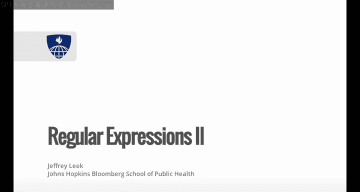

在本节课中，我们将继续学习正则表达式，深入探讨更多元字符的用法，包括如何匹配任意字符、使用“或”逻辑、定义可选部分、设置重复次数以及理解贪婪匹配。这些概念将帮助你更灵活地处理文本数据。

---

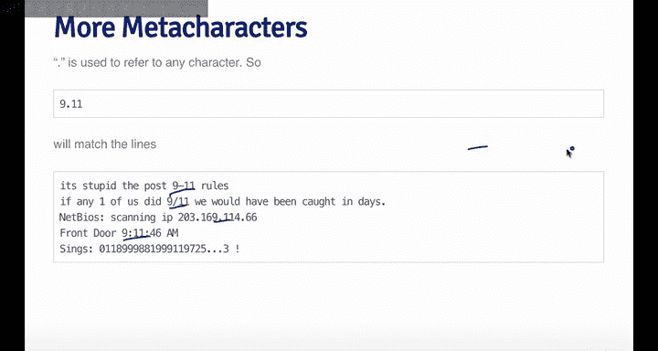

上一节我们介绍了正则表达式的基础概念和部分元字符。本节中，我们来看看更多强大的元字符及其应用。

## 点号（.）元字符

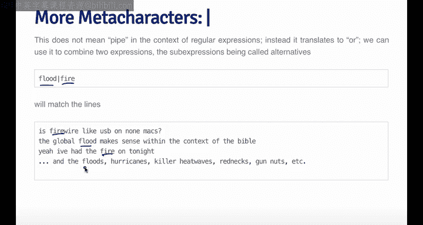

点号（`.`）是一个元字符，代表**任意单个字符**。例如，正则表达式 `9.11` 会匹配“9”后接任意一个字符，再后接“11”的字符串。

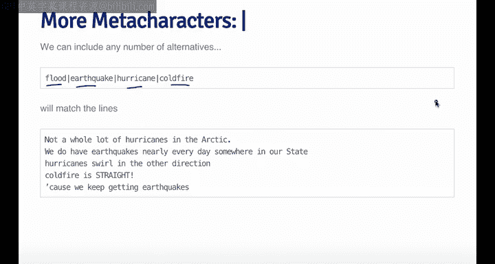

以下是一些匹配示例：
*   9-11
*   9.11
*   9 11
*   9a11

所有这些例子都满足“9”和“11”之间恰好有一个字符的条件。

## “或”逻辑（|）元字符

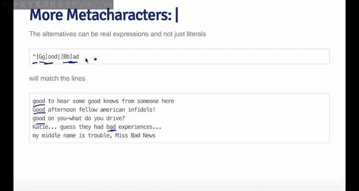

竖线（`|`）是表示“或”逻辑的元字符，用于组合多个子表达式（称为“备选项”）。

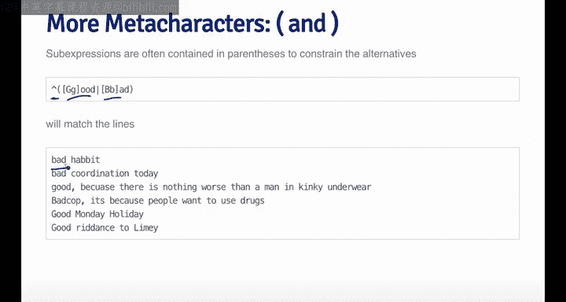

以下是其基本用法：
*   正则表达式 `flood|fire` 会匹配包含“flood”**或**“fire”的文本行。

你可以组合任意数量的备选项。
*   例如，`flood|earthquake|hurricane|cold fire` 可以匹配包含其中任一灾害名称的行。

备选项本身也可以是复杂的正则表达式，而不仅仅是字面文本。
*   例如，`^(Good|good)|bad` 会匹配：以“Good”或“good”开头的行，**或者**在行中任意位置出现“bad”的行。

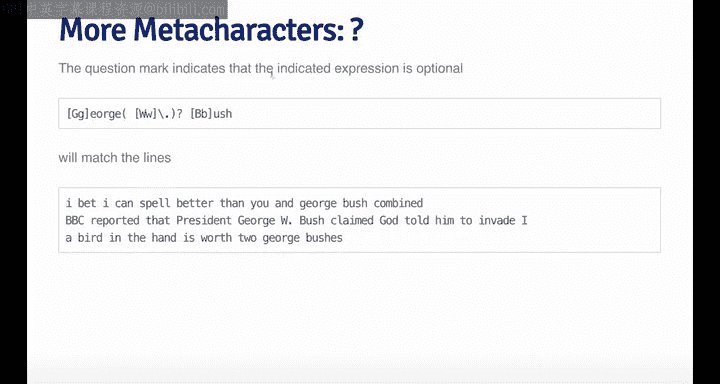

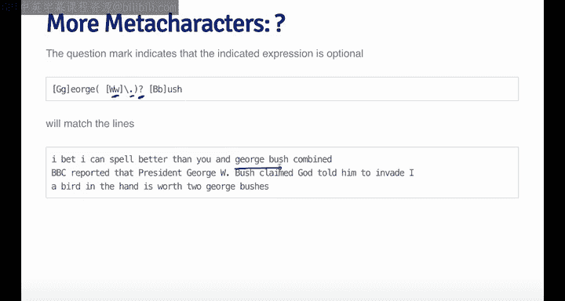

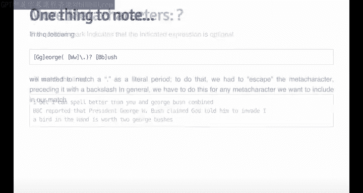

## 使用括号（()）分组

括号 `()` 用于对表达式进行分组，以限制“或”逻辑的范围。

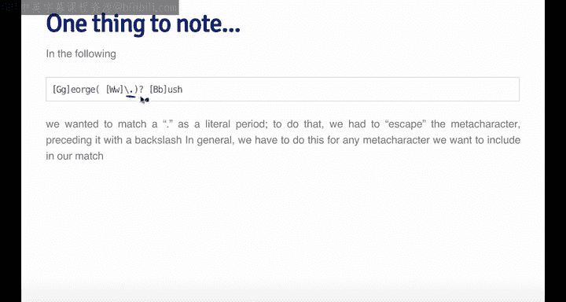

以下是分组的一个例子：
*   正则表达式 `^(good|bad)` 只会匹配以“good”或“bad”开头的行。即使行中包含“bad”，如果它不在开头，也不会被匹配。

## 问号（?）表示可选

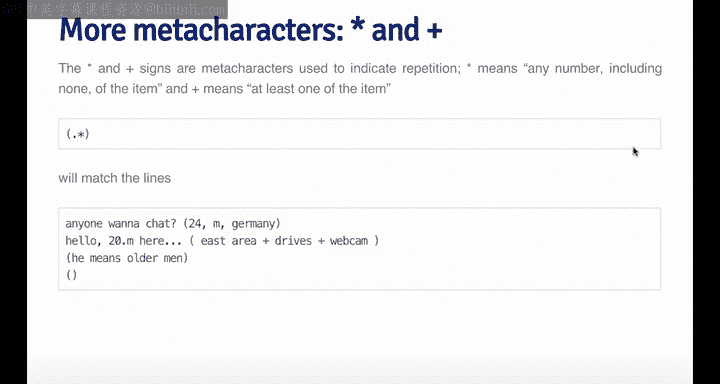

如果一个子表达式后紧跟一个问号（`?`），则表示该部分是可选的。

以下是一个示例：
*   正则表达式 `[Gg]eorge( [Ww]\.)? [Bb]ush` 用于匹配“George Bush”这个名字，其中中间名“W.”（带点号）是可选的。因此，它能匹配“George W. Bush”，也能匹配“George Bush”。

**注意**：在上面的例子中，我们使用反斜杠 `\` 对点号进行了转义（`\.`）。这是因为点号本身是元字符（代表任意字符），转义后它才表示字面意义上的句点。

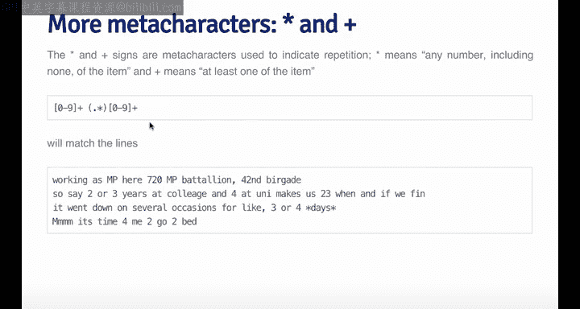

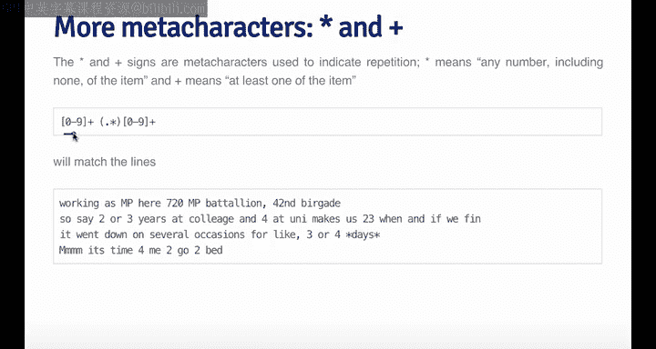

## 星号（*）和加号（+）表示重复

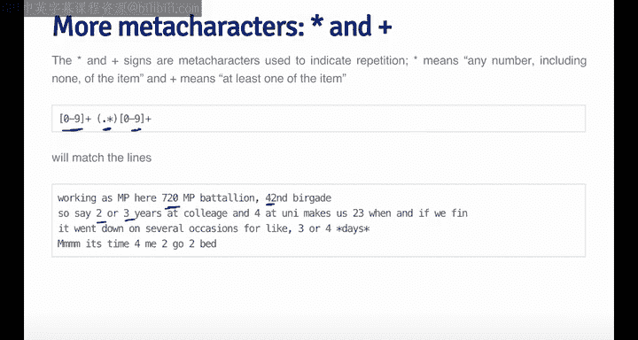

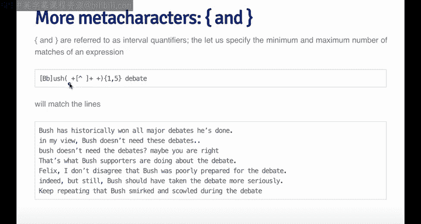

星号（`*`）表示前面的元素可以重复**零次或多次**。
加号（`+`）表示前面的元素必须重复**一次或多次**。

以下是具体说明：
*   正则表达式 `\(.*\)` 用于匹配一对圆括号及其中的内容。`.*` 表示括号内可以是任意字符，并且可以出现任意次（包括零次）。因此，它能匹配 `(any content)`，也能匹配空括号 `()`。

加号（`+`）要求至少出现一次。
*   例如，`[0-9]+.*[0-9]+` 用于匹配至少一个数字，后接任意字符，再后接至少一个数字的模式。这有助于查找被非数字字符分隔的数字组合。

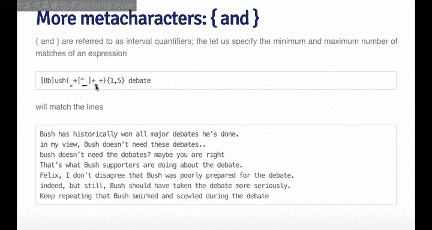

## 花括号（{}）指定重复次数

花括号 `{}` 作为区间限定符，允许我们精确指定一个表达式匹配的最小和最大次数。

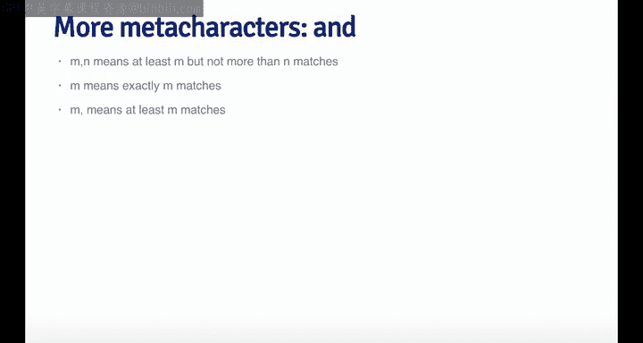

其语法规则如下：
*   `{m,n}`：表示至少匹配 `m` 次，至多匹配 `n` 次。
*   `{m}`：表示必须精确匹配 `m` 次。
*   `{m,}`：表示至少匹配 `m` 次，没有上限。

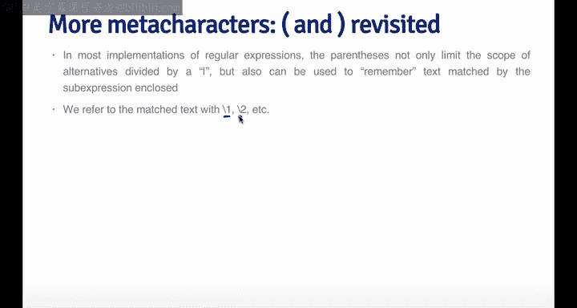

以下是一个应用实例：
*   正则表达式 `[Bb]ush( +[^ ]+){1,5} debate` 用于匹配“Bush”和“debate”之间出现1到5个单词的情况。其中 `[^ ]+` 匹配一个非空格字符序列（即一个单词），`( +[^ ]+){1,5}` 表示“空格加单词”这个组合重复1到5次。

## 使用括号进行引用匹配

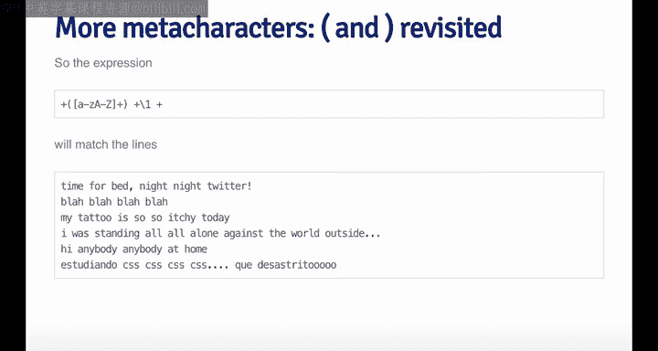

在大多数正则表达式实现中，括号 `()` 不仅用于分组，还可以“记住”括号内子表达式匹配到的具体文本。之后可以用 `\1`、`\2` 等来引用这些被记住的匹配。

以下是一个例子：
*   正则表达式 ` +([a-zA-Z]+) +\1 +` 用于查找重复的单词。它匹配一个空格，后接一个或多个字母（被括号捕获并记为`\1`），再后接空格，然后必须再次出现**完全相同的单词**（即`\1`代表的内容），最后再接一个空格。因此，它能匹配像“night night”或“so so”这样的重复短语。

## 贪婪匹配与惰性匹配

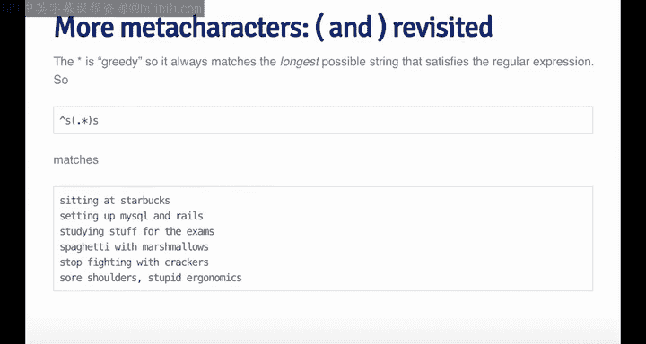

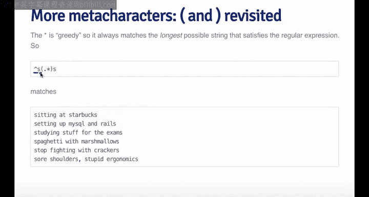

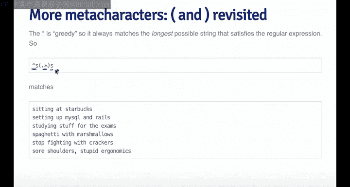

默认情况下，量词（如 `*` 和 `+`）是“贪婪”的，它们会尽可能匹配**最长**的字符串。

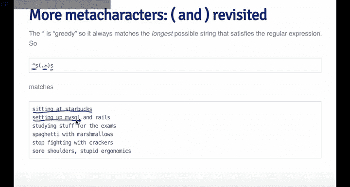

请看这个例子：
*   对于字符串“sitting at the station”，正则表达式 `^s.*s$` 会尝试匹配以‘s’开头并以‘s’结尾的**最长**子串，因此它会匹配整个字符串。

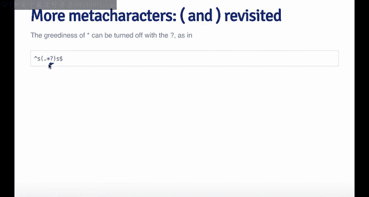

如果我们希望匹配更短的部分，可以使用问号（`?`）来将贪婪匹配变为“惰性”匹配。

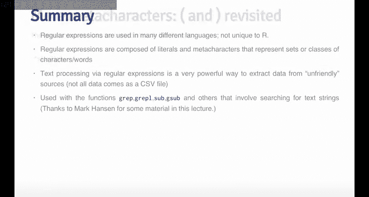

修改后的示例如下：
*   正则表达式 `^s.*?s$` 中的 `.*?` 表示惰性匹配。它会匹配以‘s’开头并以‘s’结尾的**最短**子串。对于同一个字符串，它可能只匹配到“sitting at the s”这部分。

---

## 总结 📝

本节课中我们一起学习了正则表达式更高级的功能。
*   我们探讨了点号（`.`）、“或”逻辑（`|`）、括号分组（`()`）、可选匹配（`?`）等元字符。
*   我们学习了如何使用星号（`*`）、加号（`+`）和花括号（`{}`）来控制模式的重复次数。
*   我们了解了括号的引用功能以及贪婪匹配与惰性匹配的区别。

正则表达式是文本处理的强大工具，它由**字面量**（要查找的具体文本）和**元字符**（提供匹配规则的语法）组成。在处理非结构化或格式杂乱的文本数据（如日志文件、自由文本）时，正则表达式尤其有用。在R语言中，它们常与 `grep()`、`grepl()`、`sub()`、`gsub()` 等函数结合使用，进行字符串搜索、替换和清洗工作。