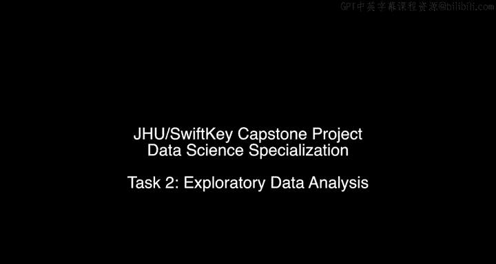

# 160：探索性数据分析 🕵️

在本节课中，我们将学习如何对数据进行探索性数据分析。这一过程的核心目标是深入理解数据的各种统计特性，以便后续构建一个高质量的预测模型。

## 概述

探索性数据分析是数据科学项目中的关键步骤。它的基本目标是理解数据的统计特性，为后续构建预测模型打下坚实基础。本节将引导你思考两个关键问题，并强调在分析前进行思考以建立数据预期的重要性。

## 关键分析问题

以下是探索性数据分析中需要首先考虑的两个核心问题：

1.  **特定词语在数据中出现的频率如何？**
2.  **特定的词语对（两个词）一起出现的频率如何？**

在思考了这些基本问题之后，你可以转向更复杂的问题，例如：**三个词的组合（三元组）是如何一起出现的？**

## 分析前的思考

在开始深入挖掘数据之前，建议你花点时间进行一些思考。

思考很重要，因为它能帮助你建立对数据的预期。这一点至关重要，因为当你对数据有预期时，你就能知道哪些特征或观察结果是出乎意料的。

这些意外情况可能是数据中的错误或异常，也可能是你必须考虑的真正有趣的特征。

当然，你最初的预期可能是错误的。但是，当你查看数据并观察结果时，你可以逐步校准和完善你的预期。

关键在于，如果你对数据没有任何预期，那么当你开始查看数据时，一切看起来都可能是正确的，从而难以区分数据中哪些是有用的，哪些是无用的。

## 总结

本节课中，我们一起学习了探索性数据分析的基本目标与初始步骤。这是为本项目开发预测模型的关键任务，因此我们鼓励你花时间真正熟悉你的数据。通过建立预期并系统性地探索词语频率及其共现关系，你将为构建一个稳健的模型奠定坚实的基础。