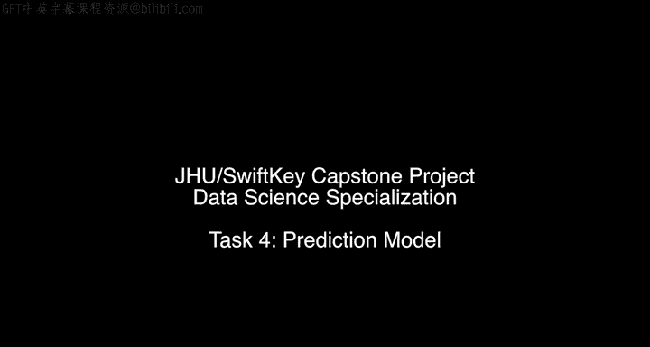

# 162：预测模型 🎯

在本节课中，我们将学习如何整合之前的所有工作，构建一个最终的、性能优良的文本预测模型。我们将关注模型的效率、准确性，并考虑其运行环境。

---

到目前为止，你已经获取了数据，并进行了初步的清理和处理。

你也完成了一些探索性分析，并构建了一些初始模型。

现在是展示成果的时候了。你需要为文本构建你的预测模型。本任务的基本目标是，将你迄今为止所做的所有工作整合起来，构建出你能做到的最佳预测模型。

在这个阶段，你需要仔细审视你的代码，检查其效率和准确性。

思考你算法的计算复杂度，或许可以考虑使用性能分析器等工具来计时代码并寻找瓶颈。同时，也要稍微考虑一下你的代码将在何种环境中运行。它会在高端服务器上运行，还是你认为它更适合在移动电话上使用？因为代码的运行环境将决定你可用的资源类型，因此你甚至可能需要考虑以一种易于适应不同环境的方式来编写你的代码。

😊 因此，在本任务结束时，你需要拥有一个性能良好的完整工作模型。

同时，尝试列出一系列可以尝试的想法，这些想法可能以各种方式提升你模型的性能。祝你在本任务中好运，我们非常期待看到你构建的模型。

---

本节课中，我们一起学习了构建最终预测模型的完整流程。我们从整合前期工作开始，强调了代码效率、准确性评估以及运行环境适配的重要性。最终目标是交付一个性能良好的工作模型，并为未来的优化提供思路。