# 课程 P101：随机森林 🌲


在本节课中，我们将要学习随机森林。随机森林可以看作是装袋法在分类与回归树上的扩展，它是一种强大且广泛应用的机器学习方法。

## 概述

随机森林的基本思想与装袋法非常相似。我们通过自助采样法获取多个数据子集，并在每个子集上构建一棵决策树。其关键区别在于，在构建每棵树的每个节点进行分裂时，我们不仅对数据进行自助采样，还会对特征变量进行随机子集采样。这种方法能构建出多样化的树，最终通过投票（分类）或平均（回归）这些树的预测结果来得到最终预测。

## 核心原理与流程

上一节我们介绍了随机森林的基本概念，本节中我们来看看它的具体工作原理。

随机森林通过结合多棵决策树来提升预测的准确性和稳定性。其构建过程可以概括为以下两个核心步骤：

以下是构建随机森林的关键步骤：

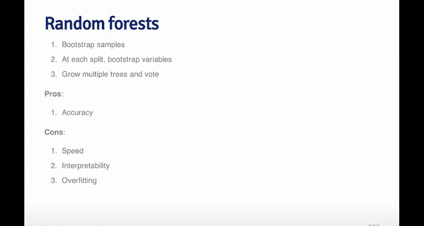

1.  **自助采样**：从原始训练数据集中有放回地随机抽取 `n` 个样本，形成一个自助样本集。此过程重复进行 `B` 次，得到 `B` 个不同的训练子集。
2.  **随机特征选择**：对于每棵决策树的每个待分裂节点，不是考虑所有 `p` 个特征，而是随机选择一个包含 `m` 个特征的子集（通常 `m ≈ √p`），并仅从这个子集中选择最佳分裂特征。

通过这种方式，我们构建了 `B` 棵彼此差异较大的树，形成了一个“森林”。

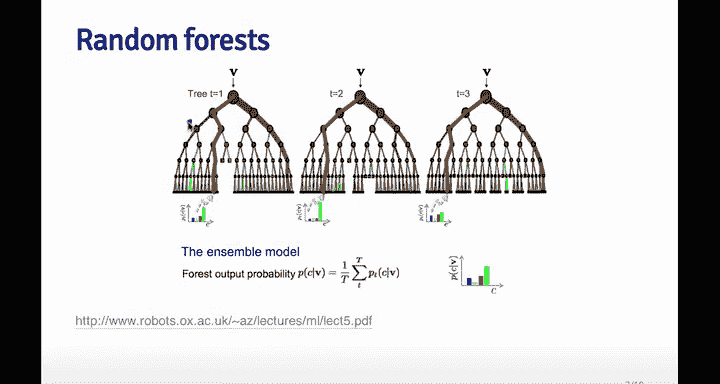

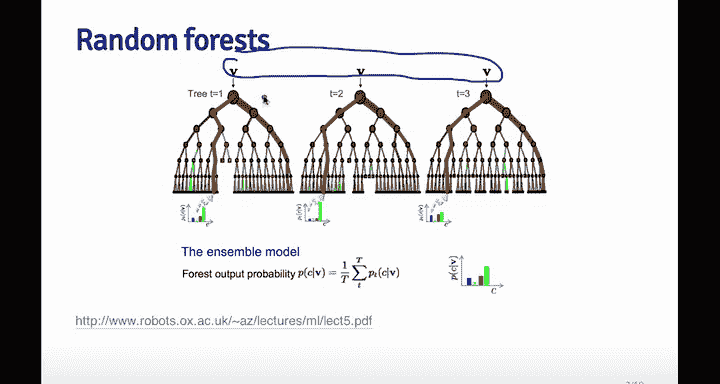

## 随机森林的优缺点

了解了构建流程后，我们来看看这种方法的优势与不足。

**优点**：
*   **高准确性**：与提升法并列，是预测竞赛中最准确的方法之一。
*   **抗过拟合能力较强**：通过平均多棵树的预测，降低了单棵树过拟合的风险。
*   **能处理高维数据**：自动进行特征选择，对特征数量多于样本数量的情况表现良好。

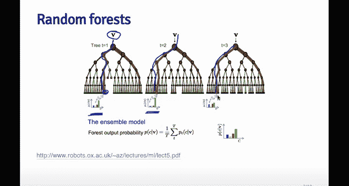

**缺点**：
*   **计算速度较慢**：需要构建大量树，训练和预测时间可能较长。
*   **可解释性差**：由于结果是成百上千棵树共同决定的，难以像单棵决策树那样直观理解预测逻辑。
*   **仍需防范过拟合**：如果树的数量过多或树生长得过深，仍可能过拟合，且难以诊断是哪部分树导致了问题。

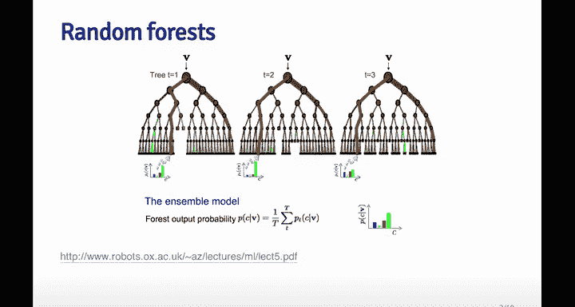

因此，**在使用随机森林时，进行交叉验证以选择合适的参数至关重要**。

## 实践示例：鸢尾花数据集


理论需要结合实践。本节我们将通过一个具体的R语言示例，演示如何使用随机森林进行分类预测。

我们将使用经典的鸢尾花数据集，目标是根据花瓣和萼片的测量数据预测花的种类。

首先，我们加载必要的库并准备数据：

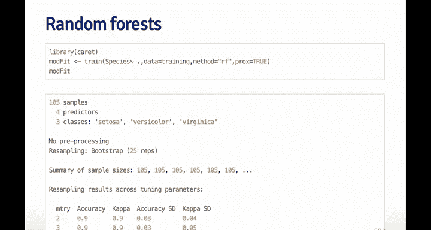

```r
library(ggplot2)
library(caret)
data(iris)

# 创建训练集和测试集
set.seed(123)
inTrain <- createDataPartition(y=iris$Species, p=0.7, list=FALSE)
training <- iris[inTrain,]
testing <- iris[-inTrain,]
```

接下来，我们使用 `caret` 包中的 `train` 函数来训练随机森林模型。参数 `method = "rf"` 指定使用随机森林，`prox=TRUE` 允许我们后续获取更多信息。

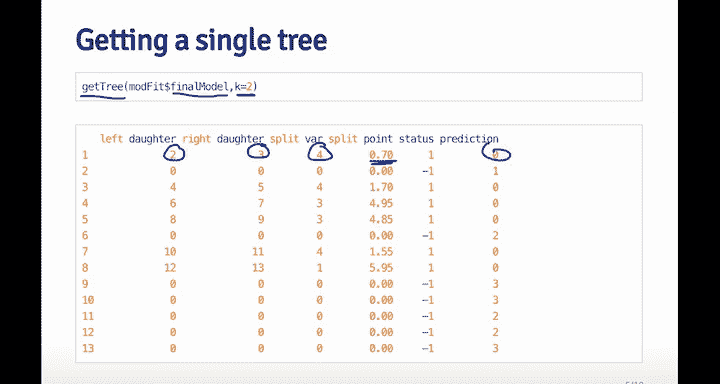

```r
# 训练随机森林模型
modFit <- train(Species ~ ., method="rf", prox=TRUE, data=training)
```

模型训练完成后，我们可以查看其中一棵具体的树的结构：

```r
# 查看第二棵树的结构
getTree(modFit$finalModel, k=2)
```

我们还可以可视化各类别的中心点，这有助于理解模型在特征空间中对不同类别的“认知”：

```r
# 获取并绘制类别中心点
irisP <- classCenter(training[,c(3,4)], training$Species, modFit$finalModel$prox)
irisP <- as.data.frame(irisP)
irisP$Species <- rownames(irisP)

p <- qplot(Petal.Width, Petal.Length, col=Species, data=training)
p + geom_point(aes(x=Petal.Width, y=Petal.Length, col=Species), size=5, shape=4, data=irisP)
```

最后，我们在测试集上进行预测并评估模型性能：

```r
# 在测试集上预测
pred <- predict(modFit, testing)

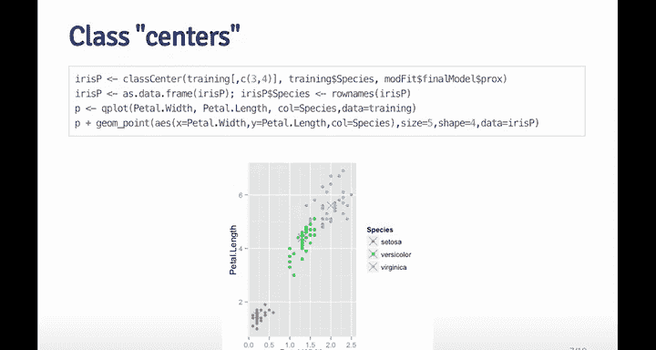

# 创建混淆矩阵查看预测准确性
confusionMatrix(pred, testing$Species)

# 找出预测错误的样本
testing$predRight <- pred==testing$Species
qplot(Petal.Width, Petal.Length, colour=predRight, data=testing, main="测试集预测结果")
```

通过混淆矩阵和错误点可视化，我们可以清晰地看到模型的预测准确率以及哪些样本容易被误分类（通常是位于类别边界上的点）。

## 总结与延伸阅读

本节课中我们一起学习了随机森林算法。它是一种基于决策树集成的强大工具，通过在数据样本和特征变量两个层面引入随机性，构建出多样化的树并进行聚合，从而获得稳定且准确的预测结果。

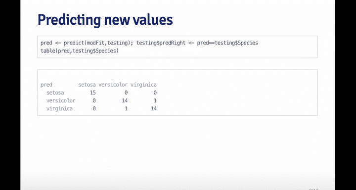

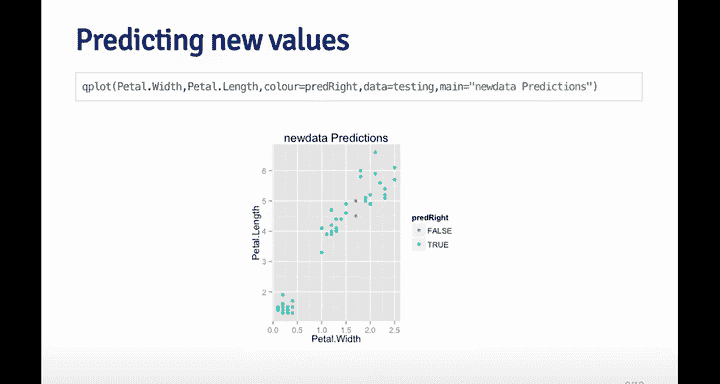

随机森林通常与梯度提升树并列为性能最佳的预测算法之一。尽管其可解释性较弱，但凭借出色的准确性，它在众多实际问题和数据科学竞赛中得到了广泛应用。

**核心公式/概念回顾**：
*   **最终预测（分类）**：`ŷ = mode{ T₁(x), T₂(x), ..., T_B(x) }`，即对 `B` 棵树的预测结果进行投票。
*   **最终预测（回归）**：`ŷ = (1/B) * Σ T_b(x)`，即对 `B` 棵树的预测结果取平均。

若想深入了解，可以参考以下资源：
*   随机森林发明者 Leo Breiman 的原始论文。
*   维基百科的“Random forest”词条。
*   《统计学习基础》一书中关于随机森林的章节。

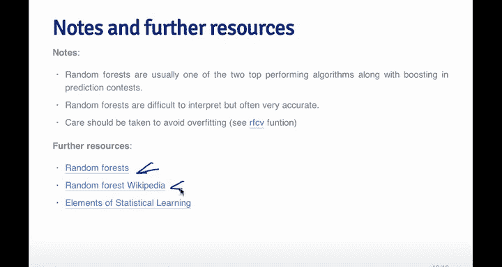

记住，在实践中务必使用交叉验证来优化模型参数（如树的数量 `B` 和每次分裂考虑的特征数 `m`），这是发挥随机森林效能的关键。