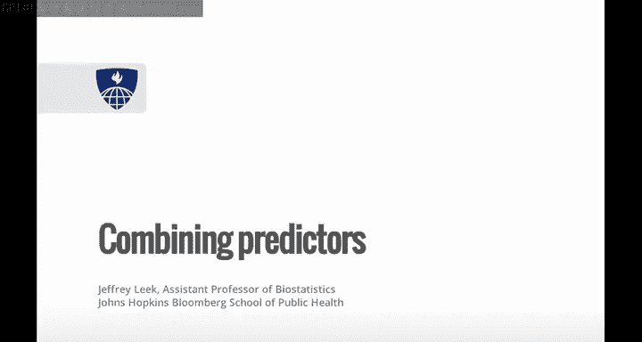
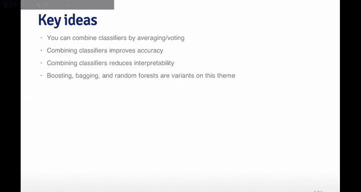
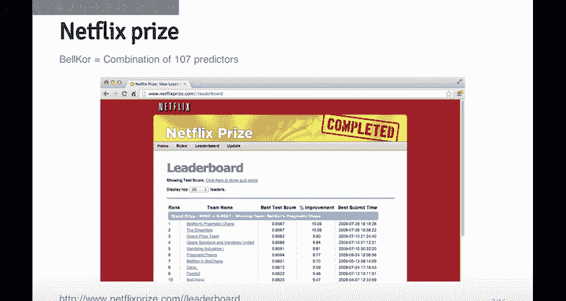
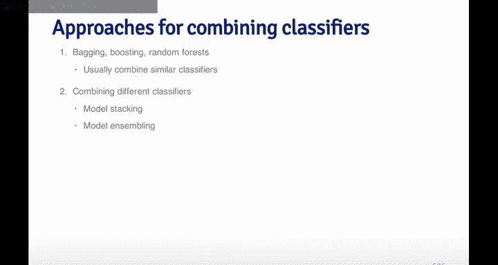
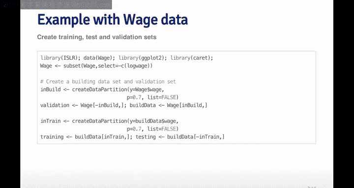
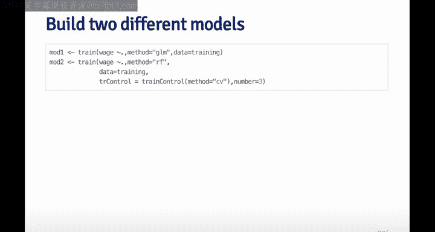
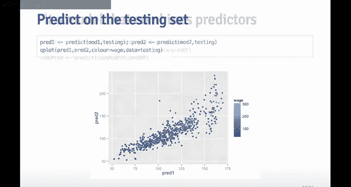
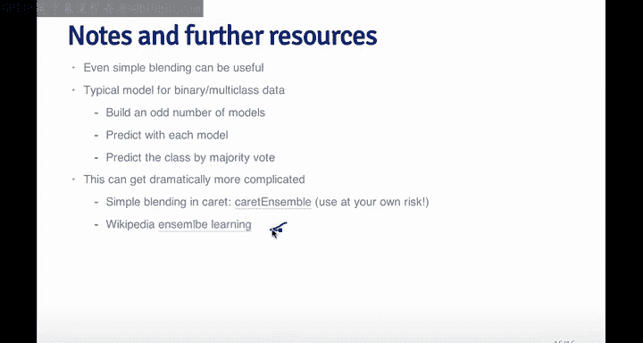
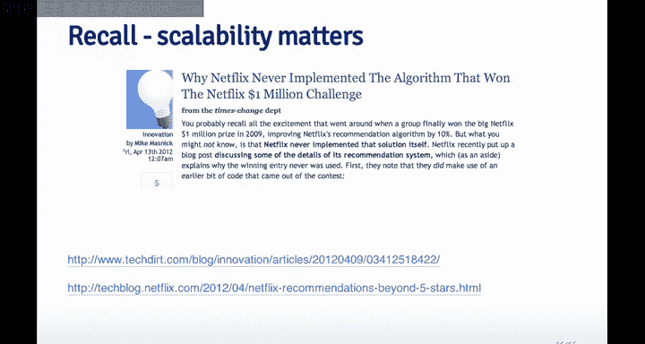

# 课程 P105：组合预测器 🧩



在本节课中，我们将要学习如何通过组合不同的预测模型来提高预测的准确性。这种方法有时被称为“集成方法”。我们将探讨其基本思想、实际应用案例以及具体的实现步骤。

---

## 概述

组合预测器的核心思想是，通过对多个分类器或回归器的预测结果进行平均或投票，来获得一个更准确、更稳健的最终预测。这些被组合的模型可以是完全不同的类型。

---



## 核心思想与优势

上一节我们介绍了组合预测器的概念，本节中我们来看看它的具体优势。

组合预测器的关键理念是，你可以通过**平均**或**投票**的方式来合并分类器。这些分类器可以差异很大，例如，你可以将一个提升（Boosting）分类器、一个随机森林和一个线性回归模型组合在一起。



通常，组合分类器能**提高准确性**，但也可能**降低可解释性**。因此，你需要谨慎权衡，确保准确性的提升值得牺牲可解释性。

提升、装袋法（Bagging）和随机森林本质上都是这种“组合不同预测器”思想的变体，但它们通常组合的是同一类型的模型。

---


## 成功案例

以下是两个著名的成功案例，展示了组合方法的强大威力。

*   **Netflix 百万美元大奖**：这是首个大型预测竞赛。最终获胜的团队实际上是将 **107** 个不同的机器学习算法融合在一起，从而获得了最佳成绩。
*   **Heritage Health 健康奖**：这个300万美元的奖项旨在根据患者以往的住院记录预测其是否会再次入院。获胜的方法同样采用了集成多个不同回归模型和机器学习方法的技术。

这两个案例的链接指向了当时领先团队的阶段性成果。

---

## 基本原理：多数投票

为了理解组合为何有效，我们可以将其看作一个**多数投票**的过程。



假设我们有五个完全独立的分类器，每个分类器的准确率都是 **70%**。那么，通过多数投票（即五个分类器中至少有三个做出正确预测），最终组合的准确率可以计算为三种情况（三票正确、四票正确、五票正确）的概率之和。计算结果表明，组合后的准确率可以达到 **83.7%**。

如果有 **101** 个独立分类器，多数投票的准确率甚至可以达到 **99.9%**。

---



## 组合方法分类

根据组合模型的方式，主要有两种策略：

1.  **组合相似模型**：使用装袋法、提升法或随机森林等方法，组合多个同类型的模型。
2.  **组合不同模型**：使用**模型堆叠**或**模型集成**，将不同类型的模型结合起来。本节课我们将重点讨论模型堆叠。

---



## 实战演示：模型堆叠

现在，我们通过一个具体的例子来看看如何实现模型堆叠。我们将使用工资数据集。

首先，我们构建数据集，并剔除“对数工资”变量（因为它是我们要预测的“工资”的极佳预测因子，为了演示需要剔除）。接着，我们将数据分为三个部分：**训练集**、**测试集**和**验证集**。你马上就会看到这样划分的重要性。



*   **训练集**：最大的数据集，包含1474个样本。
*   **测试集**：包含628个样本。
*   **验证集**：包含898个样本。

### 第一步：在训练集上构建基础模型

我们在训练集上构建两个不同的预测模型：

1.  一个广义线性模型（GLM），即线性模型。
    ```r
    model1 <- train(wage ~ ., data = training_data, method = "glm")
    ```
2.  一个随机森林模型。
    ```r
    model2 <- train(wage ~ ., data = training_data, method = "rf")
    ```

我们可以绘制这两个模型的预测值对比图。可以看到，它们的预测值相近但并不完全相同，且都与真实的工资值（图中点的颜色）存在差异。

### 第二步：在测试集上组合模型

接下来，我们创建一个组合模型。具体步骤如下：

1.  使用两个基础模型对**测试集**进行预测，得到两组预测值（`pred1` 和 `pred2`）。
2.  创建一个新的数据集，其协变量就是这两组预测值，目标变量是测试集上真实的工资值。
3.  在这个新数据集上拟合一个回归模型（例如线性模型），建立**真实工资**与**两个预测值**之间的关系。
    ```r
    combined_model <- lm(wage ~ pred1 + pred2, data = new_test_data)
    ```

现在，我们评估性能。在测试集上：
*   模型1的误差为：**827.1**
*   模型2的误差为：**866.0**
*   组合模型的误差为：**813.9**

组合模型的误差更低。但请注意，我们是用测试集来“训练”这个组合模型的，因此这个误差不能很好地代表样本外误差。

### 第三步：在验证集上评估

为了获得无偏的评估，我们需要在未参与任何模型构建的**验证集**上进行测试。

1.  用两个基础模型对验证集进行预测。
2.  将这两组预测值输入我们刚才在测试集上构建的`combined_model`，得到最终的组合预测。
3.  计算误差：
    *   模型1单独使用的误差：**1003**
    *   模型2单独使用的误差：**1068**
    *   组合模型的误差：**更低**

结果表明，即使在独立的验证集上，通过堆叠模型来融合不同模型的优势，也能有效提高预测准确性。即使是这种简单的线性融合也非常有用。

---

## 注意事项与扩展

对于二分类或多分类问题，典型的模型融合方法是构建**奇数个**模型，用每个模型进行预测，然后根据**多数投票**确定最终的类别标签。实际应用中可以变得非常复杂。



在实践时，有几点需要注意：

*   **计算复杂度**：模型集成可能导致计算复杂度显著增加。例如，Netflix百万美元大奖的获胜方案虽然准确，但因计算量过大而从未被实际部署。这提醒我们，在构建预测模型时，必须在**可扩展性**和**准确性**之间进行权衡。
*   **工具与资源**：有一些R包（如`caretEnsemble`）可以帮助集成模型，但可能尚在开发中，使用需谨慎。你也可以通过维基百科等资源了解更多关于集成学习的知识。

---

## 总结



本节课中，我们一起学习了组合预测器（集成方法）的核心概念。我们了解到，通过平均或投票组合不同的模型，可以显著提升预测性能。我们探讨了其数学原理（多数投票），并通过工资数据集的实例，一步步演示了如何使用**模型堆叠**技术来融合一个线性模型和一个随机森林模型，并在独立的验证集上验证了其效果的提升。最后，我们指出了这种方法可能增加计算复杂度，需要在准确性与可扩展性之间做出权衡。