# 课程 P107：无监督预测 🧠

在本节课中，我们将学习**无监督预测**的概念。与之前讨论的监督学习不同，无监督预测在开始时没有已知的标签。我们将探索如何通过聚类发现数据中的潜在分组，为这些分组命名，并构建预测模型来对新数据进行分类。

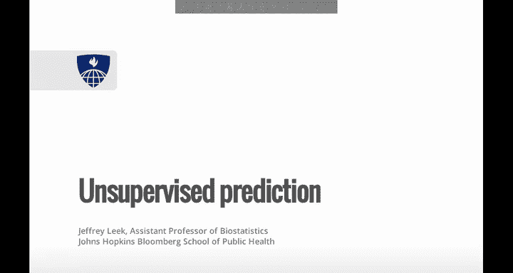

---

## 无监督预测概述

在本课程之前讨论的例子中，我们通常知道数据的标签。换句话说，我们进行的是**监督分类**，目标是预测已知的结果。

但有时我们并不知道用于预测的标签，因此需要先发现这些标签。一种方法是根据观察到的数据创建聚类，为这些聚类命名，然后在新的数据集中构建一个预测器来预测聚类，并应用之前数据中得出的名称。这为预测问题增加了几个难度层次：首先，创建聚类并非完全无噪声的过程；其次，为聚类找到合适的名称（即正确解释聚类）是一个极具挑战性的问题。

---

## 无监督预测步骤

以下是进行无监督预测的基本步骤。

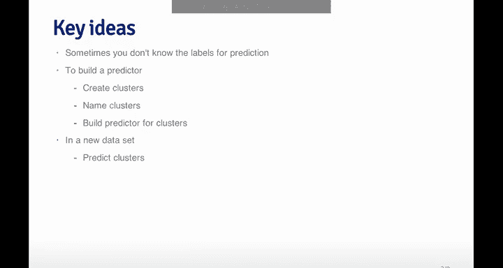

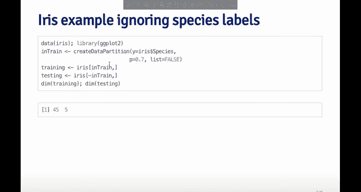

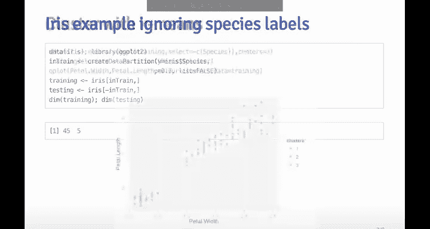

### 1. 数据准备与聚类

首先，我们加载数据并忽略已知的类别标签。接着，使用聚类算法（如K均值聚类）在数据中发现潜在的分组。

```r
# 示例：在Iris数据集上执行K均值聚类，忽略物种标签
kmeans_result <- kmeans(iris[, 1:4], centers = 3)
```

K均值聚类的基本思想是将数据划分为指定数量（例如3个）的簇，而不使用任何先验的标签信息。

### 2. 可视化与解释聚类

聚类完成后，我们可以将结果可视化，并尝试解释每个簇的含义。

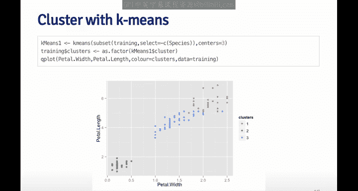

```r
# 为不同聚类分配颜色并绘图
plot(iris[, 1:2], col = kmeans_result$cluster)
```

通常，得到的聚类可能与真实的类别标签相似，但这并非必然。为聚类赋予有意义的名称通常是分析中最困难的部分之一。

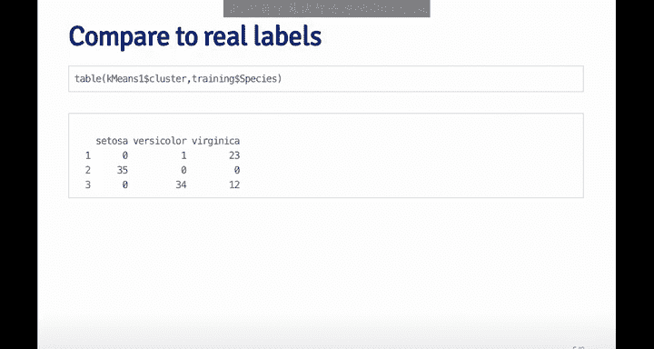

### 3. 构建预测模型

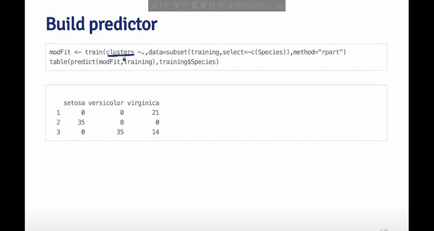

一旦我们有了聚类标签，就可以将其视为新的“结果”变量。接下来，我们使用整个课程中学到的算法（如分类树）来构建一个预测模型，将预测变量与这个新创建的聚类变量关联起来。

```r
# 使用分类树构建模型
library(rpart)
tree_model <- rpart(cluster ~ ., data = training_data_with_clusters)
```

### 4. 评估与预测

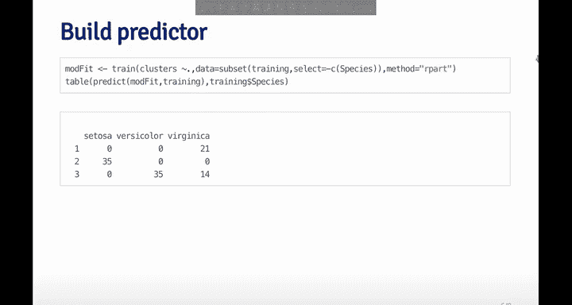

我们可以在训练集上评估模型的性能，然后将其应用于新的测试数据集进行预测。

```r
# 在训练集上预测
train_predictions <- predict(tree_model, training_data, type = "class")

# 在测试集上预测
test_predictions <- predict(tree_model, newdata = test_data, type = "class")
```

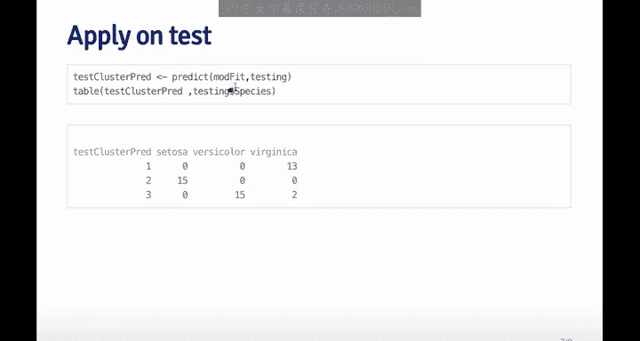

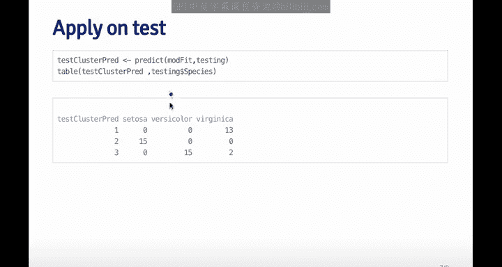

在测试集上，我们通常不知道真实标签，但为了评估，我们可以与已知的真实物种进行比较。这个过程混合了聚类构建和预测建模的误差，因此颇具挑战性。

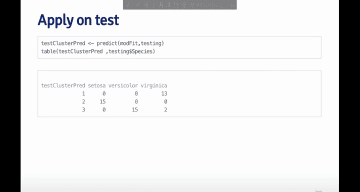

---

## 挑战与注意事项

无监督预测是一个相当困难的问题。在标记聚类和执行无监督分析时必须格外小心，并理解其工作原理。

*   **聚类的解释**：警惕对聚类结果的过度解释。这本质上是一种探索性技术，聚类结果可能因数据采样方式的不同而改变。
*   **自定义方法**：`clue`包中的`CO_predict`函数提供了类似的功能，但通常，如果你要进行无监督预测，构建自己的方法更有意义，因为你需要仔细思考如何定义聚类。
*   **应用场景**：这是构建推荐系统等应用的一种基本方法，例如识别具有相似品味的用户群，并将这些品味分配给新用户。

---

## 总结

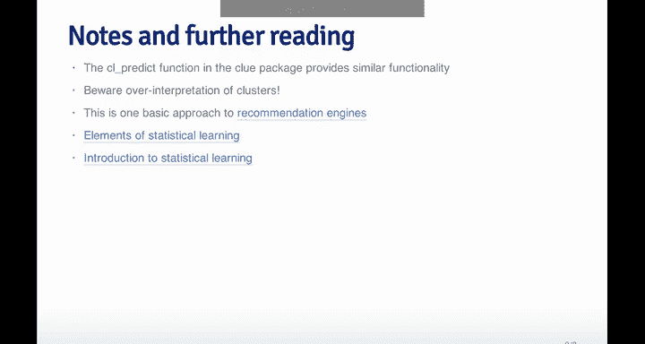

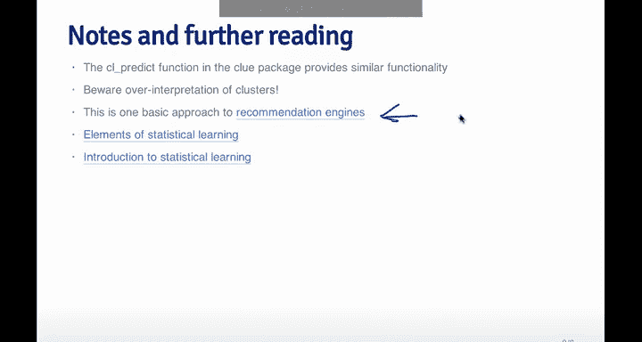

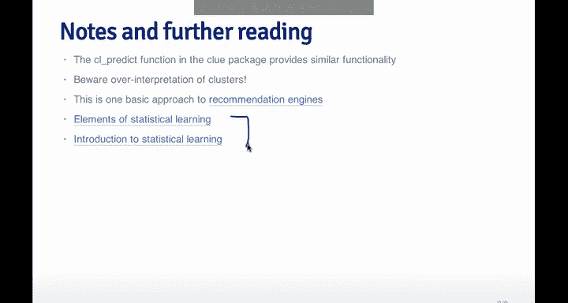

本节课中，我们一起学习了**无监督预测**。我们了解到，当数据没有预先定义的标签时，可以通过聚类技术来发现数据的自然分组，然后将这些分组作为新的标签来构建预测模型。整个过程包括数据聚类、结果解释、模型构建和预测评估。虽然这种方法很有用，但由于结合了聚类和预测的双重不确定性，它比监督学习更具挑战性。你可以通过《统计学习基础》和《统计学习导论》等资源进一步了解无监督预测。