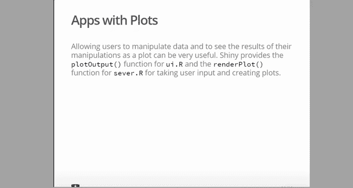
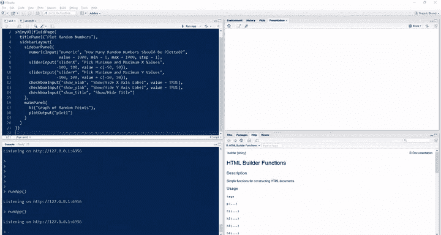
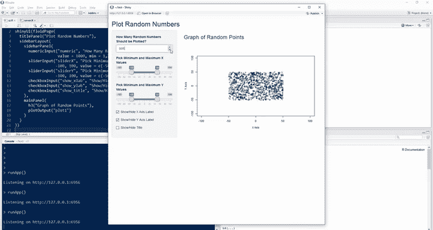
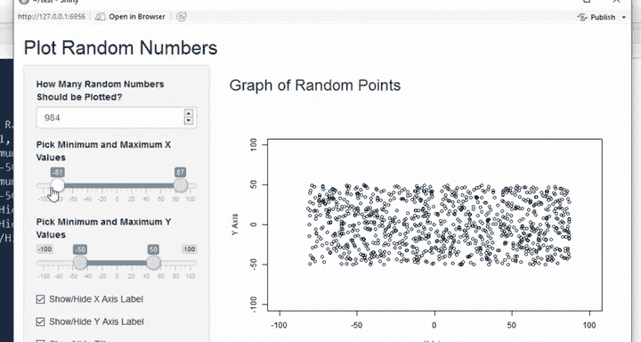
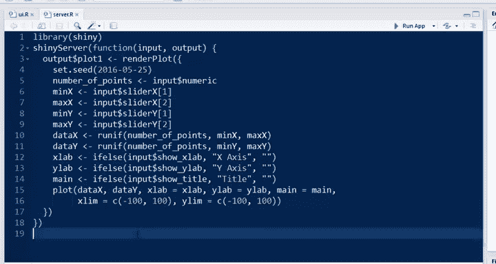
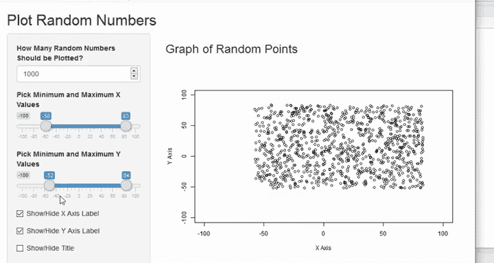

# 课程 P113：Shiny 交互式图形入门 🎨

在本节课中，我们将学习如何使用 Shiny 创建交互式图形。Shiny 极大地扩展了 R 在交互式图形方面的能力，并能将结果嵌入网页，便于广泛传播。

## 概述

我们将创建一个交互式散点图，允许用户动态调整图形参数。通过这个示例，你将掌握 Shiny 的核心工作流程，并能将其应用于实际的数据科学需求。

## 用户界面 (UI) 设计

上一节我们介绍了课程目标，本节中我们来看看如何构建用户界面。

以下是 `shinyUI` 函数的主要组件：

*   **标题面板**：`titlePanel` 用于设置应用标题。
*   **数值输入框**：`numericInput` 用于接收数值输入。
    *   `inputId = "numeric"` 定义输入变量的 ID。
    *   `label = "Number of points:"` 设置输入框的标签。
    *   `value = 500` 设置初始值。
    *   `min = 10, max = 1000` 设置允许的数值范围。
    *   `step = 10` 设置点击增减按钮时的步长。
*   **滑块输入**：`sliderInput` 用于通过滑块选择数值范围。
    *   `inputId = "sliderX"` 和 `inputId = "sliderY"` 分别对应 X 轴和 Y 轴。
    *   `value = c(-3, 3)` 设置滑块的初始范围（包含最小值和最大值）。
*   **复选框**：`checkboxInput` 用于创建勾选框。
    *   `inputId = "show_xlab"` 等定义了每个复选框的 ID。
    *   `label` 参数设置了用户看到的标签文本。
*   **主面板**：`mainPanel` 中的 `plotOutput("plot1")` 指定了用于显示图形的区域，其内容由服务器函数中名为 `plot1` 的输出提供。

## 服务器逻辑 (Server)

上一节我们设计了用户界面，本节中我们来看看服务器端如何处理这些输入并生成图形。

服务器函数 `shinyServer` 接收 `input` 和 `output` 参数。核心是 `output$plot1` 的赋值，它使用 `renderPlot` 函数来生成图形。

以下是服务器代码的关键步骤：

1.  **设置随机种子**：`set.seed(2016-05-25)` 确保图形可重现。
2.  **获取输入值**：将 `input` 列表中的值赋给局部变量，便于后续使用。
    *   `n <- input$numeric` 获取点的数量。
    *   `min_x <- input$sliderX[1]` 和 `max_x <- input$sliderX[2]` 获取 X 轴范围。
    *   `min_y <- input$sliderY[1]` 和 `max_y <- input$sliderY[2]` 获取 Y 轴范围。
3.  **生成数据**：基于输入参数生成随机数据点。
    *   `dataX <- runif(n, min_x, max_x)` 生成 X 坐标。
    *   `dataY <- runif(n, min_y, max_y)` 生成 Y 坐标。
4.  **动态设置标签**：根据复选框的状态决定是否显示坐标轴标签和标题。
    *   `xlab <- ifelse(input$show_xlab, "X Axis", "")`
    *   `ylab <- ifelse(input$show_ylab, "Y Axis", "")`
    *   `main <- ifelse(input$show_title, "Title", "")`
5.  **绘制图形**：使用基础绘图函数 `plot` 生成最终图形。
    *   `plot(dataX, dataY, xlab = xlab, ylab = ylab, main = main, ...)`

## 反应式编程

Shiny 的核心是反应式编程。每当任何输入控件（如滑块、复选框）的值发生变化时，Shiny 会自动重新执行 `renderPlot` 代码块中的所有相关代码，并更新输出图形。这种模式与传统的线性 R 脚本有所不同，需要适应。

对于计算量大的操作，后续课程会介绍如何添加“执行”按钮，以避免每次微调输入都触发重计算。

## 总结

本节课中我们一起学习了如何使用 Shiny 构建一个完整的交互式图形应用。我们掌握了如何通过 `shinyUI` 设计包含多种输入控件的界面，以及如何在 `shinyServer` 中使用 `renderPlot` 和反应式逻辑来处理输入并动态生成图形。

你的课后练习是：模仿并扩展这个示例，创建自己的交互式图形。尝试使用不同类型的输入控件（如下拉菜单 `selectInput`、单选按钮 `radioButtons` 等），而不仅仅是滑块和数值输入框。