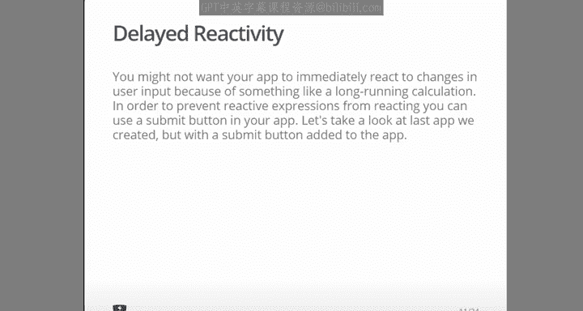
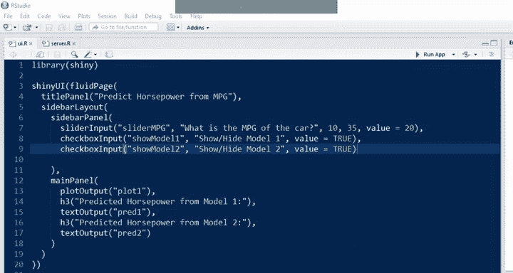
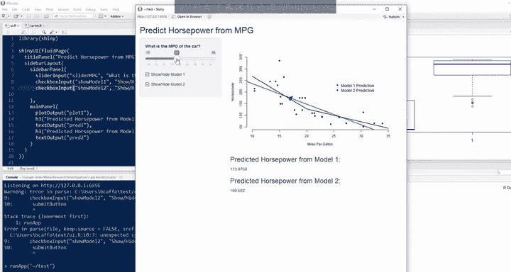
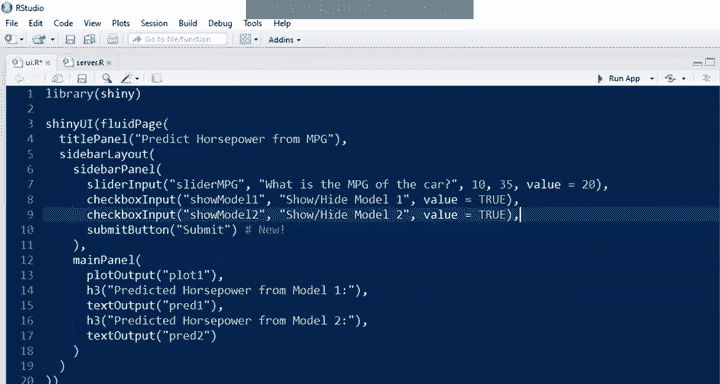
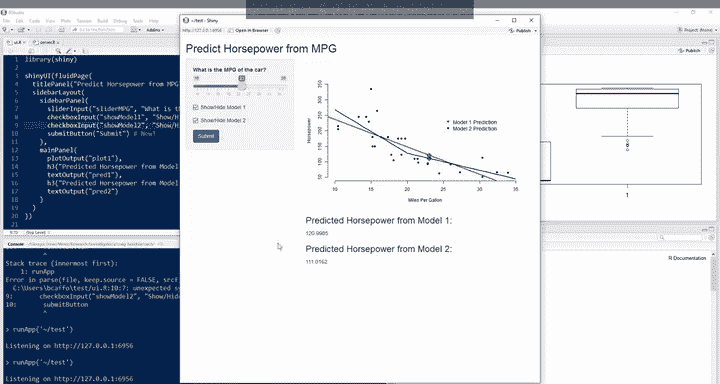
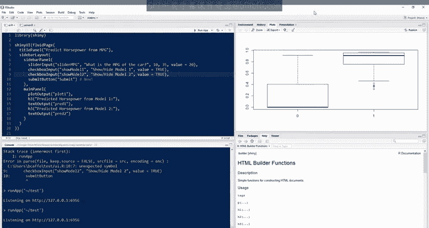

# 课程 P116：Shiny 中的延迟响应性 🕰️

在本节课中，我们将学习 Shiny 应用中的一个重要概念：延迟响应性。我们将了解为何需要它，以及如何通过一个简单的“提交”按钮来实现，从而避免在每次调整输入时都触发耗时的计算。

## 概述

在之前的课程中，我们介绍了 Shiny 的响应式编程模型。默认情况下，每当用户调整滑块等输入控件时，Shiny 会自动重新执行服务器函数中的代码。这对于快速、轻量的计算是理想的行为。然而，当应用需要执行像蒙特卡洛模拟或自助法等计算密集型任务时，这种即时响应可能会造成卡顿。本节我们将学习如何实现延迟响应，让用户先设置好所有参数，再通过一个“提交”按钮来触发计算。

## 默认的即时响应

首先，我们回顾一下默认的即时响应行为。以下代码创建了一个简单的应用，其中滑块的值会即时影响输出。

```r
# 用户界面定义
ui <- fluidPage(
  sliderInput("n", "样本数量", 1, 100, 50),
  plotOutput("hist")
)



# 服务器逻辑定义
server <- function(input, output) {
  output$hist <- renderPlot({
    hist(rnorm(input$n))
  })
}

# 运行应用
shinyApp(ui = ui, server = server)
```





在这个应用中，只要移动滑块，直方图就会立即更新。这对于生成随机数这种简单操作是合适的。

## 实现延迟响应

上一节我们看到了即时响应的例子，本节中我们来看看如何通过添加一个“提交”按钮来延迟响应。核心思想是使用 `submitButton()` 函数。

以下是修改后的代码，关键变化在于用户界面中添加了一个提交按钮：

```r
# 用户界面定义（添加提交按钮）
ui <- fluidPage(
  sliderInput("n", "样本数量", 1, 100, 50),
  submitButton("提交"), # 新增的提交按钮
  plotOutput("hist")
)

# 服务器逻辑保持不变
server <- function(input, output) {
  output$hist <- renderPlot({
    hist(rnorm(input$n))
  })
}

# 运行应用
shinyApp(ui = ui, server = server)
```



添加 `submitButton(“提交”)` 这一行后，滑块的变化将不再立即触发计算。只有当用户点击“提交”按钮时，服务器函数才会使用当前的滑块值重新执行并更新图表。

## 重要注意事项

在编写 Shiny 应用时，有几个常见的细节需要注意。

*   **函数参数与逗号**：`submitButton()` 和其他输入函数一样，是 `fluidPage()` 的一个参数。必须确保在每个函数调用后加上逗号，否则代码会报错。集成开发环境（如 RStudio）通常会通过红色“X”标记提示此类语法错误。
*   **提交按钮的状态**：`submitButton()` 会创建一个名为 `submit` 的输入变量，你可以在服务器函数中通过 `input$submit` 来引用它。这个值在按钮被点击时会发生变化，你可以利用它来编写条件逻辑。



## 总结



本节课中我们一起学习了 Shiny 中的延迟响应性。我们了解到，默认的即时响应模型虽然方便，但不适用于计算密集型任务。通过引入 `submitButton()` 函数，我们可以让用户先配置好所有输入，再手动触发计算，从而提升应用在处理复杂任务时的性能和用户体验。记住在添加新控件时注意函数参数的语法，并可以利用提交按钮的状态来构建更复杂的交互逻辑。