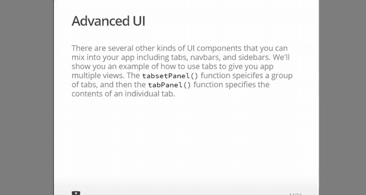
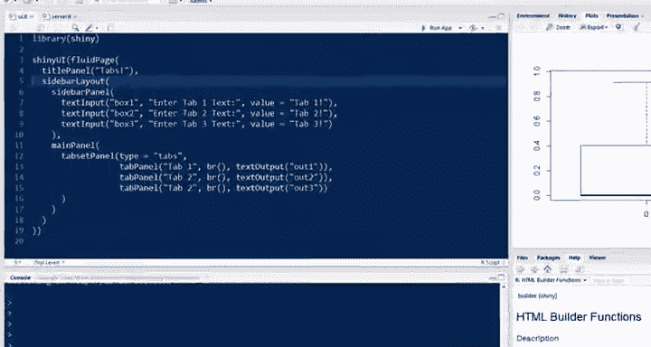
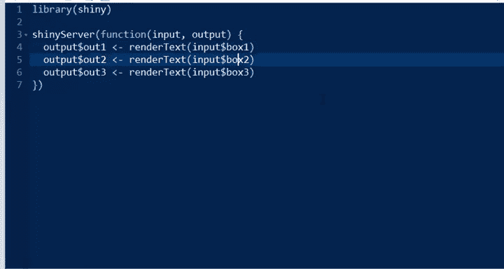
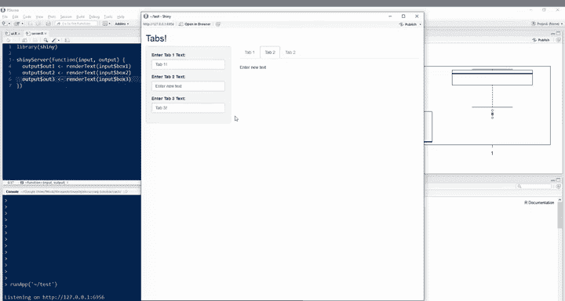

# 课程 P117：Shiny 用户界面进阶 🎨

在本节课中，我们将学习如何调整和定制 Shiny 应用程序的用户界面。我们将探索两种不同的布局方式，并了解其背后的代码模式，以便你能够根据自己的需求进行灵活定制。

---



上一节我们介绍了 Shiny 的基本结构，本节中我们来看看如何通过修改 UI 来创建更复杂的布局，例如带有标签页的界面。

首先，我们从一个带有侧边栏的默认主题开始。以下是创建一个包含标签页的 UI 的代码示例。请注意，我们可以在单个面板内使用标签页，也可以将其与侧边栏布局结合。

```r
# 加载 shiny 库
library(shiny)



# 定义用户界面
ui <- fluidPage(
  sidebarLayout(
    # 侧边栏面板，用于放置输入控件
    sidebarPanel(
      textInput("box1", "Enter tab 1 text", "tab1"),
      textInput("box2", "Enter tab 2 text", "tab2"),
      textInput("box3", "Enter tab 3 text", "tab3")
    ),
    # 主面板，包含一个标签页集合
    mainPanel(
      tabsetPanel(
        type = "tabs",
        tabPanel("Tab1", br(), textOutput("out1")),
        tabPanel("Tab2", br(), textOutput("out2")),
        tabPanel("Tab3", br(), textOutput("out3"))
      )
    )
  )
)
```

在上述代码中，`sidebarPanel` 包含了三个文本输入框，每个都有对应的标签和初始值。`mainPanel` 内部嵌套了一个 `tabsetPanel`，它包含了三个 `tabPanel`。每个标签页都通过 `textOutput` 函数指定了要显示的服务器输出内容。

---

接下来，我们看看与之对应的服务器逻辑。服务器函数非常简单，它的作用是将用户在输入框中输入的内容原样显示在对应的标签页中。

```r
# 定义服务器逻辑
server <- function(input, output) {
  output$out1 <- renderText({
    input$box1
  })
  output$out2 <- renderText({
    input$box2
  })
  output$out3 <- renderText({
    input$box3
  })
}

# 运行应用
shinyApp(ui = ui, server = server)
```

服务器端代码创建了三个输出（`out1`、`out2`、`out3`），每个都使用 `renderText` 来渲染对应输入框（`box1`、`box2`、`box3`）中的文本。

---



运行此应用程序后，你会看到一个带有三个输入框的侧边栏和三个标签页的主面板。在输入框中输入文本并切换标签页，对应的文本会显示在相应的标签页中。

以下是使用此界面时需要注意的几个关键点：

*   **代码结构**：Shiny 的 UI 语法允许嵌套结构，例如在 `mainPanel` 中嵌套 `tabsetPanel`。理解这种层级关系对于构建复杂界面至关重要。
*   **语法细节**：编写 UI 代码时，确保所有括号都已正确闭合，并且所有必要的逗号都已添加。这是避免错误的关键。
*   **开发环境**：在 RStudio 这样的集成开发环境中编写代码，可以利用其语法高亮和错误提示功能，这能极大地帮助发现和纠正代码中的问题。

---

本节课中我们一起学习了如何为 Shiny 应用程序创建带有标签页的用户界面。我们分析了 UI 和服务器端的代码结构，并强调了编写正确语法的重要性。你的课后练习是尝试开发一个属于自己的标签式 Shiny 用户界面。



在接下来的课程中，我们将对 Shiny 进行一些最后的总结和讨论。