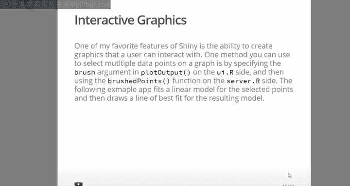
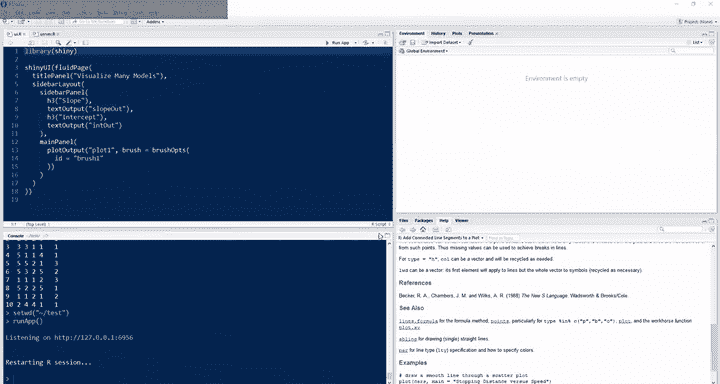
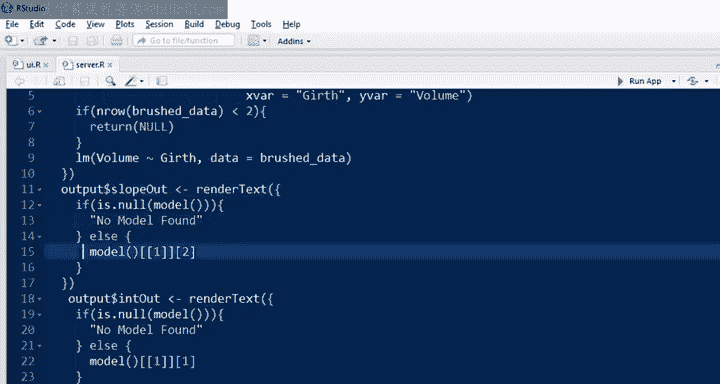
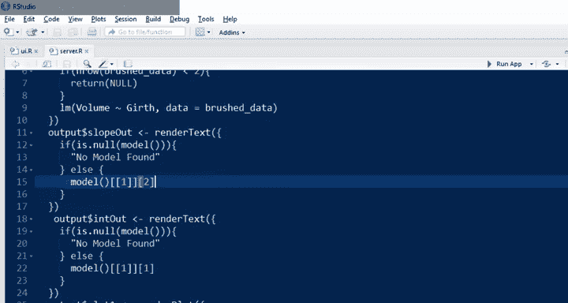
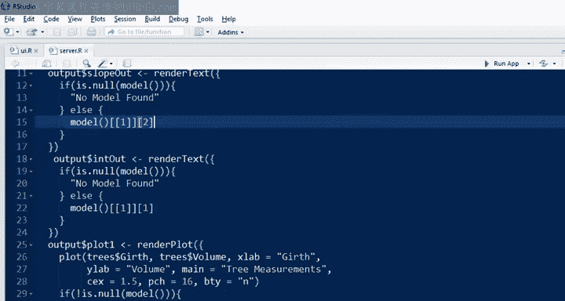
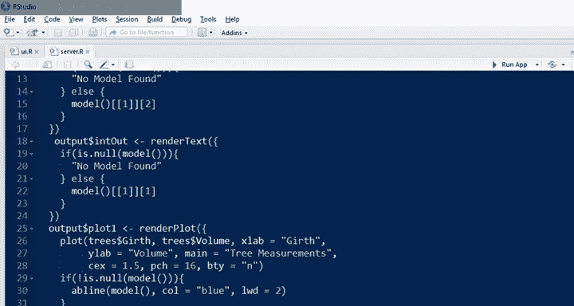
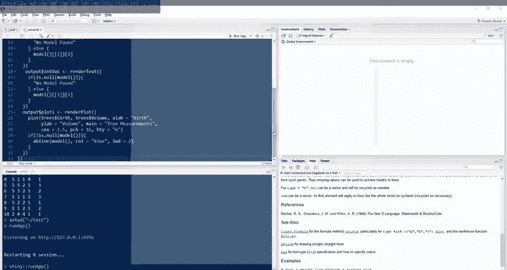
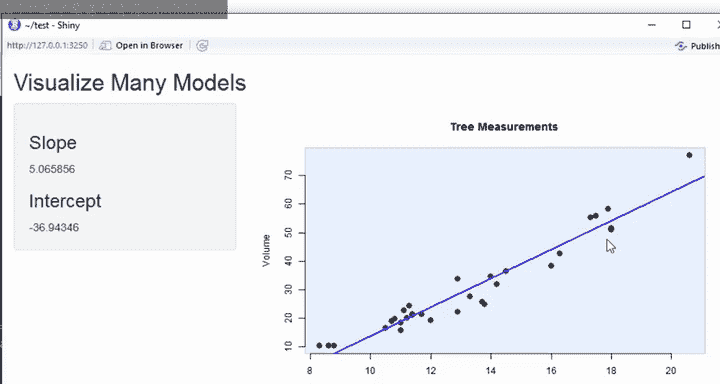

# 课程名称：约翰霍普金斯大学《数据科学：统计和机器学习》 - P119：11_Shiny 2 6 🎨📊

在本节课中，我们将要学习如何使用Shiny的`brush`和`brushPoints`参数来创建一个交互式图形应用。这个应用允许用户通过鼠标框选散点图中的数据点，并实时显示仅基于这些被选中点的线性拟合线及其斜率和截距。

---

## 概述

上一节我们介绍了Shiny应用的基本结构。本节中我们来看看如何利用`brush`功能实现用户与图形的动态交互。这是一个展示Shiny核心优势的绝佳例子，尤其对于数据分析师而言，交互式图形是Shiny的一个关键功能。



## 用户界面（UI）设计



以下是UI部分的关键组件。UI负责定义应用的布局和输入输出元素。

*   `sidebarLayout`: 创建侧边栏布局。
*   `sidebarPanel`: 侧边栏面板，用于放置输出控件。
    *   `textOutput(“slopeOut”)`: 显示模型斜率的文本输出区域。
    *   `textOutput(“intOut”)`: 显示模型截距的文本输出区域。
*   `mainPanel`: 主面板，用于放置图形。
    *   `plotOutput(“plot1”, brush = “brush1”)`: 这是核心。`plotOutput`渲染名为`plot1`的图形，`brush = “brush1”`参数启用了框选功能，并将框选事件命名为`brush1`，以便在服务器端调用。

## 服务器端（Server）逻辑

服务器端负责处理数据、执行计算并响应UI的输入。以下是其工作原理。

首先，`shinyServer`函数接收`input`和`output`参数。

我们创建一个**反应式表达式** `model`。这意味着当用户通过UI（例如框选数据）改变输入时，这个模型会自动重新计算。

```r
model <- reactive({
    brushData <- brushedPoints(trees, input$brush1, xvar = “Girth”, yvar = “Volume”)
    if (is.null(brushData) || nrow(brushData) < 2) return(NULL)
    lm(Volume ~ Girth, data = brushData)
})
```

*   `brushedPoints(trees, input$brush1, …)`: 此函数从`trees`数据集中，根据UI中名为`brush1`的框选动作，提取被选中的数据点。
*   `if (is.null(…) || nrow(…) < 2)`: 这是一个条件判断。如果框选数据为空或少于2个点（无法拟合直线），则返回`NULL`。
*   `lm(Volume ~ Girth, data = brushData)`: 如果数据足够，则使用`lm`函数，以`Girth`为自变量（X），`Volume`为因变量（Y），在框选数据`brushData`上拟合一个线性模型。

接下来，我们定义输出。

`output$slopeOut`和`output$intOut`分别用于渲染斜率和截距的文本。

```r
output$slopeOut <- renderText({
    if (is.null(model())) return(“No model found”)
    model()$coefficients[[“Girth”]]
})
output$intOut <- renderText({
    if (is.null(model())) return(“No model found”)
    model()$coefficients[[“(Intercept)”]]
})
```



*   `renderText({…})`: 告诉Shiny这是一个需要动态渲染的文本块。
*   `if (is.null(model()))`: 检查模型是否存在。如果模型为`NULL`（例如未框选或框选点不足），则显示“No model found”。
*   `model()$coefficients[[“Girth”]]`: 如果模型存在，则从模型系数中提取名为`Girth`的项（即斜率）。注意`model()`的调用方式，因为它是一个反应式表达式。

最后，我们定义图形输出`output$plot1`。



```r
output$plot1 <- renderPlot({
    plot(trees$Girth, trees$Volume, xlab = “Girth”, ylab = “Volume”, main = “Tree Measurements”)
    if (!is.null(model())) {
        abline(model(), col = “blue”, lwd = 2)
    }
})
```



*   `renderPlot({…})`: 告诉Shiny这是一个需要动态渲染的图形。
*   `plot(…)`: 绘制`trees`数据集的完整散点图。
*   `if (!is.null(model())) { abline(…) }`: 如果模型存在（即用户已框选有效数据点），则使用`abline`函数在图上添加一条基于该模型的蓝色拟合线。公式可以表示为：**`Volume = Intercept + Slope * Girth`**。

## 运行与交互

运行此应用后，初始状态如下图所示，因为没有框选任何数据点，所以斜率和截距显示为“No model found”。






当用户用鼠标在散点图上框选一组数据点时（例如下图中高亮的点），应用会立即响应。


它会执行以下操作：
1.  提取被框选的点。
2.  用这些点拟合一个新的线性模型。
3.  在主图中绘制一条蓝色的拟合线。
4.  在侧边栏更新显示该模型的**斜率**和**截距**。

用户可以尝试框选不同的数据子集（如边缘的点、中心的点或几乎所有点），每次框选都会触发一次模型重拟合和图形更新，从而直观地观察不同数据子集对模型参数的影响。



## 总结

本节课中我们一起学习了如何构建一个利用Shiny`brush`功能的交互式图形应用。我们掌握了以下核心步骤：
1.  在UI中使用`plotOutput(…, brush = “id”)`启用图形框选功能。
2.  在Server中使用`brushedPoints()`函数获取被框选的数据。
3.  使用**反应式表达式**`reactive({})`来创建依赖于用户输入的动态模型。
4.  使用`renderText`和`renderPlot`将计算结果和图形动态更新到UI界面。


这个例子充分展示了Shiny在创建交互式数据分析工具方面的强大能力。希望你能够尝试复现这个例子，并探索使用其他数据集（如`mtcars`）创建你自己的交互式图形。掌握这些基础后，你已具备将Shiny融入自己数据分析工作流的能力，未来还可以探索更高级的功能，如在Shiny中嵌入表格或3D图形。