# 课程11：变异性介绍 📊

在本节课中，我们将要学习统计学中的一个核心概念——变异性。我们将探讨如何量化数据分布的“胖瘦”或“集中程度”，理解总体方差与样本方差的定义与计算，并通过掷骰子和抛硬币的例子来具体应用这些概念。

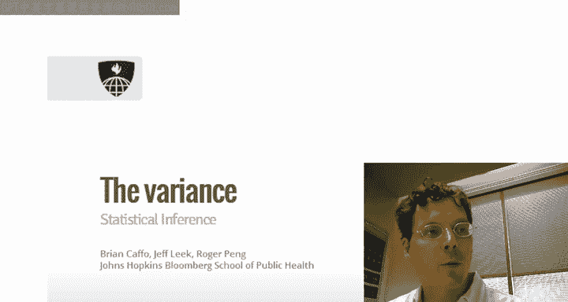

上一节我们介绍了总体均值，它描述了分布的中心位置。本节中我们来看看分布的另一个重要特性：变异性。

## 什么是方差？🤔

如果随机变量 **X** 的均值为 **μ**，那么方差就是该随机变量与其均值之间**平方距离的期望值**。

其公式为：
**Var(X) = E[(X - μ)²]**

一个实用的快捷计算公式是：
**Var(X) = E[X²] - (E[X])²**

方差越大，密度函数围绕均值分布得越“宽”或越“分散”；方差越小，则分布越“瘦”或越“集中”。方差的平方根称为**标准差**，其单位与原始数据 **X** 一致，这在实际应用中非常有用。

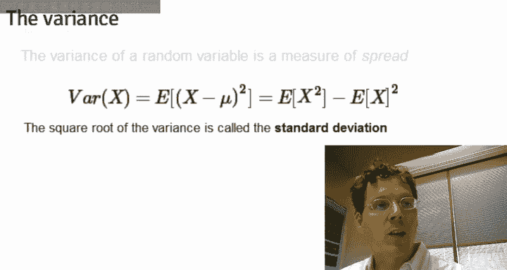

## 计算示例：掷骰子 🎲

回忆上一讲的内容，掷一次公平骰子结果的期望值 **E[X] = 3.5**。

以下是计算其方差 **E[X²]** 的步骤：
1.  计算每个可能结果（1到6）的平方。
2.  将每个平方值乘以其对应的概率（均为1/6）。
3.  将这些乘积相加。

通过计算可得 **E[X²] = 15.17**。

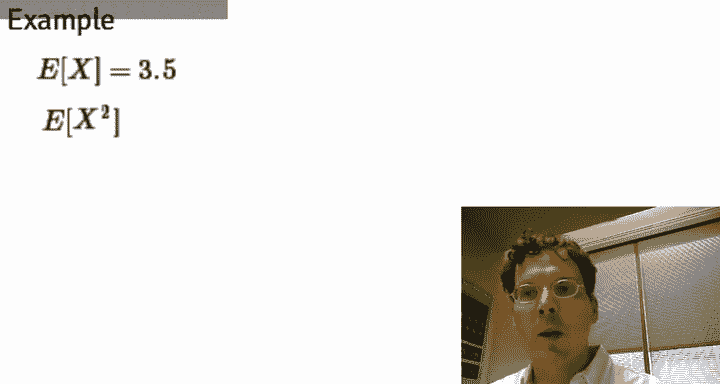

因此，方差为：
**Var(X) = E[X²] - (E[X])² = 15.17 - (3.5)² = 2.92**

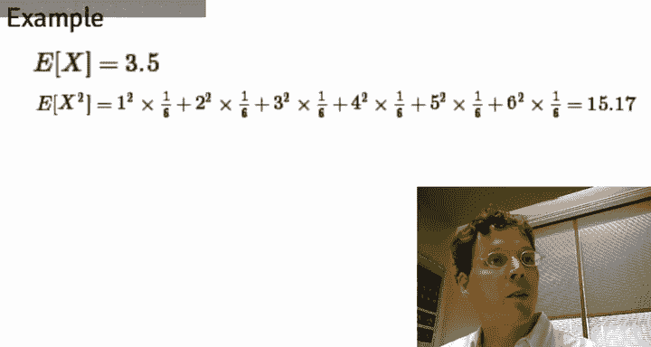

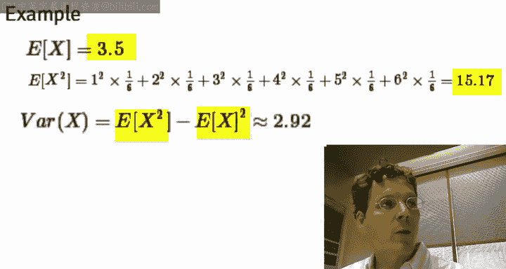

## 计算示例：抛硬币 🪙

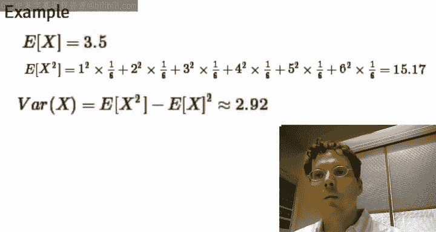

让我们看另一个例子。考虑一次抛硬币实验，正面（记为1）的概率为 **p**，反面（记为0）的概率为 **1-p**。

我们已经知道 **E[X] = p**。

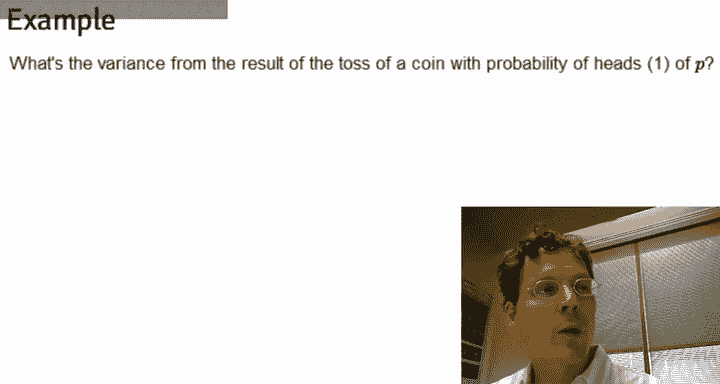

接下来计算 **E[X²]**：
*   0² = 0
*   1² = 1

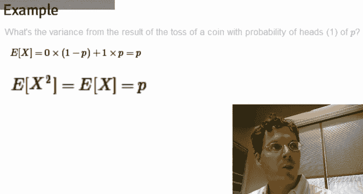

所以，**E[X²] = p**。

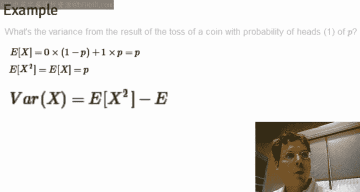

代入方差公式：
**Var(X) = E[X²] - (E[X])² = p - p² = p(1 - p)**

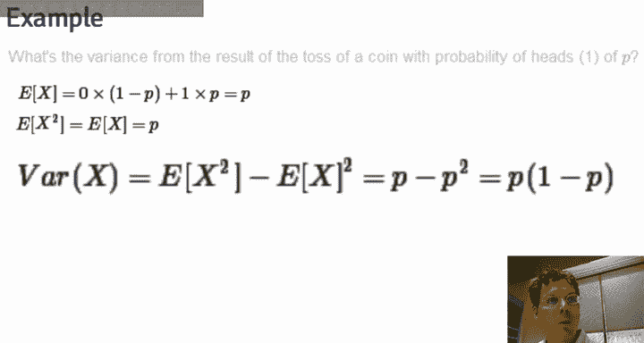

这是一个非常重要的公式，建议牢记。

## 方差如何影响分布？📈

不同的方差会显著改变概率密度函数的形状。

以正态分布为例：
*   方差为1（如标准正态分布）时，曲线呈典型的钟形。
*   方差增大时，曲线会被“压扁”，并向两侧尾部延伸更多质量。
*   这意味着，来自大方差分布的个体，其取值远离均值（例如，距离均值5个单位以上）的可能性，要高于来自小方差分布的个体。

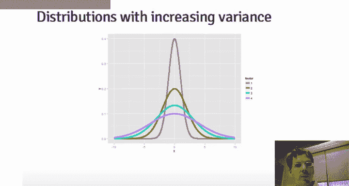

## 从总体到样本 🔄

与总体均值和样本均值的类比关系类似，总体方差和样本方差也是直接对应的。

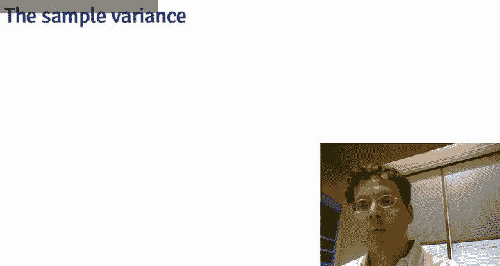

*   **总体方差**：衡量随机变量围绕总体均值的期望平方距离。
*   **样本方差**：衡量观测数据点围绕样本均值的平均平方距离。

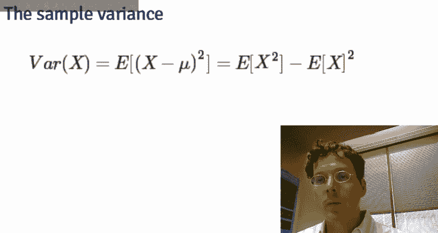

样本方差的计算公式为：
**s² = (1/(n-1)) * Σ (x_i - x̄)²**

请注意，分母是 **n-1** 而非 **n**，这被称为“贝塞尔校正”，目的是使样本方差成为总体方差的无偏估计量。

此外，样本方差本身是基于数据计算得到的，因此它也是一个随机变量，拥有自己的抽样分布。这个分布的期望值正是它试图估计的总体方差。随着收集的数据越来越多，样本方差的分布会越来越集中在总体方差周围。

最后，样本方差的平方根就是**样本标准差**。

---

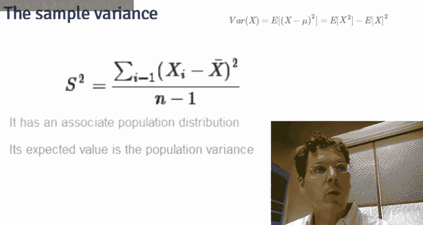

**本节课总结**：我们一起学习了变异性的概念。我们定义了总体方差和样本方差，掌握了它们的计算公式，并通过掷骰子和抛硬币的例子进行了实践。我们了解到方差描述了数据分布的离散程度，方差越大，数据越分散。同时，我们也明确了总体参数与样本统计量之间的对应关系。