# 课程 P122：14_Shiny Gadgets 1 3 📊

在本节课中，我们将学习如何使用 Shiny Gadgets 创建一个交互式绘图工具。我们将通过一个具体示例，展示如何绘制数据集并允许用户通过鼠标拖拽矩形框选数据点，最终输出所选区域对应的数据子集。本教程假设您已具备基础的 Shiny 知识，我们将重点介绍 Shiny Gadgets 特有的语法和功能。

---

## 概述

Shiny Gadgets 最实用的功能之一是创建交互式绘图。我们将利用 `trees` 数据集，绘制树木的胸径（Girth）与体积（Volume）的关系图，并实现一个矩形选择工具。用户框选后，程序将输出所选区域对应的数据行。

## 构建 Shiny Gadget 函数

Shiny Gadget 本质上是一个函数。首先，我们需要加载必要的库并定义用户界面（UI）和服务器逻辑。

### 加载库与定义 UI

以下是加载库和定义 UI 部分的代码：

```r
library(shiny)
library(miniUI)

ptrees <- function() {
  ui <- miniPage(
    gadgetTitleBar("Select points by dragging your mouse"),
    miniContentPanel(
      plotOutput("plot", height = "100%", brush = "brush")
    )
  )
```

在 UI 部分，我们使用 `miniPage` 创建页面布局，`gadgetTitleBar` 设置标题，`miniContentPanel` 容纳主要内容。`plotOutput` 用于显示绘图，我们将其命名为 `"plot"`，并设置高度为 100% 以充分利用空间。`brush = "brush"` 参数启用了刷选工具，用于在图上选择矩形区域。

### 定义服务器逻辑

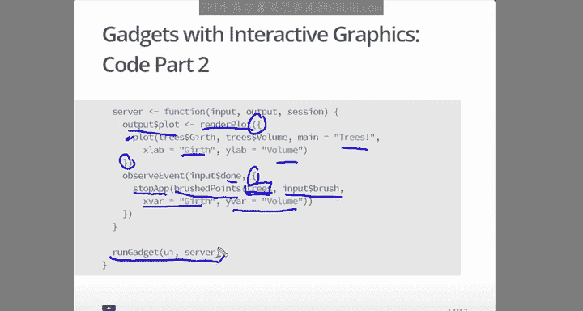

接下来，我们定义服务器逻辑，处理绘图渲染和刷选事件。

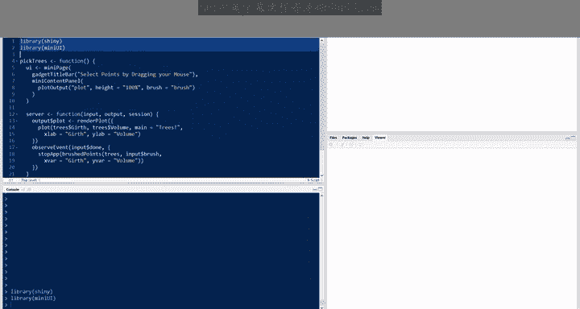

```r
  server <- function(input, output, session) {
    output$plot <- renderPlot({
      plot(trees$Girth, trees$Volume,
           main = "Trees",
           xlab = "Girth",
           ylab = "Volume")
    })

    observeEvent(input$done, {
      stopApp(brushedPoints(trees, input$brush,
                            xvar = "Girth",
                            yvar = "Volume"))
    })
  }

  runGadget(ui, server)
}
```

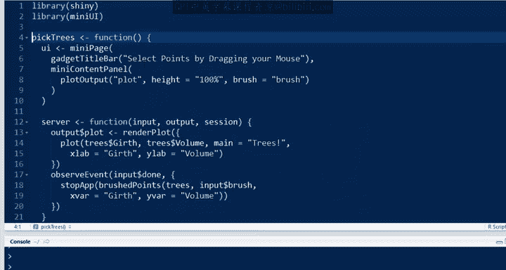

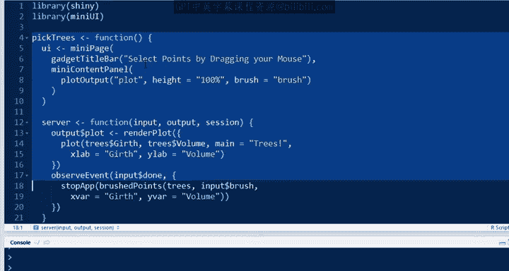

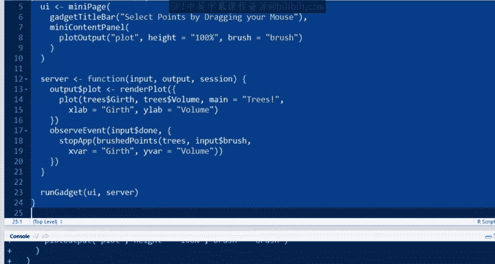

在服务器函数中，`output$plot` 使用 `renderPlot` 渲染 `trees` 数据集的散点图。`observeEvent` 监听 `input$done` 事件（当用户点击“完成”时触发）。事件触发后，`stopApp` 函数会停止应用并返回 `brushedPoints` 函数的结果。`brushedPoints` 根据刷选区域（`input$brush`）和指定的 X、Y 变量（`xvar = "Girth"`, `yvar = "Volume"`）从原始数据集中提取对应的数据点。

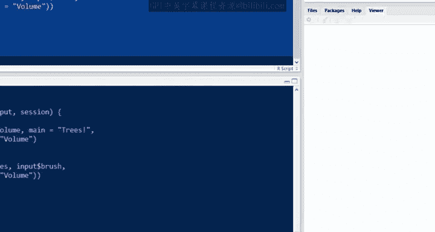

## 运行与测试应用

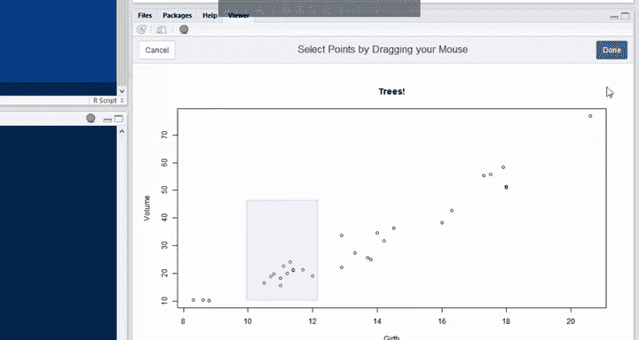

定义好函数后，我们可以运行它来测试交互式绘图功能。

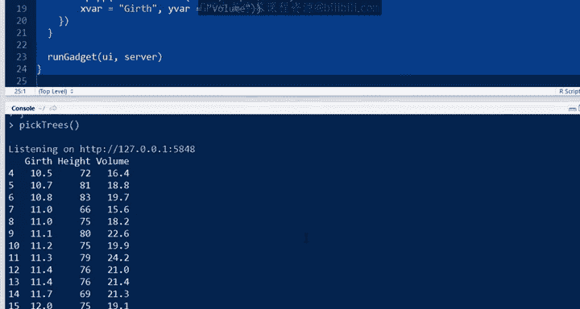

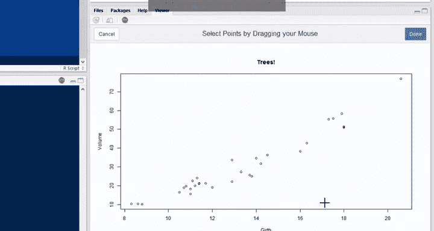

运行 `ptrees()` 函数，会启动一个 Shiny Gadget 窗口，显示 `trees` 数据集的散点图。

在绘图区域，您可以按住鼠标左键并拖拽来绘制一个矩形选择框。框选后，可以移动或调整这个矩形。点击“Done”按钮后，应用将关闭，并在 R 控制台中返回所选数据点构成的数据框。

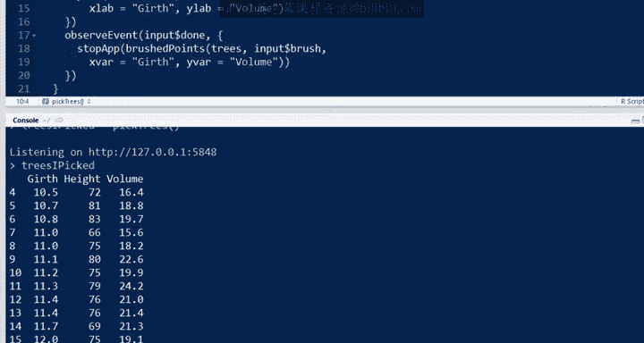

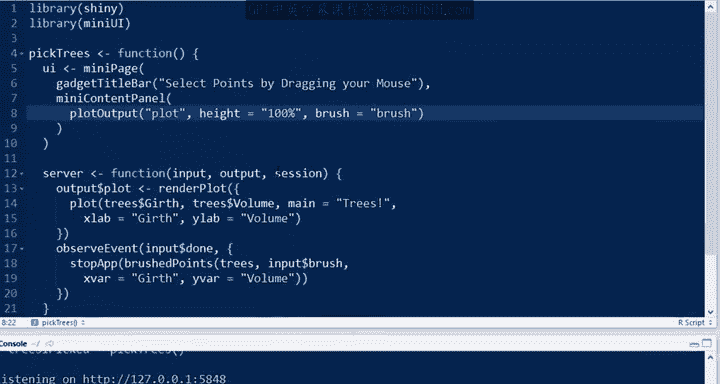

例如，您可以将输出赋值给一个变量：
```r
selected_trees <- ptrees()
```
之后，您可以查看 `selected_trees` 的内容，其中包含了所选数据点的原始行信息，便于您追溯和分析。

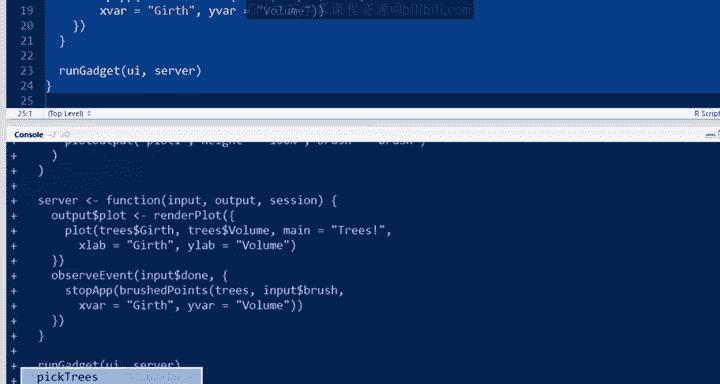

## 关键概念与注意事项

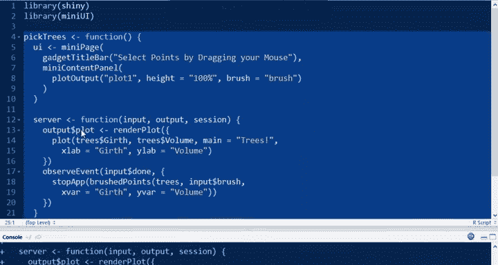

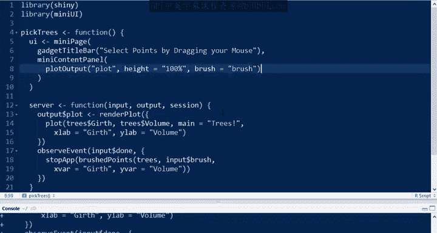

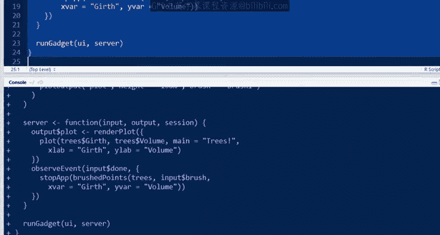

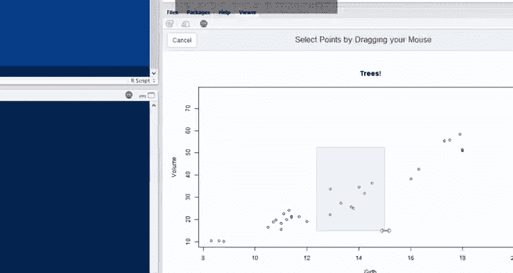

以下是构建此类应用时需要注意的几个关键点：

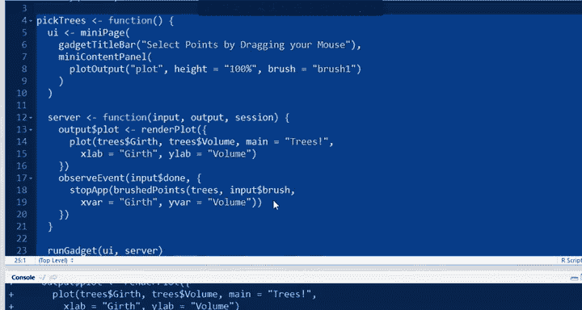

*   **命名一致性**：UI 中定义的输出（如 `plotOutput("plot", ...)`）和输入（如 `brush = "brush"`）名称，必须与服务器逻辑中引用的名称（`output$plot`、`input$brush`）完全一致。如果名称不匹配，功能将无法正常工作。
*   **数据变量名**：在 `brushedPoints` 函数中，`xvar` 和 `yvar` 参数必须与数据框中用于绘图的列名精确匹配（本例中为 `"Girth"` 和 `"Volume"`）。
*   **`renderPlot` 语法**：在 `renderPlot({ ... })` 中，花括号 `{}` 是必需的，它包裹了生成绘图的实际代码。

## 总结

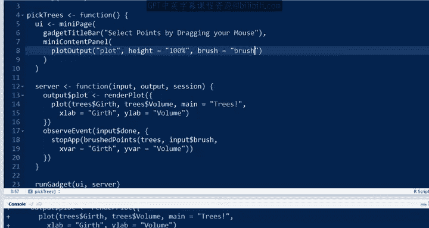

本节课中，我们一起学习了如何构建一个基础的 Shiny Gadget 来创建交互式绘图。我们实现了通过鼠标刷选数据点并提取对应数据子集的功能。掌握 Shiny Gadgets 对于创建交互式图形尤其有价值，它能显著增强数据探索和分析的体验。希望您能以此示例为基础，结合已有的 Shiny 知识，构建出满足自己需求的交互式工具。