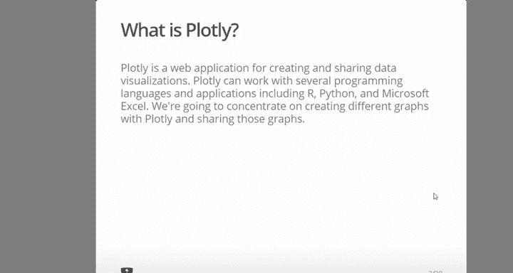
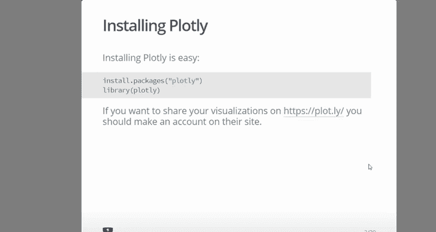
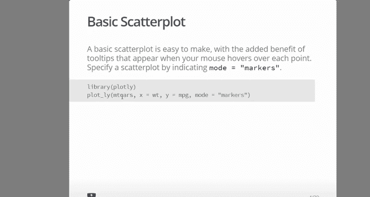
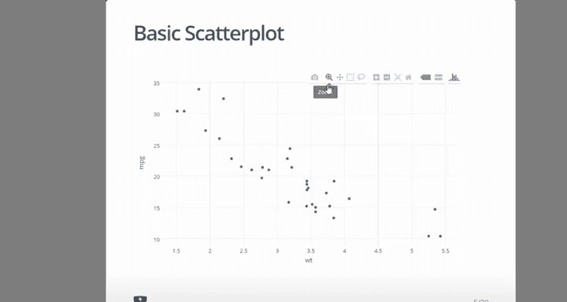
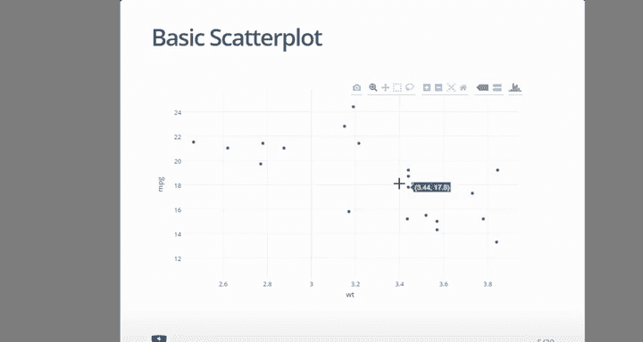

# 课程 P125：Plotly 入门教程 📊

在本节课中，我们将学习如何使用 Plotly 库在 R 语言中创建交互式网络图形。Plotly 是一个功能强大的工具，支持多种编程语言，并能轻松集成到网页中。

---

## 什么是 Plotly？🤔

Plotly 是一个用于创建和分享可视化作品的网络应用程序。它支持多种语言，包括 Matlab、Python 和 Javascript。此外，Plotly 还提供了一个网络界面，允许用户通过上传 CSV 文件等方式，以点击操作的方式创建图表。

在 R 语言中，Plotly 的使用非常简单，尤其是在 RStudio 环境中。接下来，我们将介绍如何安装和启动 Plotly。

---

## 安装与启动 Plotly ⚙️

安装 Plotly 的方法与安装其他 R 包类似。以下是安装和加载 Plotly 的代码：


```r
install.packages("plotly")
library(plotly)
```



安装完成后，您可以通过 `library(plotly)` 或 `require(plotly)` 加载该库。

---

## Plotly 的基本用法 🛠️

在 R 中，使用 Plotly 创建图表非常简单。例如，我们可以使用 `plot_ly` 函数创建一个基本的散点图。以下是使用 `mtcars` 数据集创建图表的示例：

```r
plot_ly(mtcars, x = ~wt, y = ~mpg, type = "scatter", mode = "markers")
```

这段代码会生成一个交互式散点图，用户可以通过鼠标进行缩放、平移等操作。

---

## 嵌入 Plotly 图表到文档中 📄

Plotly 图表可以轻松嵌入到 R Markdown 文档中，并生成 HTML 格式的输出。这样，您可以在文档中直接展示交互式图表，而无需依赖静态图片。以下是一个简单的示例：

```r
plot_ly(mtcars, x = ~wt, y = ~mpg, type = "scatter", mode = "markers")
```

通过将这段代码嵌入到 R Markdown 文档中，生成的 HTML 文件将包含一个可交互的图表。

---

## Plotly 的网络界面 🌐

除了在 R 中使用代码创建图表外，Plotly 还提供了一个功能丰富的网络界面。在这个界面中，您可以：

- 上传 CSV 文件并创建图表。
- 通过点击操作调整坐标轴标签。
- 分享图表到 Plotly 平台或导出为 HTML 文件。

网络界面的优势在于，它允许用户在不编写代码的情况下快速创建和调整图表。

---

## 分享 Plotly 图表 📤

Plotly 提供了多种分享图表的方式：

1. **通过 Plotly 平台分享**：您可以将图表上传到 Plotly 平台，并生成一个可分享的链接。Plotly 提供免费和付费选项，付费选项支持私有图表和用户认证等功能。
2. **导出为 HTML 文件**：您可以将图表导出为独立的 HTML 文件，并将其嵌入到自己的网页中，无需依赖 Plotly 平台。



无论选择哪种方式，Plotly 都能帮助您轻松分享和展示可视化作品。





---

## 总结 🎯

在本节课中，我们一起学习了 Plotly 的基本用法，包括安装、创建图表、嵌入到文档中以及分享图表。Plotly 是一个功能强大且易于使用的工具，特别适合在 R 语言中创建交互式网络图形。通过 Plotly，您可以轻松地将数据可视化并分享给他人。



希望本节课的内容对您有所帮助！接下来，您可以尝试使用 Plotly 创建自己的图表，并探索其更多高级功能。