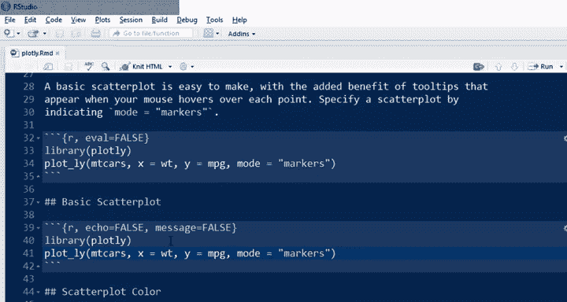
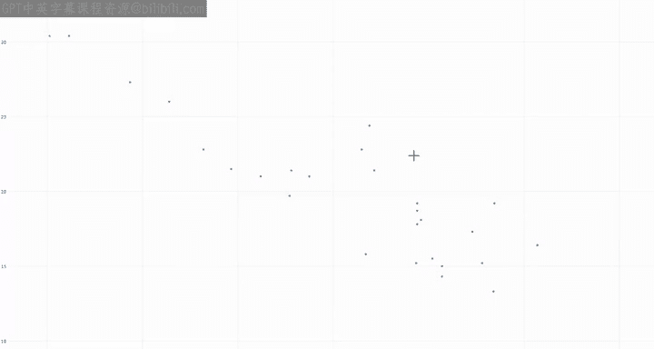
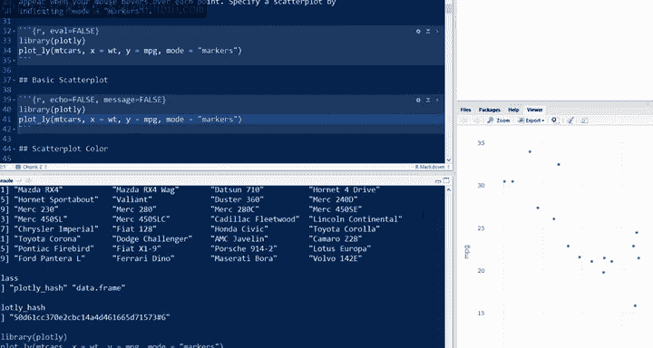

# 课程 P126：18_Plotly 1 2 📊

在本节课中，我们将学习如何使用 R 语言中的 `plotly` 包创建交互式散点图，并将其导出为网页或图片格式。

## 概述

我们将从加载 `plotly` 库开始，使用内置数据集 `mtcars` 创建一个基础的交互式散点图。之后，我们会探索如何将生成的图表保存为网页或图片文件，并简要介绍发布功能。

## 加载库与创建散点图

首先，确保已安装 `plotly` 库，然后在 R Markdown 文档中加载它。

```r
library(plotly)
```



接下来，使用 `plot_ly` 函数创建散点图。我们以 `mtcars` 数据集为例，将车重（`wt`）作为 X 轴，每加仑英里数（`mpg`）作为 Y 轴，并设置模式为标记点（`markers`）。

```r
plot_ly(mtcars, x = ~wt, y = ~mpg, mode = "markers")
```

这段代码将为任何数据框生成一个散点图。图表将显示在 RStudio 的查看器面板中，并且是交互式的。


## 交互功能与控件

当您将鼠标悬停在图表上的数据点时，会显示其对应的 X 和 Y 值。图表上方提供了一系列控件，包括：
*   将图表下载为 PNG 图片。
*   重新缩放图表。
*   重置坐标轴。
*   更改悬停提示信息的行为。
*   使用发布按钮，可以将图表发布到 RPubs 以生成网络图形。

## 导出与发布图表

除了发布到 RPubs，一个简单的方法是直接通过“导出”功能保存图表。

点击“导出”后，您可以选择：
*   将图表保存为图片。
*   复制到剪贴板。
*   保存为网页。

例如，选择“保存为网页”，将其命名为 `test.html`。这将在您的电脑上生成一个 HTML 文件，其中包含了图表的交互式版本。如果您了解 JavaScript，可以查看和修改其中的代码；如果不了解，也可以直接提取所需部分进行嵌入。




## 实践任务

以下是您的第一个实践任务，请尝试完成：
1.  使用不同的数据集创建一个简单的散点图。
2.  将图表保存为网页（HTML 文件）。
3.  将图表导出为 PNG 和 PDF 格式的图片。
4.  尝试将其发布到 RPubs。


完成这些步骤后，我们将继续学习更多 `plotly` 的示例。




## 总结


本节课中，我们一起学习了如何使用 R 的 `plotly` 包创建交互式散点图。我们掌握了基本的绘图命令、图表的交互功能，以及如何将图表导出为多种格式（如网页、PNG、PDF）并进行发布。这些是进行数据可视化展示的基础技能。