# 课程 P127：Plotly 散点图基础教程 📊

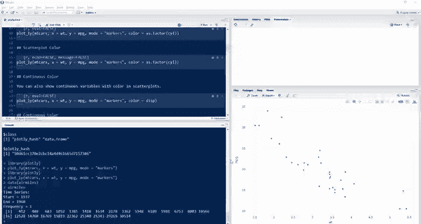

在本节课中，我们将学习如何使用 Plotly 库创建和定制散点图。散点图是数据可视化中最常见的图表类型之一，能够直观地展示两个或多个变量之间的关系。我们将从基本的二维散点图开始，逐步介绍如何通过颜色、大小等属性添加更多数据维度，最后还会学习如何创建交互式的三维散点图。

---

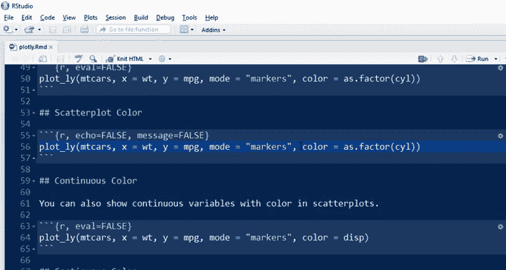

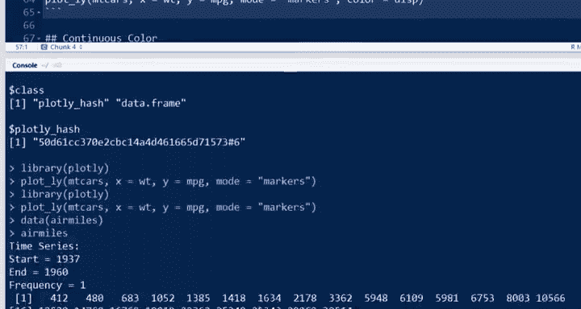

## 1. 为散点添加颜色维度 🎨

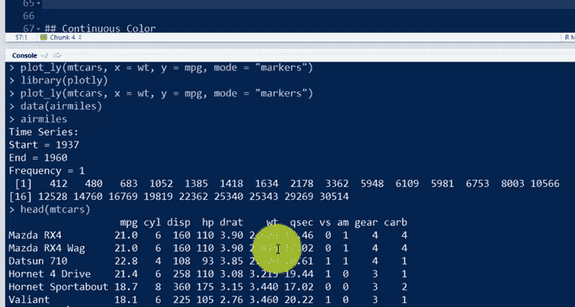

上一节我们介绍了散点图的基本概念，本节中我们来看看如何通过颜色为散点图添加一个新的数据维度。

在 `mtcars` 数据集中，`cyl`（气缸数）变量是一个分类变量，它可能影响每加仑英里数（`mpg`）。我们可以通过颜色来区分不同气缸数的汽车。

以下是具体步骤：
1.  使用 `as.factor()` 函数将数值型的 `cyl` 变量转换为因子变量。
2.  在 `plot_ly()` 函数中，通过 `color = ~as.factor(cyl)` 参数将颜色映射到气缸数。

运行代码后，图表中的点会根据气缸数显示不同颜色，并自动生成图例（8，6，4）。

---

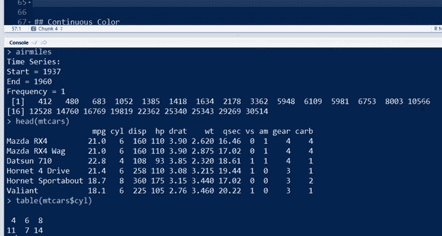

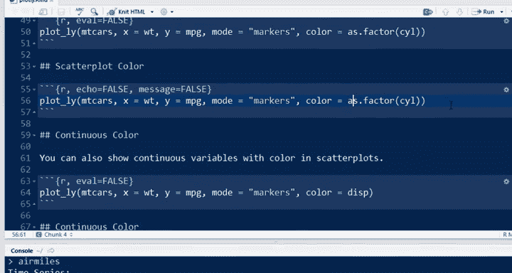

## 2. 使用连续变量映射颜色 🌈

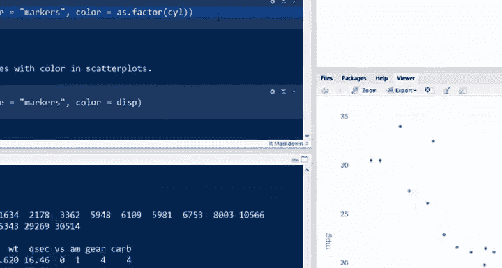

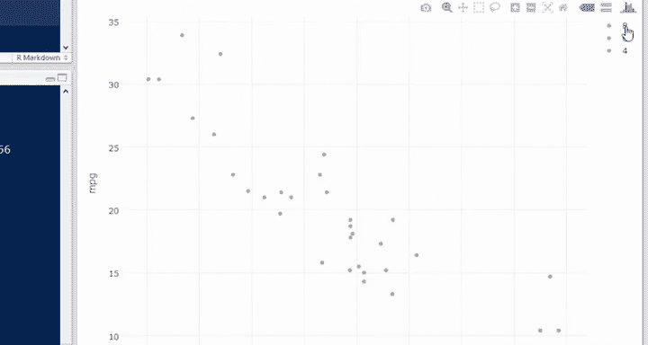

除了分类变量，我们还可以使用连续变量来映射颜色，为图表增加另一个连续维度。

在 `mtcars` 数据集中，`disp`（排量）是一个连续变量。Plotly 能够智能地识别出这是一个连续变量，并自动使用连续的色彩梯度来表示它。

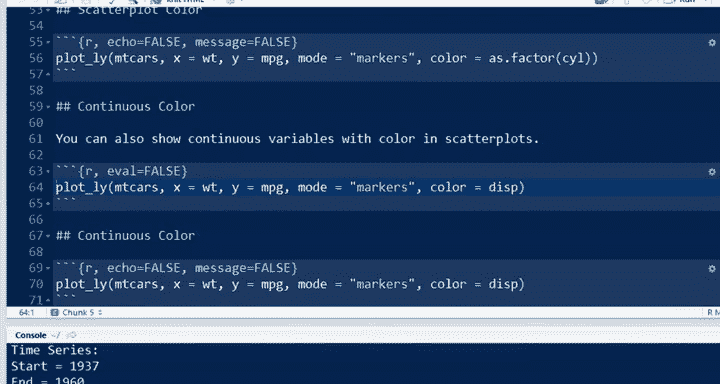

以下是具体操作：
*   在 `plot_ly()` 函数中，设置 `color = ~disp`。
*   Plotly 会自动生成一个连续的色彩梯度，并在图表侧面显示对应的颜色标尺。

这样，我们就在二维散点图的基础上，通过颜色直观地展示了第三个连续变量（排量）的信息。

---

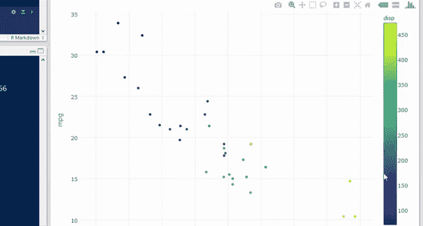

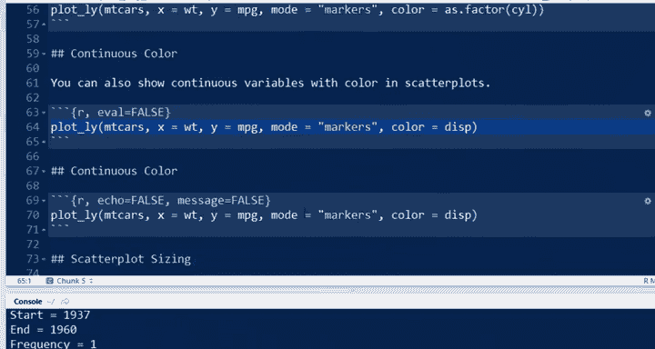

## 3. 调整散点的大小 📏

有时图表中的点可能太小，尤其是在输出为 HTML 文件时不易看清。我们可以调整点的大小，并利用这个属性来编码另一个数据维度。

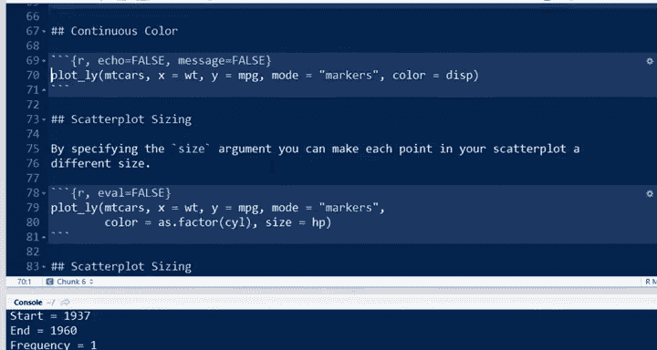

在本例中，我们将使用 `hp`（马力）这个连续变量来控制点的大小。

以下是实现方法：
*   在 `plot_ly()` 函数中，添加 `size = ~hp` 参数。
*   每个数据点的大小将与其马力值成正比。

现在，这个散点图同时展示了四个维度的信息：
*   **X轴**：车重（`wt`）
*   **Y轴**：每加仑英里数（`mpg`）
*   **颜色**：气缸数（`cyl`）
*   **大小**：马力（`hp`）

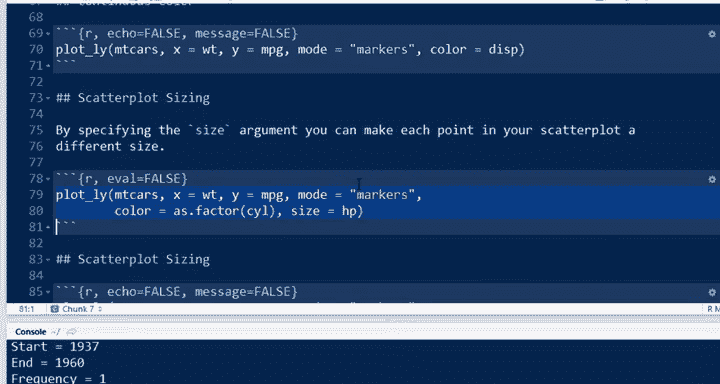

通过结合位置、颜色和大小，我们有效地在二维平面上呈现了多维数据。

---

## 4. 创建三维散点图 🚀

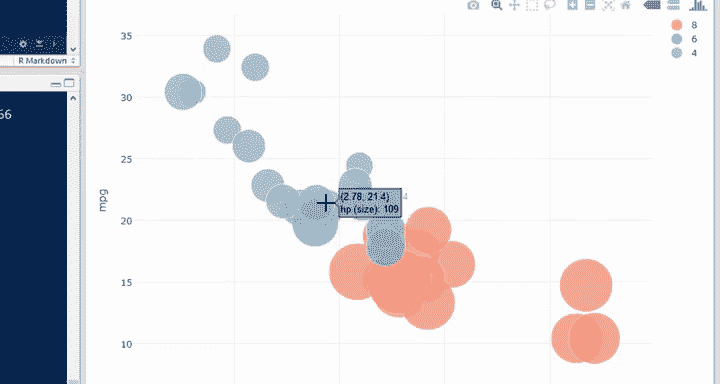

当我们需要同时展示三个连续变量的关系时，二维散点图就显得力不从心了。这时，可以创建三维散点图。

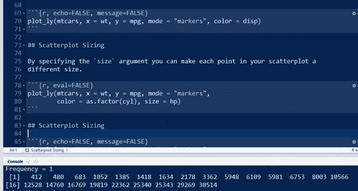

Plotly 利用 WebGL（一种基于网页的 OpenGL 图形库移植）技术，能够创建嵌入网页的交互式 3D 图形。

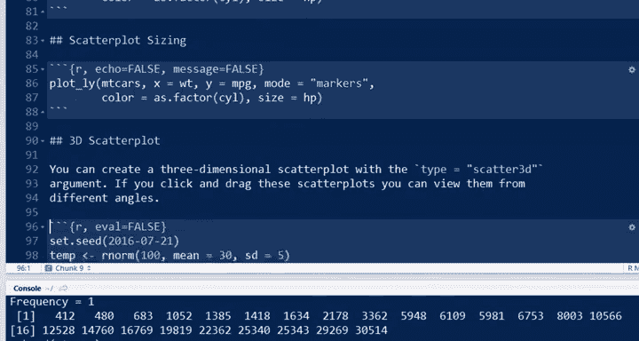

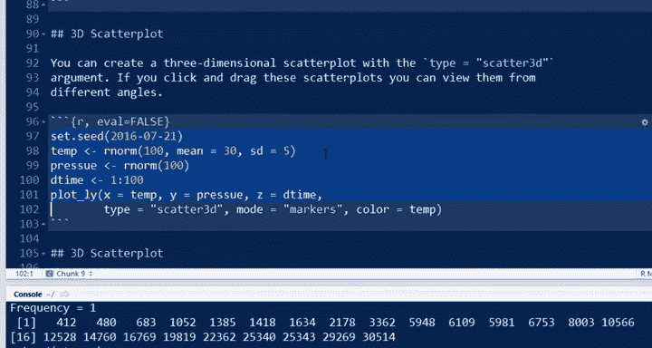

以下是创建一个三维散点图的步骤：
1.  准备三个变量作为 X、Y、Z 轴的数据。例如，我们创建了三个虚构变量：`temp`（温度）、`pressure`（压力）和 `dtime`（时间）。
2.  使用 `plot_ly()` 函数，并指定 `type = ‘scatter3d‘` 和 `mode = ‘markers‘`。
3.  通过 `x`、`y`、`z` 参数分别指定三个轴的变量，例如：`x = ~temp, y = ~pressure, z = ~dtime`。
4.  同样，可以使用 `color` 参数为点添加颜色梯度，例如 `color = ~temp`。

生成的图表是完全交互式的，你可以旋转、缩放，从不同角度观察数据分布。当输出为网页时，这些交互功能会完全保留。

---

## 5. 课后练习与总结 🏁

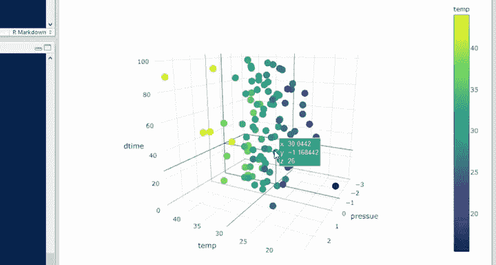

本节课中我们一起学习了 Plotly 散点图的核心功能。我们掌握了如何创建二维散点图，并通过**颜色**和**大小**属性来编码额外的数据维度。公式可以概括为：

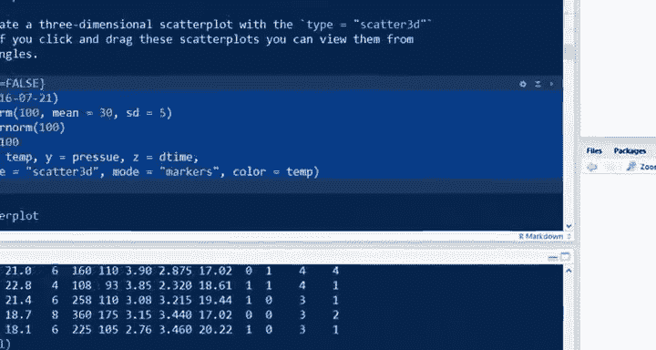

**基础散点图**：`plot_ly(data, x = ~x_var, y = ~y_var, type = ‘scatter‘, mode = ‘markers‘)`

**添加颜色（分类）**：`color = ~as.factor(cat_var)`

**添加颜色（连续）**：`color = ~cont_var`

**调整大小**：`size = ~size_var`

**创建3D散点图**：`plot_ly(data, x = ~x, y = ~y, z = ~z, type = ‘scatter3d‘, mode = ‘markers‘)`

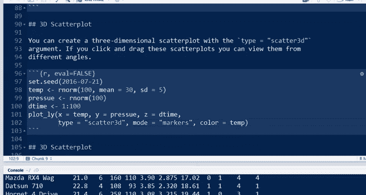

---

### 课后作业

为了巩固所学知识，请完成以下练习：

1.  **创建多种二维散点图**：使用 `mtcars` 或其他数据集，尝试改变不同的绘图属性。例如：
    *   用颜色表示不同的分类变量（如 `gear` 或 `am`）。
    *   用点的大小表示不同的连续变量（如 `qsec`）。
    *   组合使用颜色和大小来展示多个维度。

2.  **创建三维散点图**：选择一个包含至少三个连续变量的数据集，创建一个交互式的 3D 散点图。尝试为点添加颜色维度。

3.  **输出与发布**：将你的图表输出为 HTML 网页文件，在浏览器中查看其交互效果。如果你愿意，可以尝试将其发布到 RPubs 等平台进行公开分享。

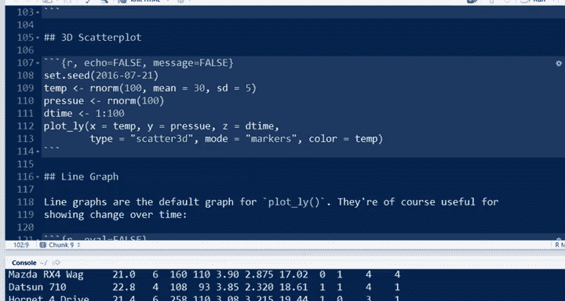

完成这些练习后，你将能够熟练运用 Plotly 创建丰富、多维的数据可视化图表。下一节课，我们将探索 Plotly 更多有趣和强大的应用。