# 课程 P128：使用 Plotly 创建折线图 📈

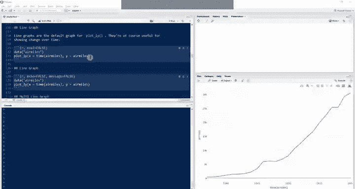

在本节课中，我们将学习如何使用 Plotly 库创建折线图，特别是如何绘制时间序列数据和包含多条折线的图表。我们将使用 R 语言中的 `plotly` 包，并结合 `tidyr` 和 `dplyr` 包进行必要的数据处理。

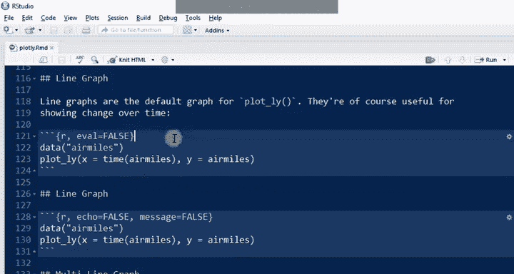

---

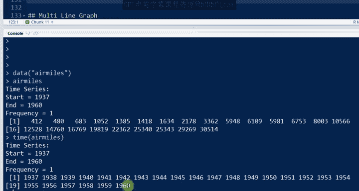

## 创建基础折线图

上一节我们介绍了 Plotly 的基本概念，本节中我们来看看如何创建一个简单的折线图。

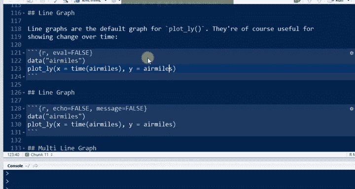

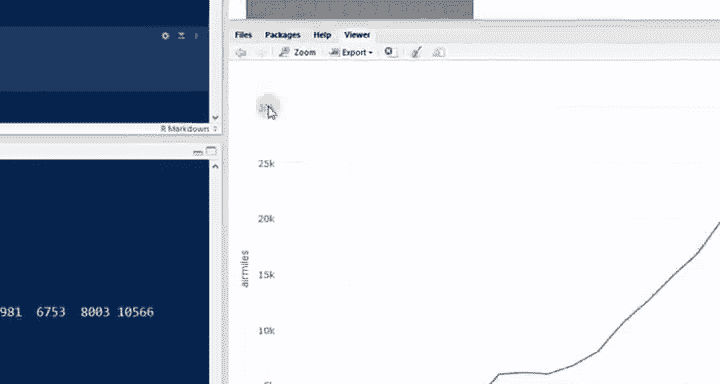

首先，我们有一个名为 `AirMiles` 的时间序列数据集。这个数据集包含了一系列数值，每个数据点对应一个年份。

我们可以使用 `plot_ly` 这个 Plotly 的主要绘图命令来创建图表。其基本语法是 `plot_ly(x = 时间变量, y = 数值变量)`。在这个例子中，我们没有指定数据框，而是直接使用了环境中的变量名作为参数。

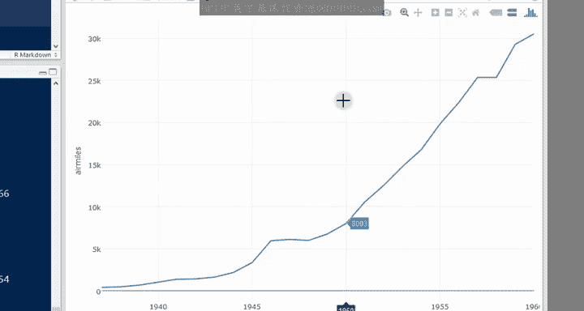

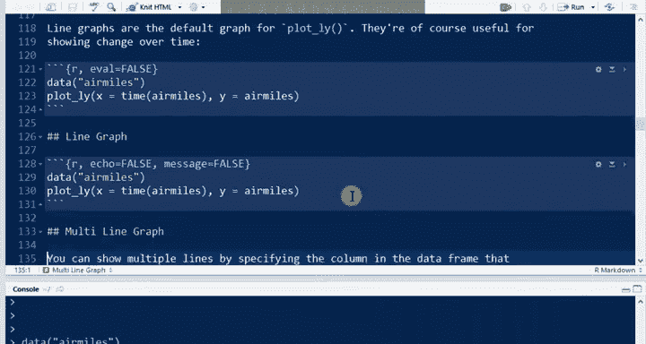

以下是创建基础折线图的代码：

```r
plot_ly(x = time(AirMiles), y = AirMiles)
```

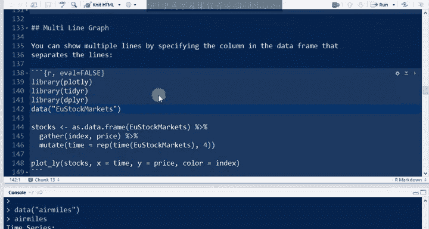

执行这段代码后，会生成一个时间序列图。当鼠标悬停在图表的任意位置时，会显示对应的 X（时间）和 Y（数值）坐标值。这种图表类似于常见的市场指数（如标准普尔500指数）随时间变化的走势图。

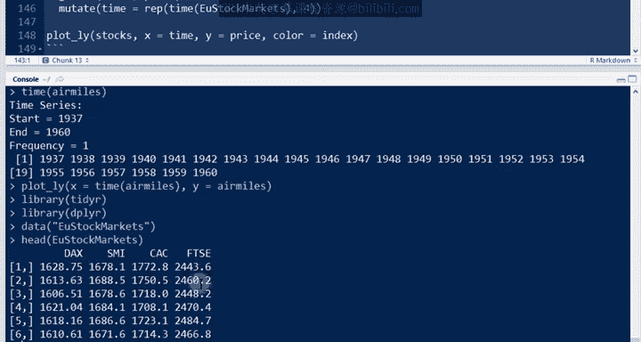

---

## 创建多线折线图

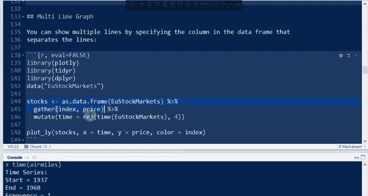

接下来，我们将创建一个包含多条折线的图表，以展示多个股票市场指数的走势。

我们需要加载 `plotly` 库，同时为了进行数据操作，也需要 `tidyr` 和 `dplyr` 库。

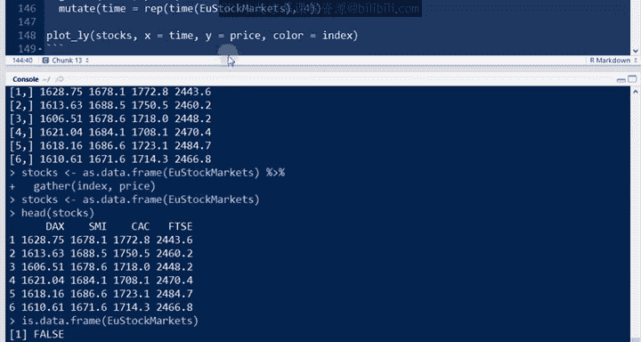

我们将使用 `EuStockMarkets` 数据集。这个数据集包含了德国、瑞士、法国和英国的市场指数数据。它本身是一个时间序列对象，我们需要将其转换为适合 Plotly 绘图的格式。

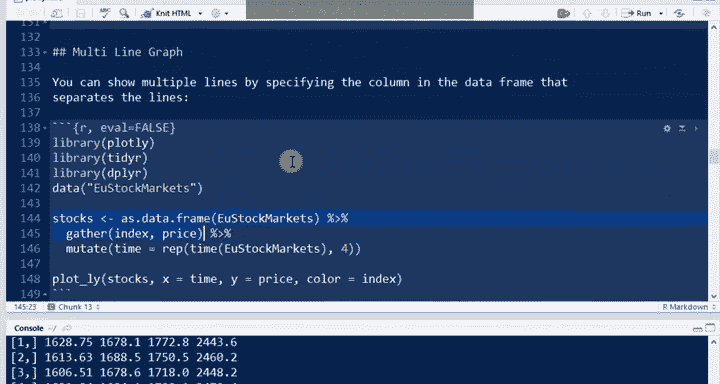

以下是数据处理和绘图的具体步骤：

1.  **转换为数据框**：首先，将时间序列对象 `EuStockMarkets` 转换为标准的数据框格式。
    ```r
    stocks <- as.data.frame(EuStockMarkets)
    ```

2.  **数据从宽格式变长格式**：Plotly 绘制多线图时，需要数据是“长格式”。即，所有指数的数值应在一列中，并用另一个因子变量来区分它们属于哪个指数。我们使用 `tidyr` 的 `gather` 函数来完成这个转换。
    ```r
    stocks <- gather(stocks, key = "index", value = "price")
    ```
    转换后，数据框将包含三列：`index`（指数名称）、`price`（指数价格）以及自动生成的行索引。

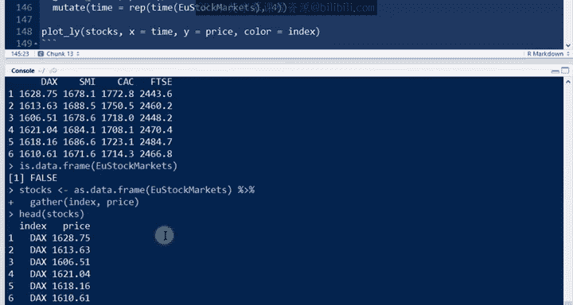

3.  **创建时间变量**：原始的时间信息在转换中丢失了，我们需要重新创建一个时间变量。
    ```r
    stocks$time <- rep(time(EuStockMarkets), times = ncol(EuStockMarkets))
    ```

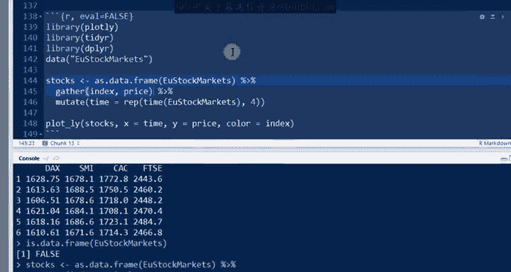

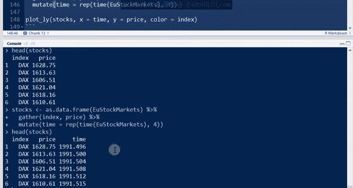

完成数据准备后，就可以使用 Plotly 绘制多线图了。以下是绘图代码：

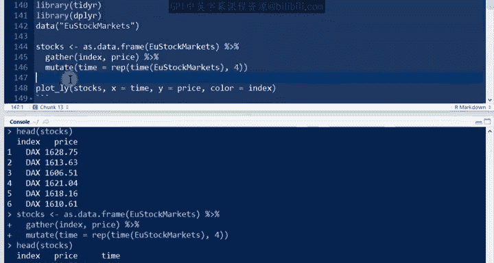

```r
plot_ly(data = stocks, x = ~time, y = ~price, color = ~index)
```

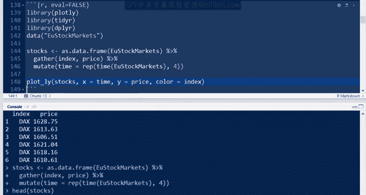

在这段代码中，我们指定：
*   `x` 轴为时间变量 `time`。
*   `y` 轴为价格变量 `price`。
*   `color` 参数根据 `index` 变量（即不同的股票市场）来区分线条颜色。

生成的图表会为每条折线分配不同的颜色，并提供一个图例。鼠标悬停时，会显示特定时间点的具体指数值。这种图表与在金融网站上看到的股票走势图非常相似。

---

## 总结

本节课中我们一起学习了如何使用 Plotly 创建折线图。我们首先创建了一个基础的时间序列折线图，然后通过数据转换，将“宽格式”的股票数据转换为“长格式”，最终成功绘制了展示多个股票市场指数走势的多线图。

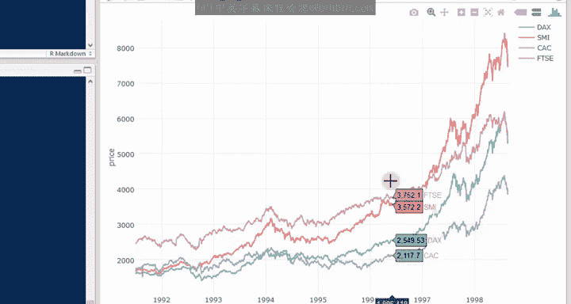

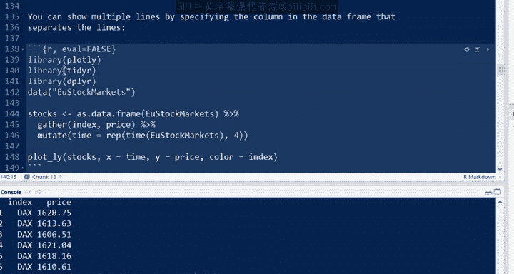

关键点在于，使用 `tidyr` 和 `dplyr` 进行数据整理（特别是 `gather` 函数）是准备绘图数据的关键步骤。Plotly 的 `plot_ly` 函数通过 `color` 参数可以轻松实现多系列数据的可视化。