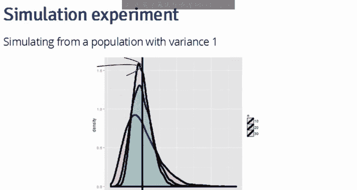
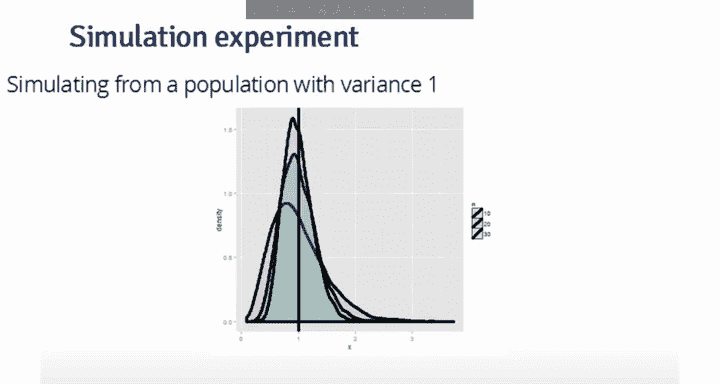
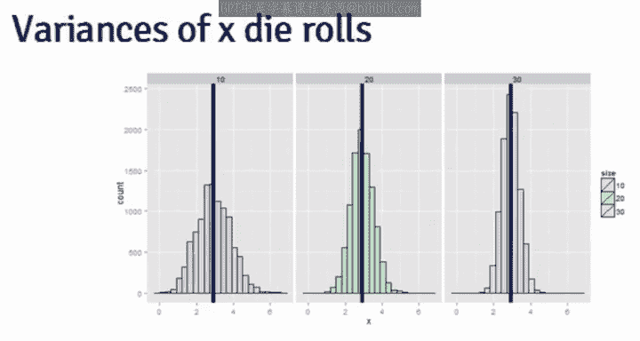
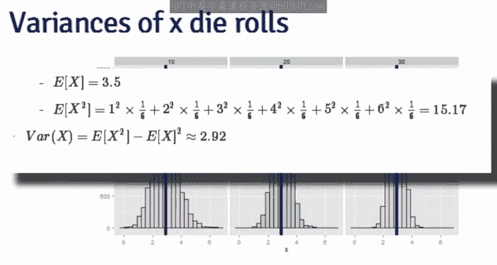
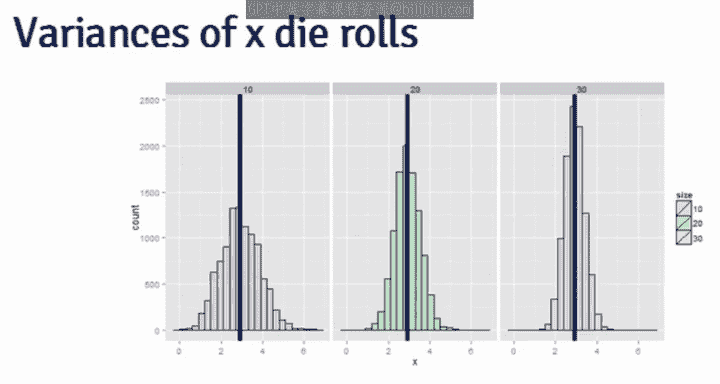

# 课程 P12：方差模拟示例 📊

在本节课中，我们将通过模拟实验来理解样本方差的性质。我们将看到，样本方差是总体方差的一个无偏估计量，并且随着样本量的增加，样本方差的分布会变得更加集中。

---

想象一下，我进行以下操作：模拟10个标准正态分布随机数，计算它们的样本方差，然后重复这一过程多次。

这样，我就得到了样本方差的分布。图中鲑鱼色的密度曲线正是我重复该过程成千上万次后得到的结果。

上一张幻灯片讨论的结果仅仅是：这个分布，如果我抽取足够多的样本，其质心将恰好等于1。

这个1正是我所抽样的原始总体的方差，即标准正态分布的方差，其值为1。

对于从这个分布中抽取20个观测值计算样本方差，情况也是如此。我抽取20个标准正态随机数，计算其样本方差，然后重复该过程多次，以了解20个标准正态随机数样本方差的分布。我得到了这个更偏蓝绿色的分布，即第二个分布，它的中心同样在1。

当我用30个观测值做同样的事情时，结果也一样。但请注意发生了什么：样本方差分布的方差（即其自身的离散程度）随着我拥有更多数据而变得更加集中。

换句话说，更多的数据将产生一个更好、更集中的估计值，围绕样本方差试图估计的目标（在本例中，它们都试图估计1，因为它们是从方差为1的总体中抽取的样本）。

---

回顾本讲座早些时候的内容，我们发现一个骰子点数的方差是2.92。

现在想象一下，如果我投掷10个骰子，并计算朝上一面点数的样本方差。

然后，如果我重复这个投掷10个骰子并计算方差的过程很多很多次。

那么，我将对10次骰子投掷的方差分布有一个很好的了解。我需要重复很多次，但幸运的是，在计算机上我可以重复数千次，这正是我在这里所做的。

注意，10次骰子投掷的方差分布的中心恰好是2.92，即单个骰子总体的方差。当我增加到20次和30次投掷时，分布中心仍在同一位置，但它变得更加集中于其试图估计的目标。

这基本上说明，样本方差是总体方差的一个良好估计量。随着我们收集更多数据，样本方差的分布会围绕其估计目标更加集中，并且其中心位置正确，换句话说，它是无偏的。

这种无偏性正是我们除以 `n-1` 而不是 `n` 的原因，这使得样本方差成为无偏估计量。

---

## 总结 🎯

本节课中，我们一起学习了样本方差的关键性质。通过模拟标准正态分布和骰子实验，我们观察到：

1.  **无偏性**：样本方差的期望值等于总体方差，即 `E(s²) = σ²`。这是通过公式中使用 `n-1` 作为分母（而不是 `n`）来保证的。
2.  **一致性**：随着样本量 `n` 的增加，样本方差的分布变得更加集中和精确，这意味着更大的样本能提供更可靠的方差估计。

这些性质共同表明，样本方差是推断总体方差的一个有效且可靠的统计量。