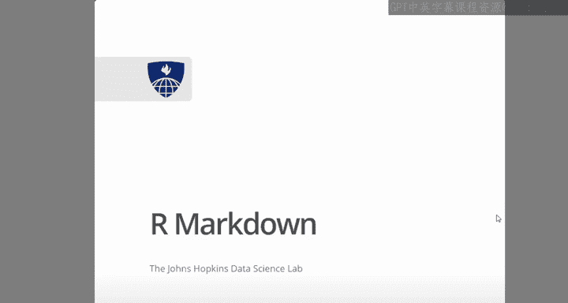
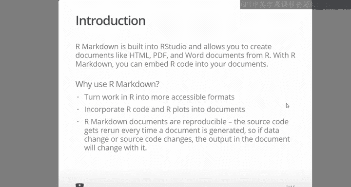

# 课程名称：约翰霍普金斯大学《数据科学：统计和机器学习》 - P133：R Markdown 入门教程 1️⃣

## 概述 📋

在本节课中，我们将要学习如何使用 R Markdown 创建可重复的报告和演示文稿。我们将介绍 R Markdown 的基本概念、优势，并通过示例展示其工作流程。

## 什么是 R Markdown？ 🤔

上一节我们介绍了课程背景，本节中我们来看看 R Markdown 是什么。

R Markdown 内置于 RStudio 中。它允许你从 R 内部创建文档，特别是 HTML 文档。它的核心功能是将分析过程中的代码、代码运行结果、图表等所有内容，以一种可重复的方式嵌入到最终文档中。

这种工作方式非常有用，因为它改变了传统的工作流程。传统流程通常包括：一份可能没有良好文档记录的 R 分析代码，以及一份独立的文档（如 Word、Google Docs 或 LaTeX 文档）。你需要手动复制、粘贴或保存文件，再将它们插入到文档中。

对于演示文稿也是如此。你可能有一个 PowerPoint 文件，在另一边运行代码，然后将结果复制粘贴到演示文稿中。这会导致版本控制问题，也带来另一个问题：当你将文件交给演示对象时，对方不一定能复现其中的所有图表和图形。

因此，如果你关心可重复性，并希望为生成演示文稿建立一个良好、一致的结构，这通常是一种更好的方法。

## 为何使用 R Markdown？ 💡

上一节我们了解了 R Markdown 是什么，本节中我们来看看为什么应该使用它。

可以想象一个场景，例如在公司环境中，需要定期（比如每几周）根据生成的重要数据提交特定报告。与其每次重新制作演示文稿，并经历容易出错的复制粘贴过程，不如拥有一个脚本。这个脚本可以用最新的数字生成演示文稿，并且所有内容都是可追溯和版本控制的，这将是非常有用的。

因此，将 R Markdown 用于创建此类演示文稿，可以视为生成周期性或自动化演示文稿的有效方式。

## 强调可重复性 🔄

R Markdown 有很多用途，这里我想强调“可重复性”这一理念。这一点在学术界受到了广泛关注，主要涉及论文发表。

人们发表论文后，独立的研究小组会尝试复现论文的结果（不是重新做实验，而是使用相同的数据集尝试复现分析过程）。结果发现，这常常无法实现，并引发了关于谁是正确的争论。第一组人、第二组人，甚至第三组人可能都无法复现，或者得到了与之前两组都不同的结果。

因此，拥有一份嵌入了代码的文档，可以极大地提高文档的可重复性。虽然这并非完美，因为你可能还需要调用一些外部文件、数据集或库，并且计算架构等差异可能会影响结果，但总的来说，这在创建更具可重复性的文档结果方面迈出了一大步。

希望你在学习数据科学专项课程中的“可重复性研究”课程时，已经通过 knitr 等工具了解了很多关于可重复性的内容。如果你是新学习这门课，我们将通过几个主要关注演示文稿的示例来引导你。

我们在这门课中专注于演示文稿，是因为我们喜欢将这门课视为一门“产品”课程。你的产品就是你的分析成果，而你的演示文稿就是你为这个产品所做的“推介”。我们希望你的“推介”能以这些可重复的格式之一来创建。

## 开始示例 🚀

接下来，我们将开始看一些具体的例子。

---

## 总结 📝

本节课中我们一起学习了 R Markdown 的基本概念及其在创建可重复文档和演示文稿中的重要性。我们了解到，R Markdown 通过将代码、结果和文本整合在一个文档中，解决了传统工作流程中的版本控制和可重复性问题。这对于需要定期生成报告或确保分析结果可被他人验证的场景尤其有价值。在接下来的课程中，我们将通过实际示例进一步探索如何使用 R Markdown。