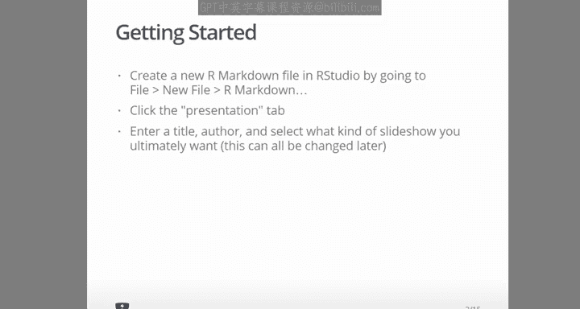
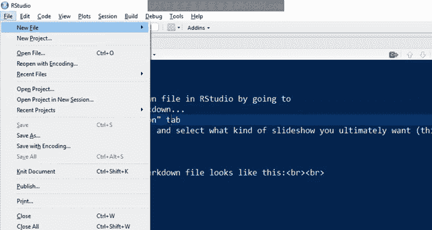
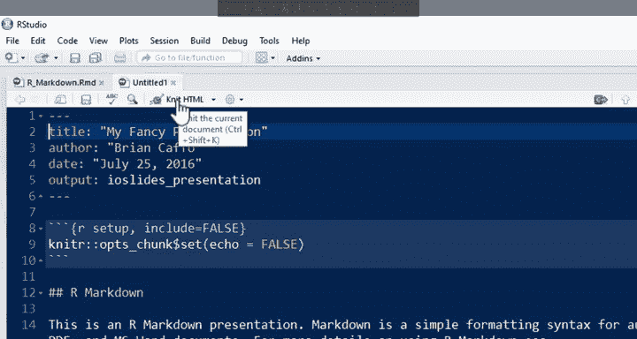
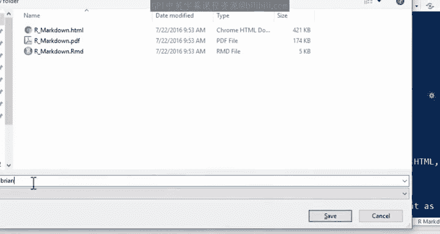
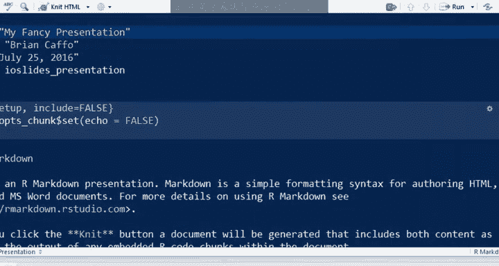
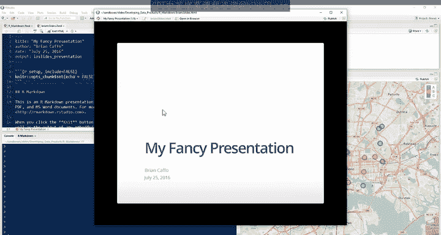

# 课程26：R Markdown 基础教程（第一部分）📊

在本节课中，我们将学习如何使用R Markdown创建动态文档和演示文稿。我们将从创建一个基本的演示文稿模板开始，并逐步了解其核心组成部分。

## 概述

R Markdown允许你将代码、分析结果和文本叙述结合在一个文档中。本节我们将通过实际操作，演示如何创建一个新的R Markdown演示文稿，并将其编译为可查看的格式。

## 创建新演示文稿

上一节我们介绍了R Markdown的概念，本节中我们来看看如何创建一个新的演示文稿文件。

在RStudio中，你可以通过菜单栏轻松创建新文件。

以下是创建新演示文稿的具体步骤：
1.  点击菜单栏的 **File**（文件）。
2.  选择 **New File**（新建文件）。
3.  点击 **R Markdown...**（R Markdown...）。

或者，你也可以使用快捷键 `Ctrl/Cmd + Shift + N` 来打开新建文件对话框。

## 配置演示文稿选项

创建新文件后，会弹出一个配置对话框，你需要在此设置演示文稿的基本信息。

以下是需要配置的选项：
1.  在 **Title**（标题）输入框中，为你的演示文稿命名，例如 `MyFancyPresentation`。
2.  在 **Author**（作者）输入框中，填写你的名字。
3.  在 **Default Output Format**（默认输出格式）下，选择 **Presentation**（演示文稿）。
4.  在右侧的格式下拉菜单中，暂时选择 **ioslides_presentation**。这是一种基于HTML的幻灯片格式。

关于PDF输出格式，需要额外安装TeX系统（如Windows的MiKTeX，macOS的MacTeX，或Linux的TeX Live）。我们将在后续课程中介绍如何安装和配置。

## 编译与查看演示文稿

配置完成后，RStudio会生成一个包含默认模板的RMD文件。现在，我们可以尝试将其编译成最终格式。

以下是编译演示文稿的方法：
1.  点击R Markdown工具栏中的 **Knit**（编织）按钮。
2.  或者使用快捷键 `Ctrl/Cmd + Shift + K`。

首次编译时，系统会提示你保存这个RMD文件。

为文件命名并保存后，R Markdown会自动开始编译过程。

编译完成后，生成的HTML幻灯片将在预览窗口或你的默认浏览器中自动打开。

## 第一个练习任务

现在，你已经看到了一个基础演示文稿的生成过程。

你的第一个任务是：按照上述步骤，成功创建一个新的演示文稿模板并完成编译。完成后，我们将在下一节学习如何为其添加具体内容。

## 总结

本节课中我们一起学习了R Markdown的入门操作。我们掌握了如何通过RStudio的图形界面创建一个新的演示文稿项目，配置其标题、作者和输出格式，并最终使用“Knit”功能将其编译为可交互的HTML幻灯片。这是使用R Markdown进行动态报告和演示的第一步。