# 课程 P138：R Markdown 进阶与发布 🚀

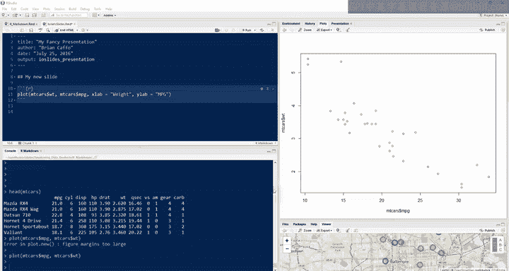

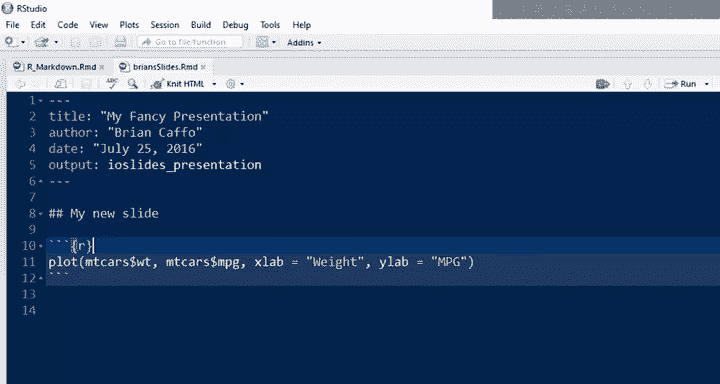

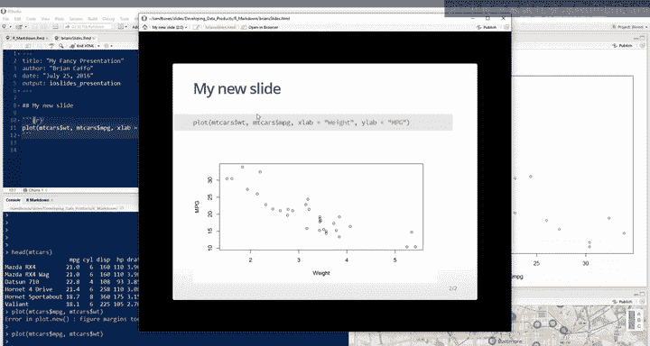

在本节课中，我们将学习如何在 R Markdown 中控制代码块的输出，特别是图形的显示方式，并探索如何将完成的文档发布到网络上，例如通过 GitHub Pages。

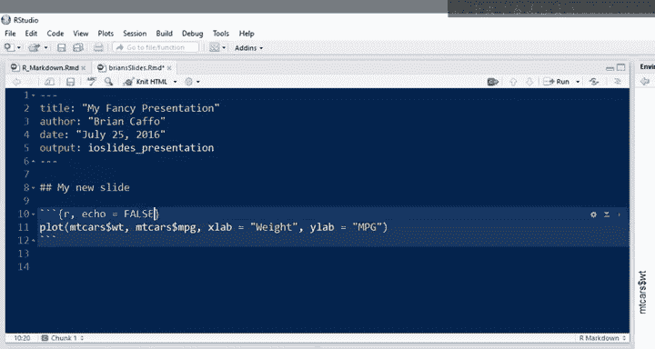


---

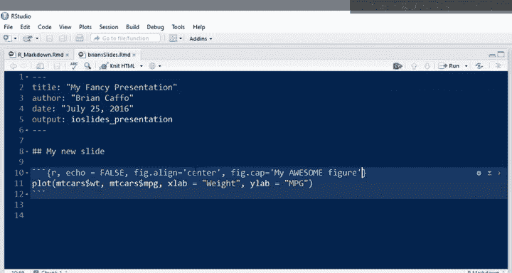

上一节我们介绍了 R Markdown 的基础，本节中我们来看看如何优化图形输出并分享你的成果。

首先，我们创建一个简单的散点图，展示汽车重量与每加仑英里数的关系。以下是生成该图的代码：

```r
plot(cars$weight, cars$mpg, xlab = "Weight", ylab = "Miles per Gallon")
```

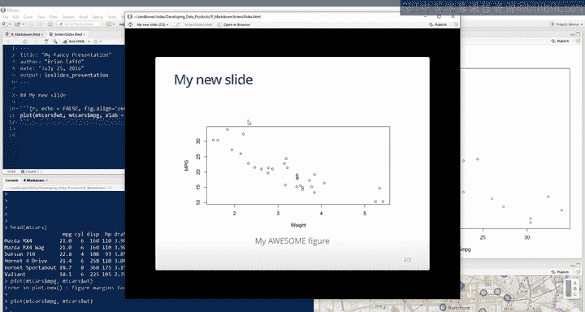

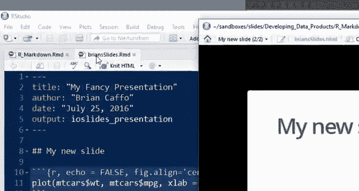

运行后，图形会显示出来。但在最终报告中，我们通常不希望显示生成图形的源代码。

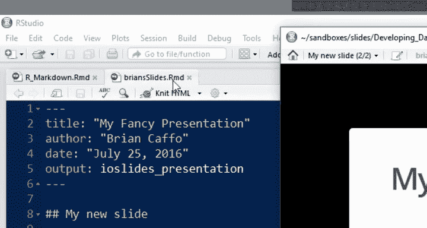

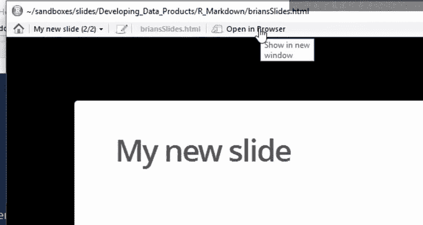

为了隐藏代码，我们可以在代码块选项中设置 `echo = FALSE`。修改后重新运行，图形会正常显示，但源代码不会出现在最终文档中。

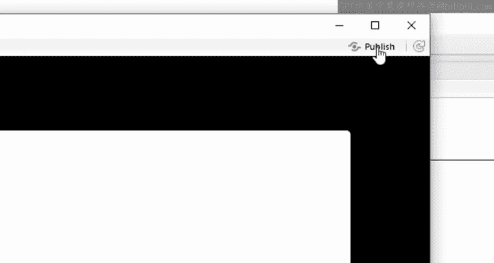

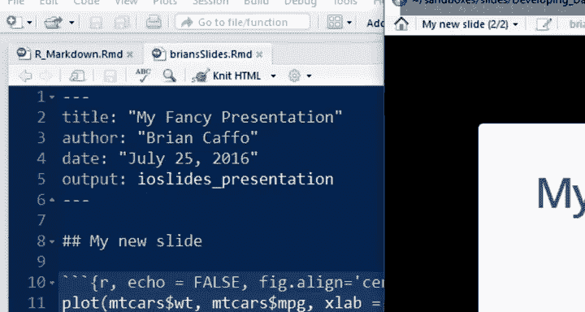

`knitr` 包提供了丰富的图形控制选项。以下是几个常用的参数：

*   **`fig.align`**: 用于控制图形的对齐方式，例如设置为 `"center"` 可使图形居中。
*   **`fig.cap`**: 用于为图形添加标题，例如 `fig.cap = "我的图表"`。
*   **`fig.width`** 与 **`fig.height`**: 分别用于控制图形的宽度和高度。

你可以尝试调整这些选项，看看它们如何影响最终输出效果。

---

上一节我们介绍了如何美化图形，本节中我们来看看如何发布你的 R Markdown 文档。

当你点击 `Knit to HTML` 时，R Markdown 会在当前目录下生成一个同名的 `.html` 文件。你可以直接在浏览器中打开这个文件查看效果。

在 RStudio 的预览窗口，除了“在浏览器中打开”，还有一个“发布”按钮。点击它可以发布到 RPubs 等平台，这是一种简单的在线发布方式。

我个人更推荐使用 **GitHub Pages** 进行发布。这是一种将 GitHub 仓库直接转换为网站的服务。以下是关键步骤：

1.  确保你的仓库中有一个名为 `gh-pages` 的分支（或使用 `main` 分支的 `docs` 文件夹等特定配置）。
2.  将你的 R Markdown 文件以及 `knit` 生成的 `.html` 文件推送到这个分支。
3.  访问 `https://<你的用户名>.github.io/<仓库名>/<文件路径>.html` 即可在线查看。

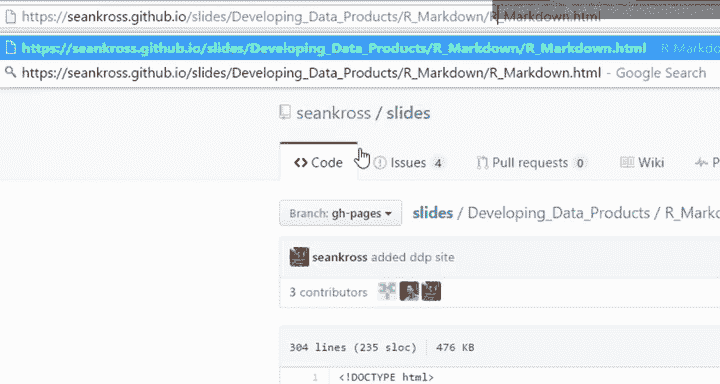

例如，讲师 Sean Cross 的课程幻灯片就托管在他的 GitHub Pages 上。这种方式非常适合已经使用 GitHub 进行版本控制和协作的数据科学工作者。

---

本节课中我们一起学习了 R Markdown 的两个重要进阶主题：控制图形输出选项和发布文档。请尝试完成以下练习以巩固所学：

*   在你的演示文稿中创建一个图形，并尝试使用 `fig.align`, `fig.cap` 等选项进行调整。
*   将你的文档发布到 GitHub Pages，或尝试使用 RPubs 进行发布。
*   确认 `.html` 文件已在本地生成，并理解如何离线查看。

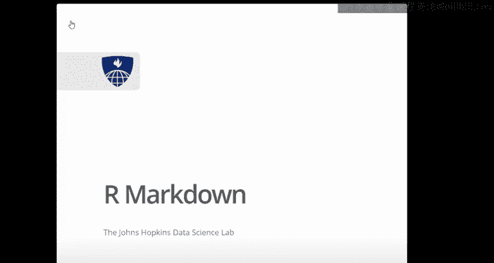

掌握这些技能后，你将能创建更专业的报告，并轻松地与他人分享你的数据分析和可视化成果。在最终的课程项目中，你将使用 R Markdown 来展示你的项目构想。