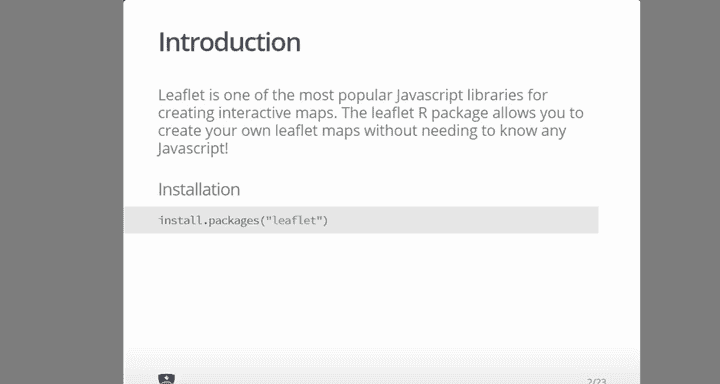
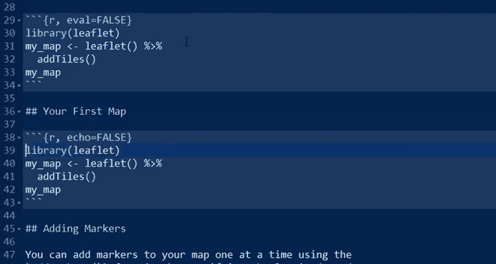
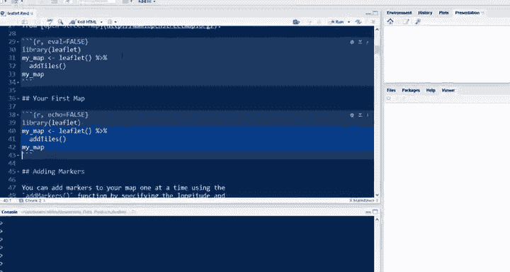
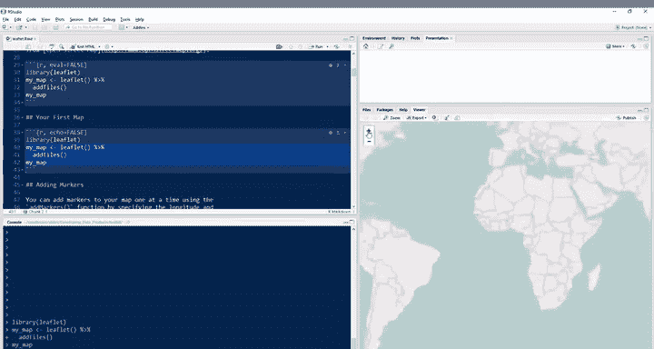
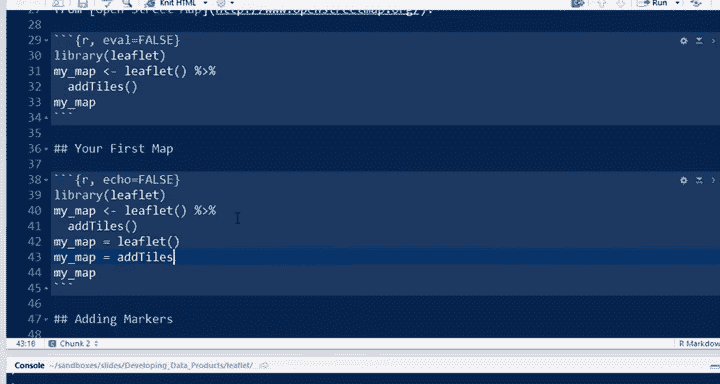
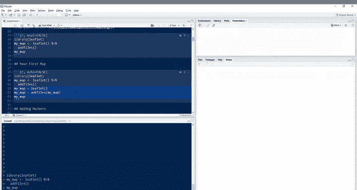
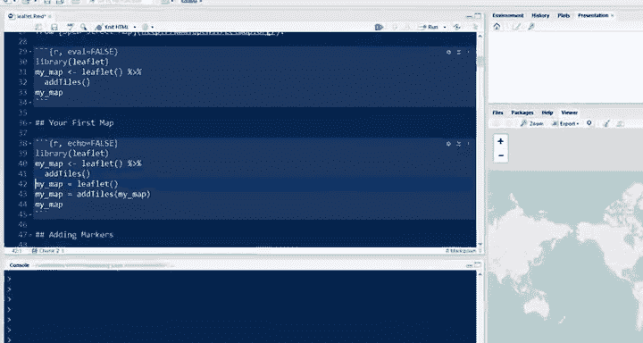
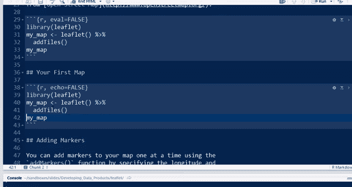

# 课程 P139：31_Leaflet 1 🗺️

在本节课中，我们将学习如何使用 R 语言中的 `leaflet` 包来创建交互式地图。`leaflet` 是一个基于 JavaScript 库的 R 包，它允许我们在 R 环境中，尤其是在 RStudio 的查看器窗格中，轻松构建和展示交互式地图。这是开发数据产品的一个重要方面。

除了 `leaflet`，还有其他创建交互式地图的方法，例如 `googleVis`。`leaflet` 因其在 R 社区中的广泛接受和使用而值得单独介绍。我们也会在后续关于 `googleVis` 的课程中讨论如何直接使用谷歌地图。目前，`leaflet` 和 `googleVis` 可能是两种最流行的方法。

---

## 安装与第一个地图 🚀

要开始使用，首先需要确保安装了 `leaflet` 包。你可以使用以下命令安装：

```r
install.packages("leaflet")
```

安装完成后，让我们通过一个简单的代码示例来创建你的第一个 `leaflet` 地图。

首先，加载 `leaflet` 库：

```r
library(leaflet)
```



上一节我们介绍了安装和加载，本节中我们来看看如何生成一个基础的世界地图。

以下是创建基础地图的代码：

```r
leaflet() %>%
  addTiles()
```



运行这三行代码后，你将在 RStudio 的查看器窗格中看到一个交互式世界地图。你可以随意缩放这个地图。请注意，它显示在类似浏览器的查看器中，而不是一个静态的图形。



---



## 理解管道操作符 %>% 🔄

在刚才的代码中，我们使用了一个重要的符号：管道操作符 `%>%`。理解它有助于编写更清晰、易读的代码。

上面的代码等价于以下不使用管道的写法：

```r
my_map <- leaflet()
my_map <- addTiles(my_map)
my_map
```



管道操作符 `%>%` 的作用是：将左侧命令的输出，作为右侧命令的第一个参数传递进去，并可以重新赋值给变量。因此，`leaflet() %>% addTiles()` 意味着先执行 `leaflet()` 生成一个地图对象，然后将其传递给 `addTiles()` 函数添加图层。



一旦你习惯了这种写法，它会比传统的嵌套或分步赋值代码更加简洁和易于阅读。



---

## 代码解析与下一步 🧭

现在，让我们解析一下我们刚刚运行的基础代码：
*   `leaflet()`: 这个函数初始化一个 `leaflet` 地图对象。
*   `addTiles()`: 这个函数为地图添加默认的瓦片图层（即地图背景）。

第一步的目标是成功生成一个世界地图，并能够进行缩放操作。这确保了 `leaflet` 库已正确安装并能运行。

在接下来的课程中，我们将探讨如何在地图上添加更有用的内容，例如标记点、多边形、弹出窗口等，让地图变得更加丰富和实用。

---



本节课中我们一起学习了如何使用 R 的 `leaflet` 包创建基础的交互式地图，理解了管道操作符 `%>%` 在串联操作中的作用，并成功输出了第一个可缩放的世界地图。这是利用 `leaflet` 进行空间数据可视化的第一步。