# 课程名称：约翰霍普金斯大学《数据科学：统计和机器学习》 - P140：32_Leaflet 1.2 🗺️

在本节课中，我们将学习如何使用R语言的`leaflet`包来创建交互式地图，并重点介绍如何在地图上添加标记点。我们将从回顾创建基础地图开始，然后详细讲解添加标记的步骤和代码结构。

## 概述

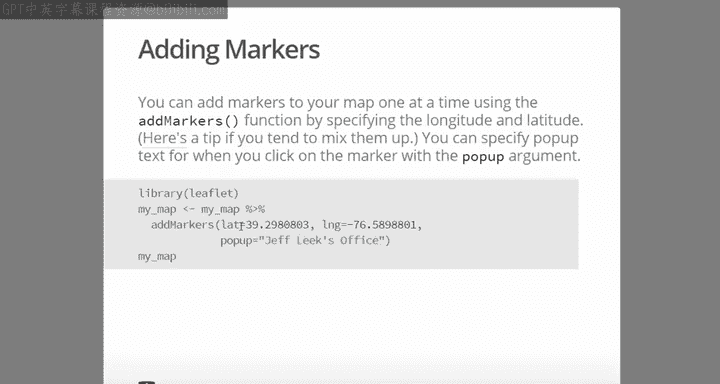

上一节我们介绍了如何使用`leaflet()`函数创建一个基础地图图层。本节中我们来看看如何向这个地图上添加具体的标记点，以实现更丰富的信息展示和交互功能。

## 创建基础地图

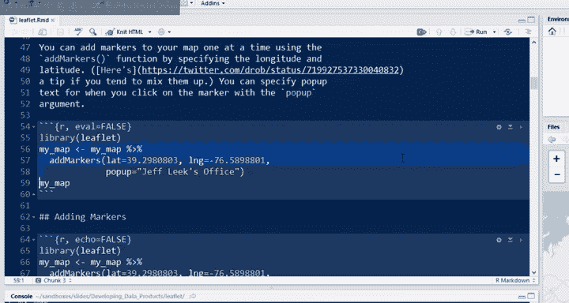

首先，我们快速回顾如何生成一个基础地图。使用`leaflet`函数可以创建一个类似于Photoshop中“图层”的背景。然后，通过`addTiles()`函数添加来自OpenStreetMap的具体地图数据。

```r
# 创建基础地图
my_map <- leaflet() %>%
  addTiles()
```

运行上述代码后，会显示一个可以缩放和浏览的交互式地图。例如，我们可以放大到约翰霍普金斯大学所在的巴尔的摩地区。

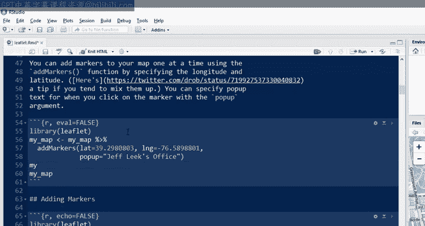

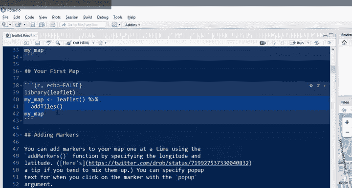

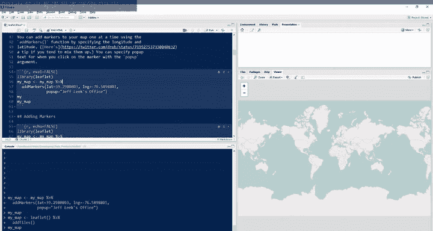

## 添加地图标记

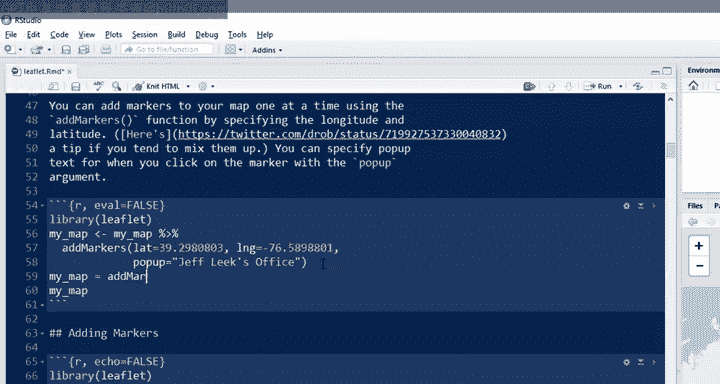

为了增加交互性，我们通常需要在地图上添加标记。`addMarkers()`命令可以轻松实现这一点。以下是如何在特定经纬度位置添加一个带有标签的标记。

以下是添加单个标记的代码示例：

```r
# 使用管道操作符添加标记
my_map <- my_map %>%
  addMarkers(lng = -76.6795, lat = 39.2975, popup = "Jeff Leek's office")
```

运行这段代码后，地图上会出现一个标记。点击该标记，会弹出一个显示“Jeff Leek‘s office”的标签。通过缩放地图，我们可以在布隆伯格公共卫生学院找到这个具体位置。

## 理解代码结构

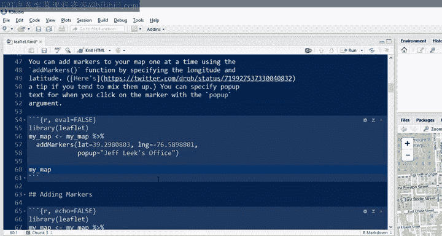

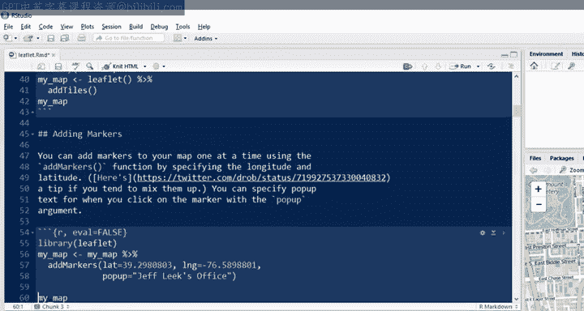

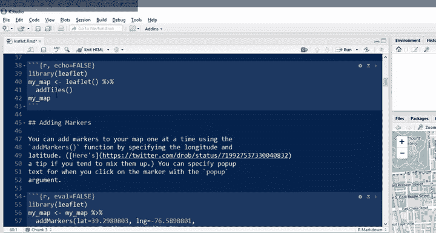

现在，我们来详细解析这段代码是如何工作的。首先，变量`my_map`已经在之前创建基础地图时被定义。

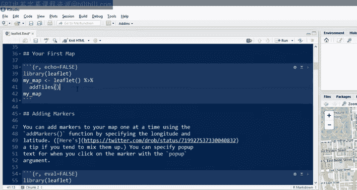

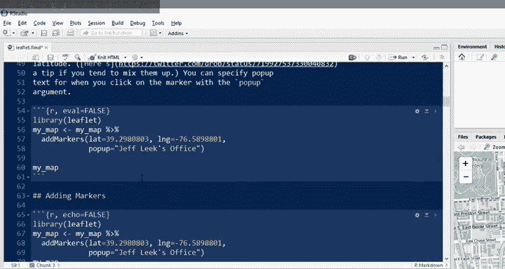

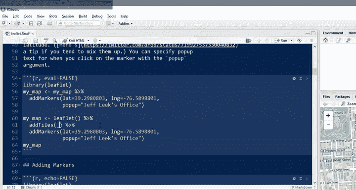

这里使用了管道操作符`%>%`。其作用是将左侧`my_map`变量的值，作为右侧`addMarkers()`函数的第一个参数传入。整个表达式的结果最终被赋值回`my_map`变量。

虽然看起来有些冗余，但这种链式操作在添加多个图层或标记时非常强大和简洁。它避免了重复键入长变量名，使代码更清晰易读，这与在`dplyr`包中使用管道的理念一致。

`addMarkers()`函数的核心参数很简单：
*   第一个参数通过管道传入，是地图对象。
*   `lng`和`lat`参数指定标记点的经度和纬度坐标。
*   `popup`参数定义了点击标记时显示的弹出文本。

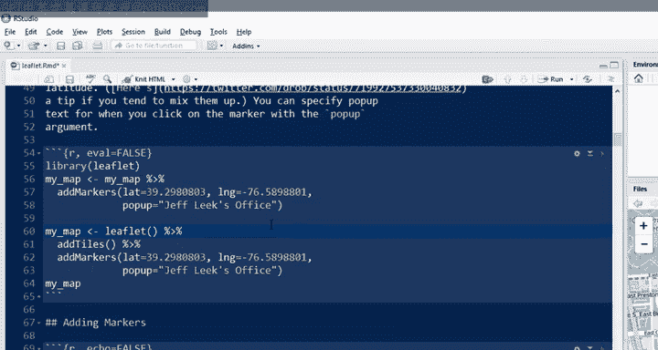

你可以想象，在制作复杂地图时，可能会需要添加大量这样的标记。

## 总结

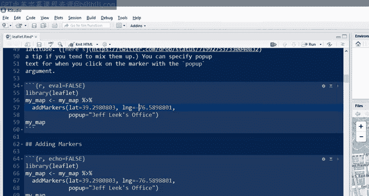

本节课中我们一起学习了如何使用`leaflet`包为交互式地图添加标记点。我们回顾了基础地图的创建，重点讲解了`addMarkers()`函数的使用方法及其参数，并深入理解了管道操作符`%>%`在链式地图操作中的优势。掌握这些基础后，你就可以开始构建包含多个信息点的自定义地图了。