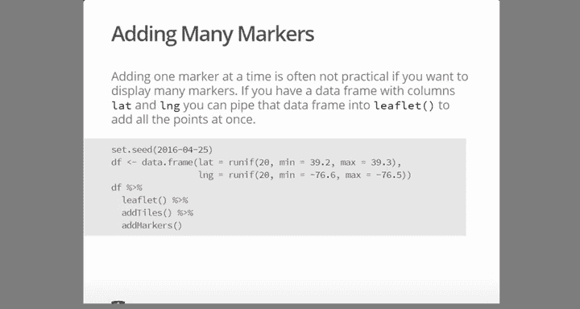
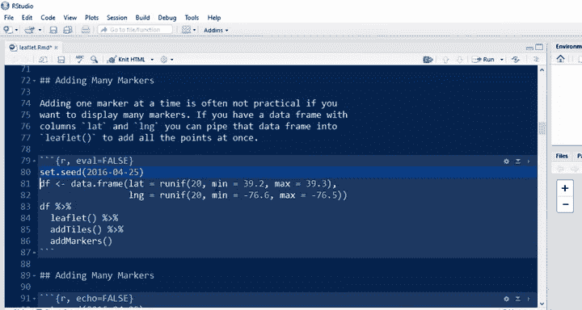
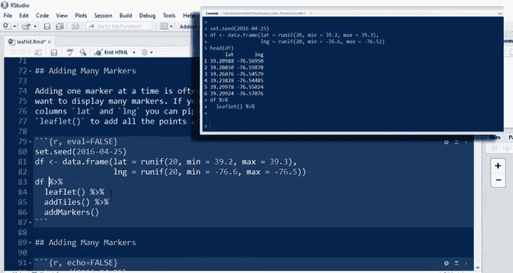
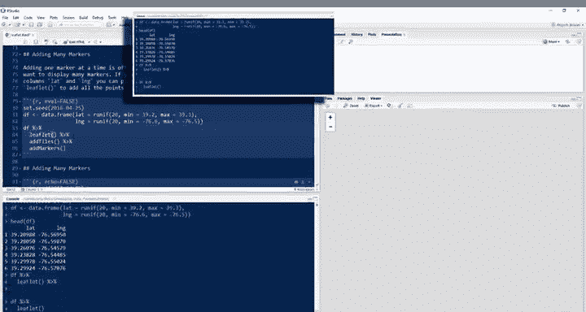
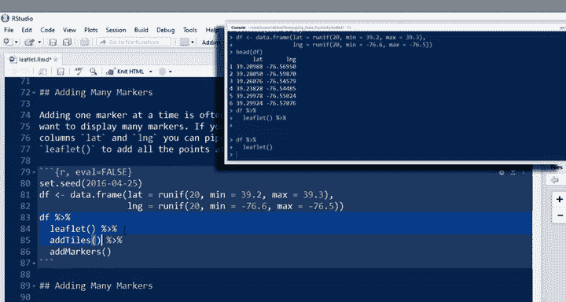
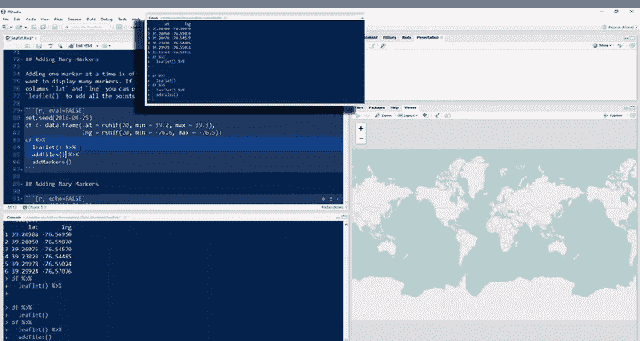
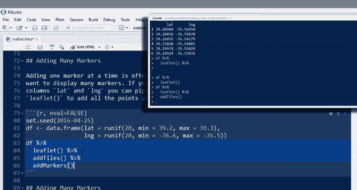

# 📍 课程 P141：使用 Leaflet 批量添加标记

在本节课中，我们将学习如何使用 Leaflet 库一次性在地图上添加多个标记。通过将标记数据组织在数据框中，我们可以高效地管理并可视化大量位置点。

---

上一节我们介绍了如何创建基础地图并添加单个标记。本节中我们来看看如何批量添加多个标记。



如果你想添加大量标记，有一个非常简单的方法：只需将所有要添加的标记信息放入一个数据框中。下面我们通过一个示例来演示这个过程。

首先，我们创建一个包含随机经纬度数据的数据框。为了确保结果可复现，我们先设置随机种子。

```r
set.seed(1234)
```



接着，创建数据框。以下是生成数据框的代码：

```r
df <- data.frame(
  lat = runif(20, min = 39.2, max = 39.3),
  long = runif(20, min = -76.6, max = -76.5)
)
```

现在，让我们查看一下这个数据框的结构。它包含20行数据，每行有两个列，分别名为 `lat`（纬度）和 `long`（经度）。

接下来，我们将这个数据框传递给 `leaflet()` 函数来创建地图。初始地图是空白的。

如果我们仅运行以下代码（不添加图层）：

```r
leaflet(df)
```

我们会得到一个空白的地图对象。

现在，如果我们在此基础上调用 `addTiles()` 函数：



```r
leaflet(df) %>% addTiles()
```

地图会加载底图瓦片，但此时还没有任何标记被绘制上去。

最后，我们通过管道操作符将结果传递给 `addMarkers()` 函数：

```r
leaflet(df) %>% addTiles() %>% addMarkers()
```

执行这行代码后，所有基于数据框 `df` 中经纬度数据的标记就会被一次性添加到地图上。

当然，你不需要像演示中这样分步运行代码。你可以一次性运行完整的代码链，效果完全相同。





以下是完整的代码示例，供你尝试：



```r
set.seed(1234)
df <- data.frame(
  lat = runif(20, min = 39.2, max = 39.3),
  long = runif(20, min = -76.6, max = -76.5)
)
leaflet(df) %>% addTiles() %>% addMarkers()
```

运行后，你将看到地图上显示出了所有的标记。

---



**总结**

本节课中我们一起学习了如何使用 Leaflet 批量添加标记。核心步骤是：
1.  将标记的经纬度数据存储在一个数据框中。
2.  将该数据框作为首要参数传递给 `leaflet()` 函数。
3.  通过管道依次调用 `addTiles()` 和 `addMarkers()` 函数，即可在地图上呈现所有标记。

请尝试自己创建一个包含随机经纬度的数据框，并生成一个带有所有标记的地图。