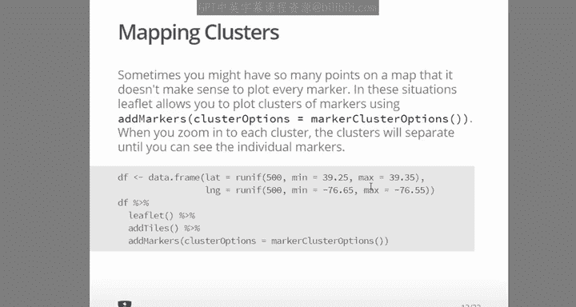
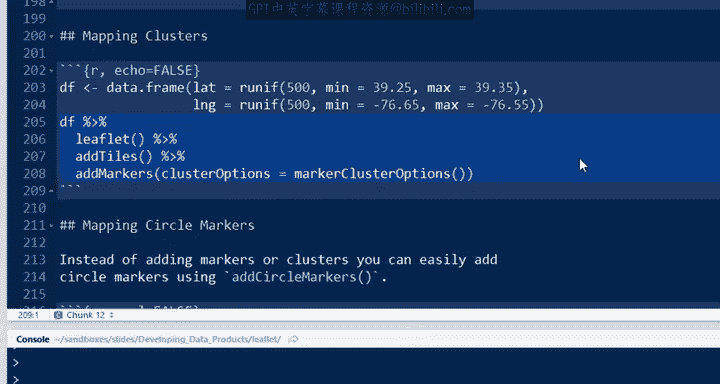
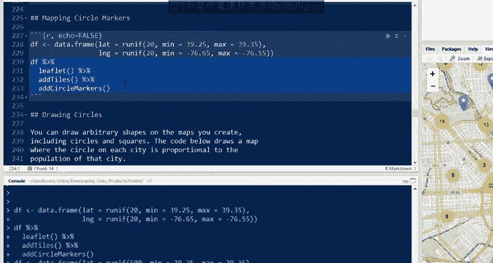

# 课程 P143：35_Leaflet 1.5 🗺️

在本节课中，我们将要学习如何使用 Leaflet 库来处理地图上大量重叠的数据点。当许多点在地图上紧密聚集时，用户难以区分它们。Leaflet 提供了一个优雅的解决方案：**点聚合**。此外，我们还将了解如何将默认的标记样式替换为圆形标记。

---

## 点聚合功能

上一节我们介绍了基础的地图标记。本节中我们来看看如何处理密集的数据点。

有时，地图上的点足够多且彼此靠近，以至于用户无法清晰地区分它们。Leaflet 对此有一个非常出色的解决方案，即**将点聚合在一起**。在不同缩放级别下，聚合的簇会自动展开或合并，从而提升地图的可读性。

请看下面的示例，你将立刻明白这个功能为何有用。




以下是实现点聚合的代码步骤。

首先，我们创建一个包含 500 个经纬度点的数据框，这些点都集中在巴尔的摩附近。

```r
# 创建数据框
df <- data.frame(
  lat = runif(500, 39.25, 39.35),
  lng = runif(500, -76.65, -76.55)
)
```

接着，我们将这个数据框传递给 `leaflet()` 函数，然后依次链式调用 `addTiles()` 和 `addMarkers()` 函数。Leaflet 会自动启用默认的聚合选项。

```r
# 创建带聚合功能的地图
library(leaflet)
leaflet(df) %>%
  addTiles() %>%
  addMarkers()
```

运行代码后，我们得到以下地图。可以看到，点被聚合成一个簇，并显示了该簇中包含的点数（例如“96”）。




观察这个位于巴尔的摩市中心的大簇。随着我们不断放大地图，这个簇会逐渐分解，最终显示出全部 500 个独立的点。在不同缩放级别下，点会自动聚拢或散开，这使我们能够轻松浏览高密度区域。

---

## 使用圆形标记

除了添加带聚合功能的标记或标准弹出窗口，我们还可以改变标记的视觉样式。例如，可以使用圆形来替代默认的图标。

实现方法非常简单，只需使用 `addCircleMarkers()` 函数来替代 `addMarkers()` 函数。

下面我们创建一个包含约 20 个点的地图，并使用圆形标记。

```r
# 创建少量数据点并使用圆形标记
df_small <- data.frame(
  lat = runif(20, 39.25, 39.35),
  lng = runif(20, -76.65, -76.55)
)

leaflet(df_small) %>%
  addTiles() %>%
  addCircleMarkers()
```

运行代码后，地图上的点显示为小圆圈，如下图所示。



---

## 总结

本节课中我们一起学习了 Leaflet 的两个实用功能。

首先，我们探讨了**点聚合**。通过 `addMarkers()` 函数，Leaflet 能自动将密集的点聚类，并在不同缩放级别下动态展示，有效解决了点重叠导致的视觉混乱问题。

其次，我们介绍了如何**更改标记样式**。使用 `addCircleMarkers()` 函数可以快速将默认的图标标记替换为简洁的圆形标记，为地图可视化提供更多灵活性。


掌握这两个技巧，能帮助你创建出信息更清晰、用户体验更佳的地图应用。