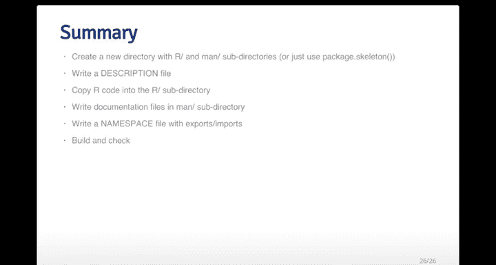

# 📦 课程 38：R 包 第 2 部分


在本节课中，我们将学习构成一个 R 包的核心要素。我们将了解创建 R 包所需的基本文件和目录结构，包括描述文件、R 代码、命名空间文件和文档。通过掌握这些组件，你将能够系统地组织和分享你的 R 代码。

---

## 🗂️ R 包的构成要素

一个 R 包由几个必需元素和若干可选元素构成。

创建 R 包时，首先需要在文件系统中创建一个目录。具体操作方式因平台而异，但起点总是一个目录。通常，目录名与包名相同。例如，如果你的包名为 `mypackage`，那么目录名也应为 `mypackage`。这是所有 R 包普遍遵循的惯例。

接下来，包中需要一个名为 **描述文件** 的文件，它包含关于包的元数据。当然，你还需要一些 R 代码，它们应放在 `R` 子目录下。R 代码需要文档，这些文档通常放在 `man` 子目录下。

**命名空间文件** 是可选的，但非常常见，我鼓励你创建它。

如果你想了解所有完整要求，可以查阅 R 官网上的《编写 R 扩展》文档。

---

## 📄 描述文件

创建目录后，首先要处理的是描述文件。你可以在目录中放置一个描述文件，其中必须包含以下元素：

*   **包名**：包的名称。
*   **标题**：比名称稍长的包描述。
*   **描述**：更长的描述，可以是一两句话。
*   **版本号**：通常采用“主版本号.次版本号-补丁级别”的格式，但并非必须。
*   **作者**：编写原始代码的人，可能不是你。
*   **维护者**：非常重要，这是负责维护包的人员姓名及其电子邮件地址。如果包出现问题，可以通过此邮件联系负责人。
*   **许可证**：描述源代码发布所依据的条款。常见的 R 代码开源许可证包括 GNU 通用公共许可证、BSD 许可证或 MIT 许可证。

描述文件中还可以包含一些可选但常用的字段：

*   **依赖项**：你的包所依赖的其他 R 包列表。
*   **建议项**：用户可能需要安装但不是严格必需的 R 包列表。
*   **日期**：包的发布日期。
*   **主页**：可以列出包的主页 URL，例如 GitHub 仓库的链接。
*   你还可以添加其他字段供自己使用，但 R 通常会忽略它们。

以下是 `gpclib` 包的一个描述文件示例：

```
Package: gpclib
Title: General Polygon Clipping Library for R
Description: General polygon clipping routines for R based on the C library by Alan Murta.
Version: 1.5-5
Author: Roger Bivand [aut, cre], Barry Rowlingson [ctb], Edzer Pebesma [ctb], Virgilio Gomez-Rubio [ctb]
Maintainer: Roger Bivand <Roger.Bivand@nhh.no>
License: file LICENSE
Depends: R (>= 2.14), methods
Imports: graphics
Date: 2013-04-01
URL: http://www.cs.man.ac.uk/~toby/alan/software/, https://github.com/rsbivand/gpclib
```

在这个例子中，包名是 `gpclib`，它依赖于 R（版本至少为 2.14）和 `methods` 包，并从 `graphics` 包导入函数。

---

## 💻 R 代码

编写好描述文件后，下一步通常是将你的 R 代码复制到 `R` 子目录中。

该目录中可以包含任意数量的文件。你不必将所有 R 代码放在一个文件中，也不必每个函数一个文件。你可以按任何方式组织代码，文件数量不限。

但通常，你会希望按逻辑功能组来分离文件。例如，所有读取数据的函数放在一个文件，所有拟合模型的函数放在另一个文件。你的 R 代码应包含在此处，任何你希望通过包提供的功能都应放在这里。不应在包的其他部分包含 R 代码。

---

## 🔧 命名空间文件

命名空间文件很有用，因为它本质上指明了你函数的应用程序接口，并列出了包使用的所有来自其他包的依赖代码。

它主要涉及两类内容：

1.  **导出**：指明包中哪些函数是导出的，即对用户可用的公共函数。未在此文件中列出的函数（非导出函数）通常无法被用户直接调用，除非使用某些特殊函数访问。这允许你向用户隐藏实现细节，使包接口更清晰。
2.  **导入**：可以从其他包导入函数。这允许你的包使用其他包的功能，而无需让这些包对用户可见。通常，当你加载一个依赖许多其他包的包时，你可能不希望所有其他包都被加载到用户的搜索路径中。导入函数会加载包的命名空间，但不会将其附加到搜索路径。

命名空间文件的一些关键指令包括：
*   `export()`：用于导出一个函数。
*   `import()`：用于导入一个完整的包。
*   `importFrom()`：用于从包中导入特定的函数。

这允许你非常具体地描述包的依赖关系和公共 API。如果你使用 S4 类和方法，那么重要的指令还包括 `exportClasses` 和 `exportMethods`。需要注意的是，这些指令看起来像 R 函数，但并不完全是 R 函数。

以下是 `mvtsplot` 包的一个简单命名空间文件示例：

```r
export(mvtsplot)
importFrom(graphics, axis)
import(splines)
```

这个包只导出了一个函数 `mvtsplot`。它从 `graphics` 包导入了 `axis` 函数，并导入了 `splines` 包的所有功能。

我们之前看到的 `gpclib` 包有一个稍复杂的命名空间文件示例：

```r
export(read.polyfile, write.polyfile)
importFrom(graphics, plot)
exportClasses(gpc.poly, gpc.poly.nohole)
exportMethods(show, getbbox, ...)
```

这里导出了两个函数和两个 S4 类，以及应用于这些新类的多个方法。

---

## 📖 文档

处理完描述文件、R 代码和命名空间文件后，接下来要处理的是文档。

文档非常重要，它让用户能够理解如何使用你的函数。文档文件通常以 `.Rd` 为扩展名，位于包目录结构的 `man` 子目录下。它们用一种特定的标记语言编写。

**每个导出的函数都需要一个文档文件**。这提供了另一个限制向用户导出函数数量的理由，因为每个导出的函数都需要编写文档。对于未导出的函数，则不需要文档，因为它们不打算被用户使用。你也可以记录非函数的内容，如数据集、基本概念或提供包概述。

以下是一个简单的帮助文件示例（来自基础 R 安装中的 `line` 函数）：

```
\name{line}
\alias{line}
\alias{residuals.tukeyline}
\title{Robust Line Fitting}
\description{
  Fit a line robustly as recommended in Exploratory Data Analysis.
}
\usage{
line(x, y)
}
\arguments{
  \item{x, y}{the arguments can be any way of specifying x-y pairs.}
}
\details{
  ... [一些详细说明] ...
}
\value{
  An object of class \code{"tukeyline"}.
}
\references{
  Tukey, J. W. (1977). Exploratory Data Analysis. Addison-Wesley.
}
```

可以看到，文档包含名称、别名、标题、描述、用法、参数说明、细节、返回值，以及可选的参考文献部分。

---

## 🛠️ 构建与检查包

当你准备好 R 代码、帮助文件、描述文件和命名空间文件后，就可以开始构建包了。

R 附带一个名为 `R CMD build` 的命令行工具，它可以创建包归档文件（通常以 `.tar.gz` 为扩展名）。构建包后，你可以运行一系列测试来检查包。这可以通过运行 `R CMD check` 命令行程序来完成。它会运行一整套测试，以确保包结构内部一致，例如，没有遗漏任何文档，或者导入导出指定得当。

你可以从命令行终端运行 `R CMD build` 和 `R CMD check`，也可以在 R 内部使用 `system()` 函数来运行。

`R CMD check` 运行一系列测试，例如：
*   检查文档是否存在，每个导出的函数是否有文档。
*   检查代码是否可以加载。
*   检查编码风格，确保没有基本问题。
*   如果你在文档中有示例，它会运行示例以确保它们能实际执行。
*   检查文档中的参数说明是否与代码中的参数列表匹配。

这一点尤其重要，因为如果你想将包提交到 CRAN，它必须通过 `R CMD check` 中的所有测试，不能有任何警告或错误。

---

## 🚀 快速入门与总结

如果你想快速开始，一个方便的函数是 `package.skeleton()`。它的作用是创建包的基本目录结构。如果你将函数名作为第一个参数传递给它，它会创建目录、`R` 和 `man` 子目录，创建一个待填写的描述文件草稿，创建一个命名空间文件框架，并将一些文档文件存放到 `man` 目录中（默认情况下，它会获取工作空间中的所有函数并写入 `R` 和 `man` 目录）。之后，你只需要编辑这些文件以满足你的需求。

**基本总结如下：**
R 包是向他人提供 R 代码的系统化方式。它非常有用，并且是一种标准化的方式，人们都理解这种标准。标准之所以重要，是因为它们确保包至少拥有最少的文档，并具有一定的健壮性。人们通常从 CRAN、Bioconductor、GitHub 或其他类型的代码仓库获取 R 包。

创建 R 包的基本清单是：
1.  创建一个新目录。
2.  创建 `R` 和 `man` 子目录（也可使用 `package.skeleton`）。
3.  编写描述文件。
4.  将 R 代码放入 `R` 子目录。
5.  将文档文件写入 `man` 子目录。
6.  创建命名空间文件，定义导出和导入。
7.  构建并检查你的包，确保通过所有检查。

这就是构建 R 包的基本模板。

---



本节课中，我们一起学习了 R 包的核心组成部分，包括描述文件、代码组织、命名空间管理、文档编写以及最终的构建与检查流程。掌握这些步骤，你就能创建结构清晰、易于分享的标准化 R 包了。