# 课程13：方差数据示例 📊

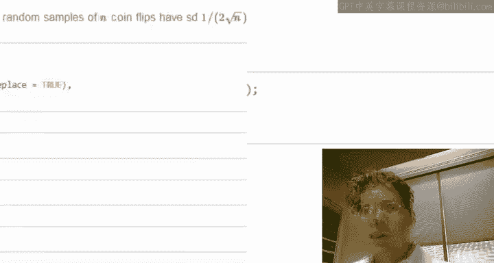

在本节课中，我们将通过一个具体的数据示例，深入理解样本方差、标准差以及标准误等核心概念。我们将使用一个真实的数据集进行计算和解释，帮助你直观地把握这些描述数据变异性的关键指标。

---

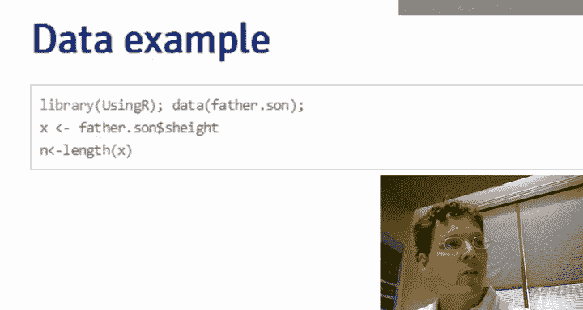

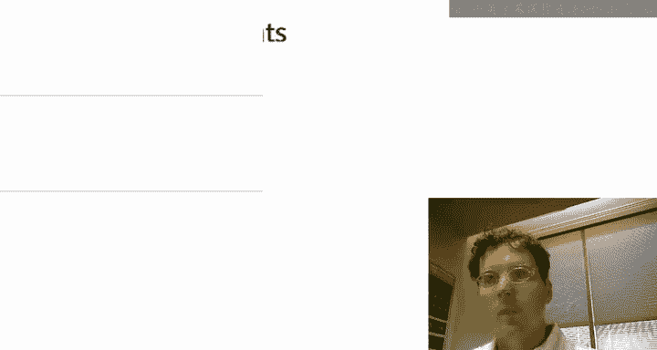

## 数据示例：父子身高数据

现在，让我们通过一个数据示例来具体说明。这里我将使用来自“UsingR”数据集的父子身高数据。我将提取儿子的身高数据，并设 `n` 为观测值的数量。


```r
# 假设 x 为儿子的身高数据向量
# n 为观测值数量
n <- length(x)
```

如果我为儿子的身高绘制一个直方图，会得到此处显示的分布。我在直方图上叠加了一条连续的密度估计曲线。这个分布看起来非常接近高斯分布（正态分布）。

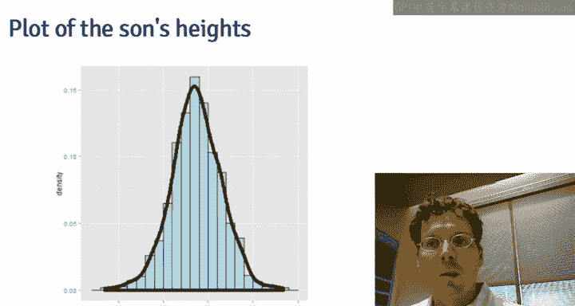


现在，这条密度估计曲线是对总体密度的一个估计。我们无法获得真实的总体密度，因为我们没有收集无限量的数据。


这个直方图的变异性，正是样本方差所要计算的内容。它是在估计这些儿子身高数据所来源的总体中，身高的变异性。我们假设这是一个随机样本。

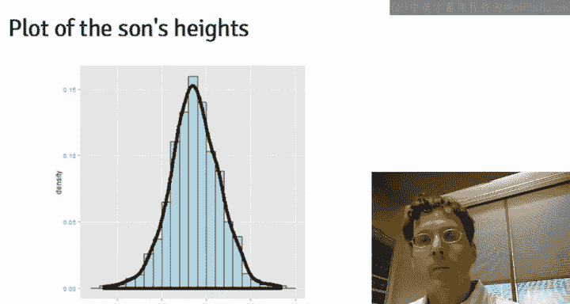


---

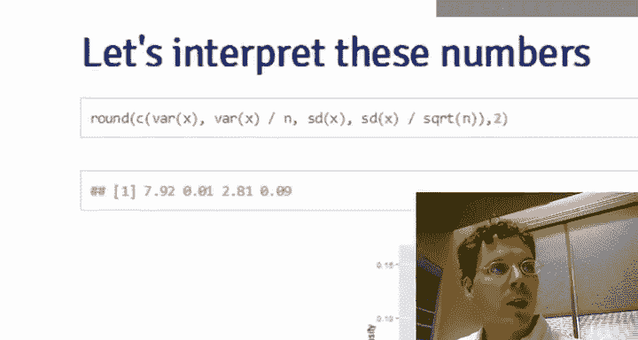

## 计算关键统计量

接下来，我们计算几个关键的数字。这里我计算了：
*   `x` 的方差
*   `x` 的方差除以 `n`
*   `x` 的标准差
*   `x` 的标准差除以 `n` 的平方根

所有数字都四舍五入到两位小数。

```r
var_x <- var(x)               # 样本方差
var_x_over_n <- var_x / n     # 样本均值的方差估计
sd_x <- sd(x)                 # 样本标准差
se_x <- sd_x / sqrt(n)        # 标准误
```

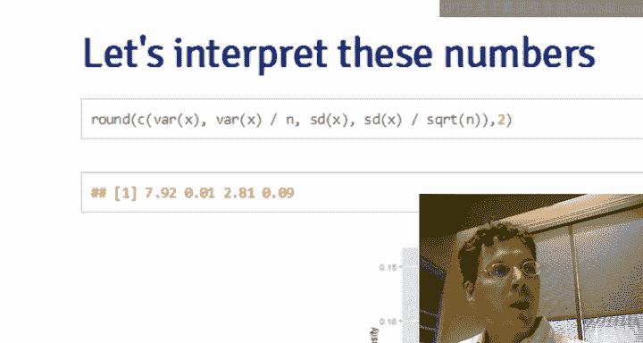

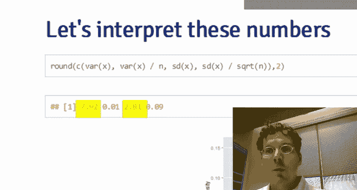


所以，我们得到方差为 **7.92**，标准差为 **2.81**。`x` 的方差和标准差描述的是这个数据集中儿子身高的变异性。如果你愿意假设这些儿子是来自某个有意义总体的随机样本，那么这些值就是对总体中儿子身高变异性的估计。

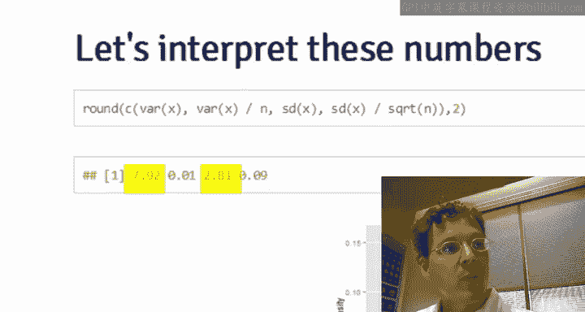


在这个案例中，我更喜欢 **2.81** 而不是 **7.92**，因为 7.92 的单位是英寸的平方，而 2.81 的单位是英寸。我更喜欢使用原始单位而不是单位的平方来工作。

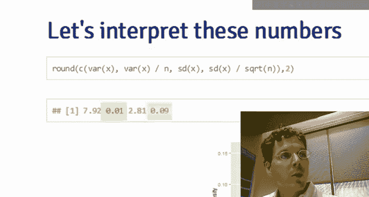

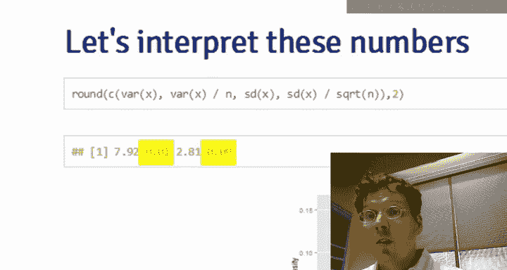


---

## 理解标准误

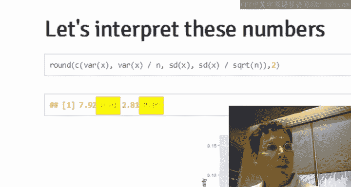

而 **0.01**（方差除以n）和 **0.09**（标准差除以根号n）这两个值，讨论的就不再是儿童身高的变异性了。它们讨论的是 **10个儿童身高平均值的变异性**。

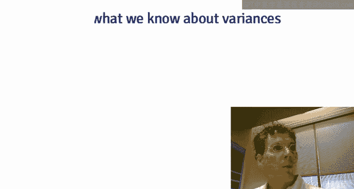


因此，**0.09** 可能是最有意义的一个值，它就是 **标准误**。换句话说，它是 **N个儿童身高平均值的分布的标准差**。同样，在此例中，这是对标准误的一个估计，但它是我们根据现有数据能得到的最佳估计。


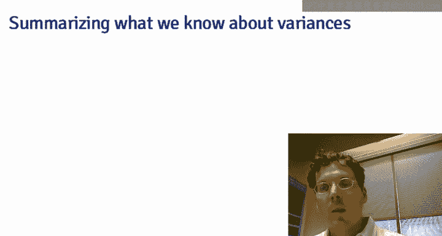

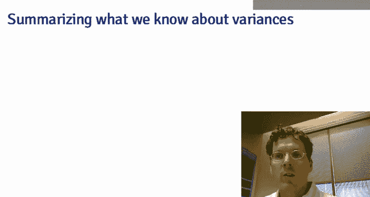

---

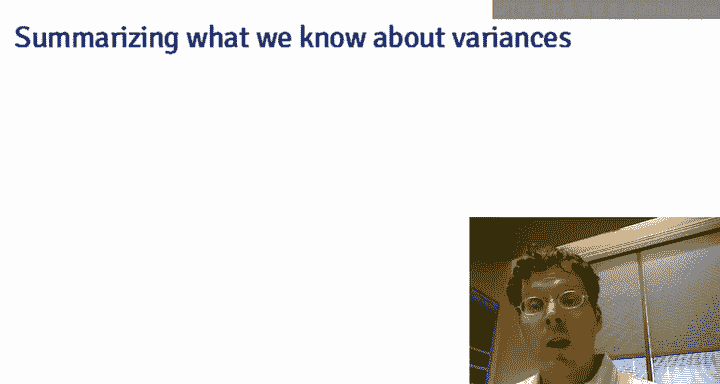


## 核心概念总结 📝

现在让我们总结一下所学内容，因为本节课涵盖了许多有些复杂的主题。我认为，理解统计学与不理解统计学的根本区别在于 **是否理解变异性**。如果要说哪一讲最重要，可能就是这一讲。

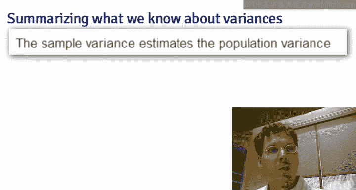

以下是本节课的核心要点总结：

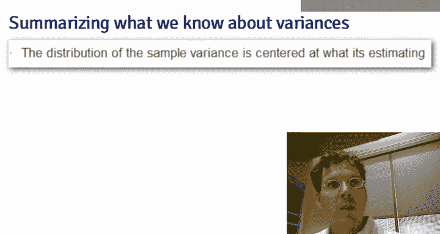


**1. 样本方差与总体方差**
*   **样本方差** 是 **总体方差** 的一个估计量。
*   样本方差的分布以其所要估计的总体方差为中心。这是一个很好的性质，意味着它是 **无偏的**。
*   随着收集的数据增多，样本方差的分布会围绕其估计目标（总体方差）更加集中。这同样是一个好性质，意味着如果我们费力收集更多数据，就能得到更好的估计。


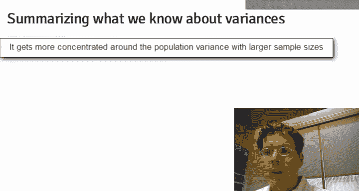


**2. 样本均值的分布**
*   从上节课我们知道，样本均值的分布以总体均值 `μ` 为中心。
*   本节课我们还知道，**样本均值的方差** 等于 **总体方差 `σ²` 除以样本量 `n`**。
*   其平方根，即 **`σ / √n`**，就是所谓的 **标准误**。

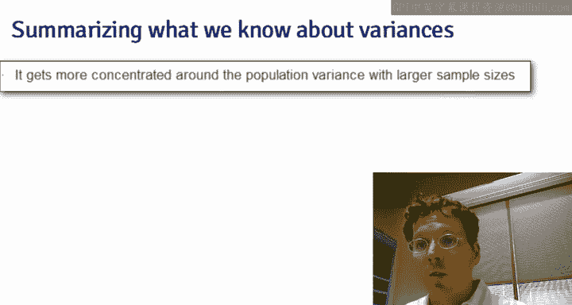

**公式表示如下：**
```
Var(样本均值) = σ² / n
标准误 (SE) = σ / √n
```


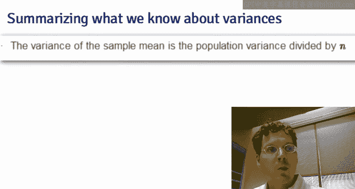

**3. 标准误的意义**
*   这些量（方差除以n和标准误）代表了从该总体中抽取的 **样本平均值的变异程度**。


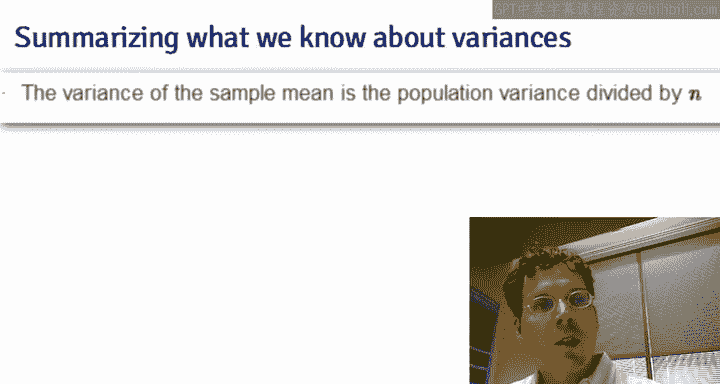


**4. 统计推断的基础**
*   事实证明，即使在实际数据中我们只能看到一个样本均值，我们也可以对来自随机样本的 **平均值的分布** 说出很多信息。
*   这为我们提供了大量可用的工具，并构成了我们进行许多统计推断方法的基石。

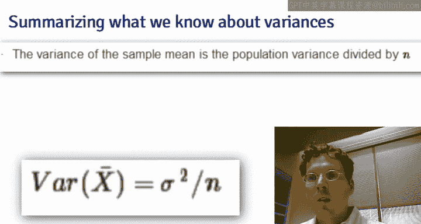


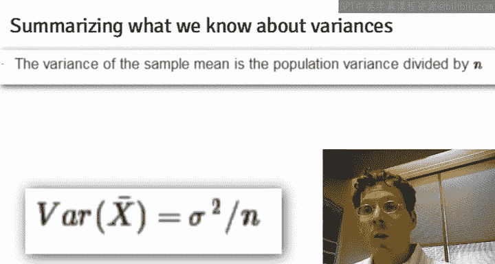

---

## 课程总结


在本节课中，我们一起学习了如何通过实际数据计算和解释方差、标准差与标准误。我们明确了样本方差是总体方差的无偏估计，并且深入理解了标准误 `σ/√n` 作为样本均值变异性的度量标准。掌握这些关于数据变异性的核心概念，是理解统计学并利用样本信息对总体进行推断的关键第一步。