# 课程P150：使用Swirlify创建Swirl课程与教程 🎓

在本节课中，我们将学习如何使用Swirlify包来创建自己的Swirl互动式课程。Swirl是一个R语言包，它能将R控制台转变为交互式学习环境。如果你还不熟悉Swirl，我们将先进行一个简短的介绍。

---

## Swirl简介与启动 🚀

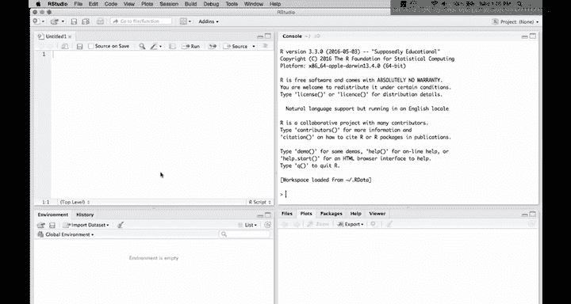

首先，我们需要加载Swirl包并启动它。以下是启动Swirl的基本步骤：

```r
# 加载swirl包
library(swirl)

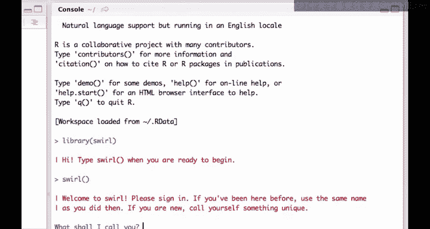

# 启动swirl
swirl()
```

启动后，R控制台会开始与你对话，并询问你的名字。接着，它会询问你是否要继续之前的课程，或者选择一个新的课程开始。

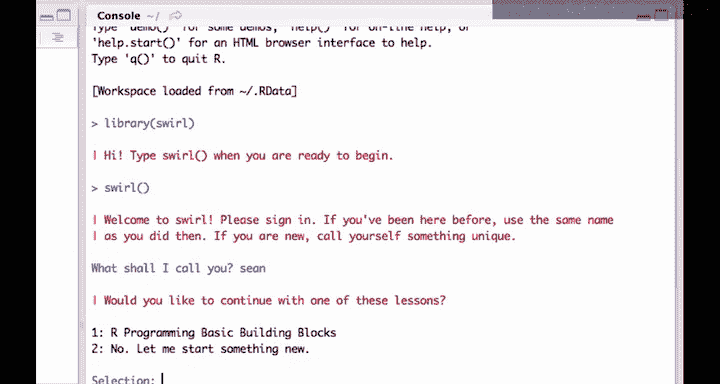

---

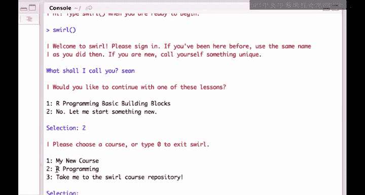

## 选择课程与开始学习 📚

在Swirl中，你可以从一系列课程中选择一个开始学习。例如，选择“R Programming”课程，然后在该课程中选择第一课“Basic Building Blocks”。

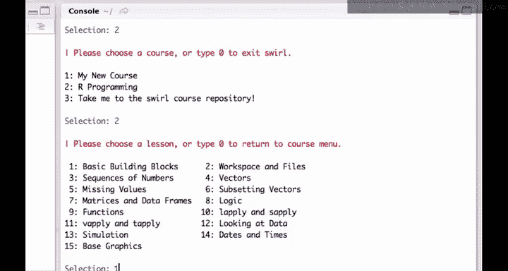

Swirl课程会显示一些文本，并逐步引导你完成练习。例如，它可能会要求你计算 `5 + 7` 的结果。

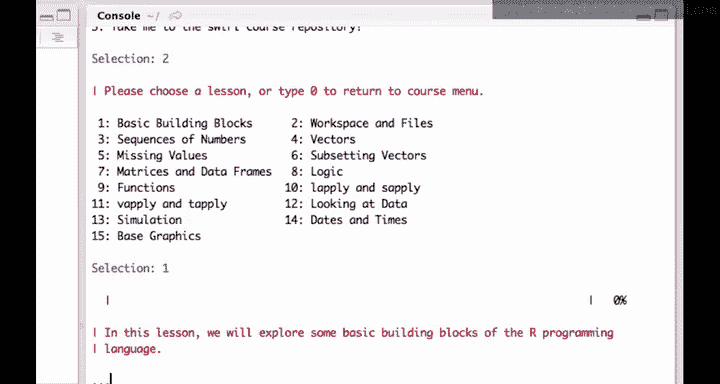

---

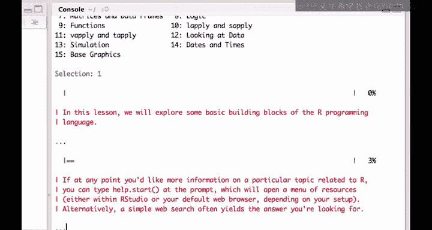

## 互动练习与反馈 🔄

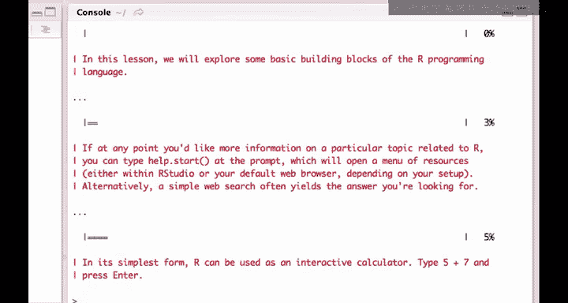

在Swirl课程中，你会遇到各种类型的问题。例如，Swirl可能要求你将 `5 + 7` 的结果赋值给一个变量 `x`。

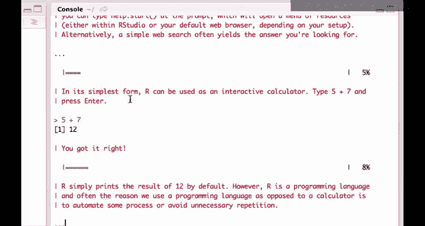

如果你输入了错误的答案，比如 `x <- 5 + 8`，Swirl会提示你答案不正确，并给出提示，引导你输入正确的答案 `x <- 5 + 7`。

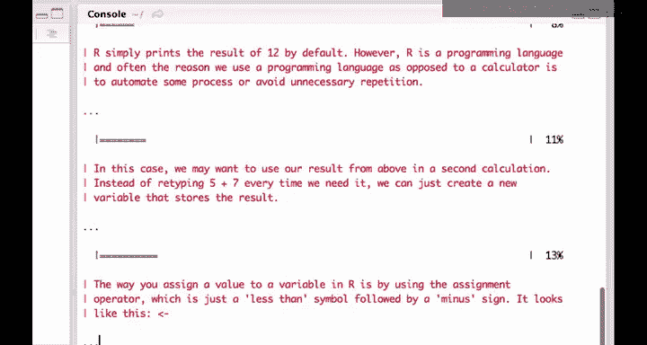

Swirl支持多种类型的问题，包括计算题、选择题和代码填空题，每种问题都会根据你的回答提供即时反馈。

---

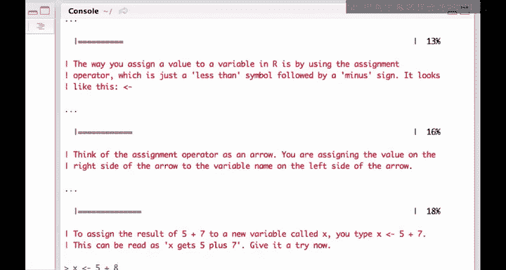

## 退出课程与下一步 🛑

要退出当前的Swirl课程，你可以按键盘上的“Esc”键。退出后，你将回到R控制台的正常模式。

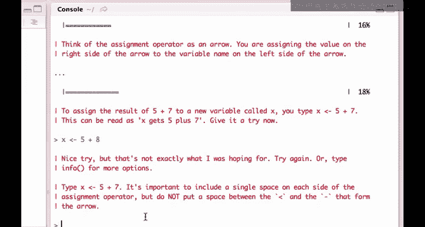

现在，我们已经了解了Swirl的基本使用方法，接下来我们将介绍如何使用Swirlify包来创建自己的Swirl课程。

---

## 总结 📝

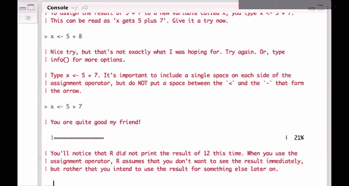

本节课中，我们一起学习了Swirl的基本功能和使用方法。我们了解了如何启动Swirl、选择课程、完成互动练习，以及如何退出课程。Swirl通过即时反馈和提示，帮助初学者在R控制台中轻松学习编程概念。

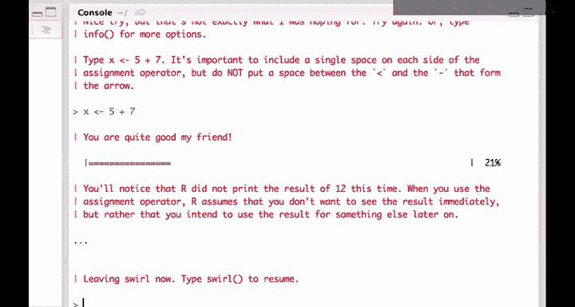

在接下来的课程中，我们将深入探讨如何使用Swirlify包来创建自定义的Swirl课程，以便你可以根据自己的需求设计互动式学习内容。