# 课程 P151：创建你的第一个 Swirl 交互式教程 🎯

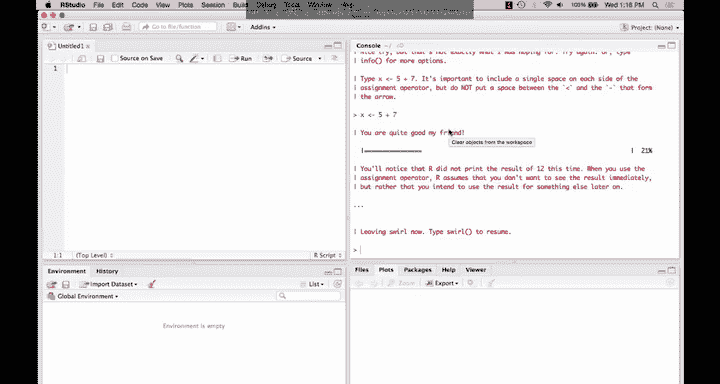

在本节课中，我们将学习如何使用 `swirlify` 包来创建自己的 Swirl 交互式课程和课程单元。你将了解课程的基本结构、如何编写不同类型的题目，以及如何测试和运行你的课程。

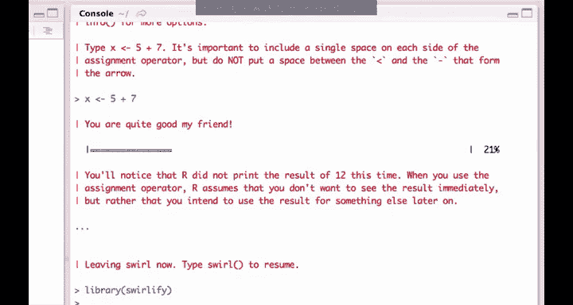

---

## 1. 准备工作与环境设置

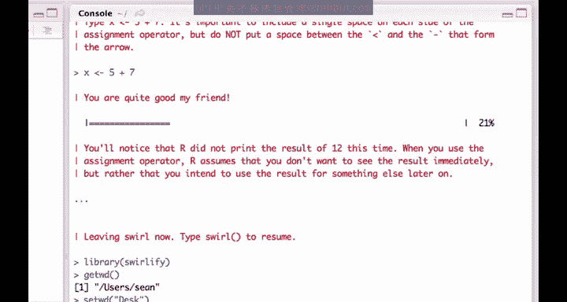

首先，你需要加载 `swirlify` 包。这个包是创建和管理 Swirl 课程的核心工具。

```r
library(swirlify)
```

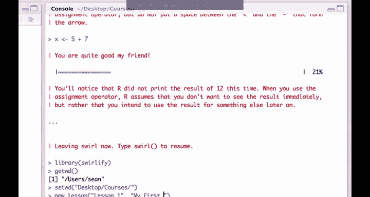

Swirl 始终知晓你的当前工作目录。为了组织课程文件，建议设置一个专门的工作目录。例如，可以在桌面上创建一个名为 `courses` 的文件夹来存放和开发课程。

```r
setwd("~/Desktop/courses")
```

---

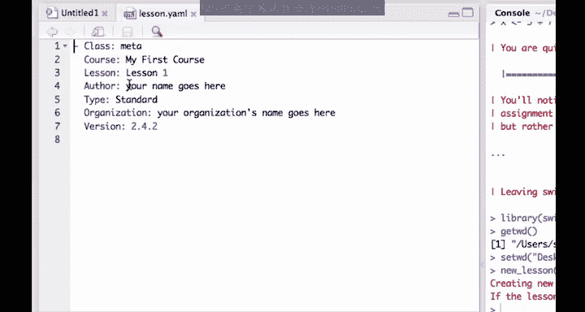

## 2. 创建新课程与新课程单元

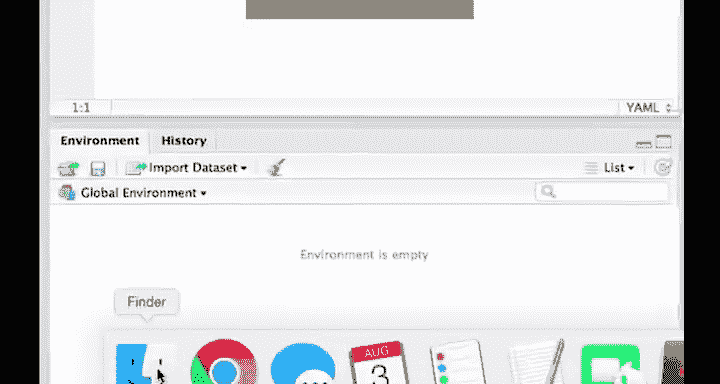

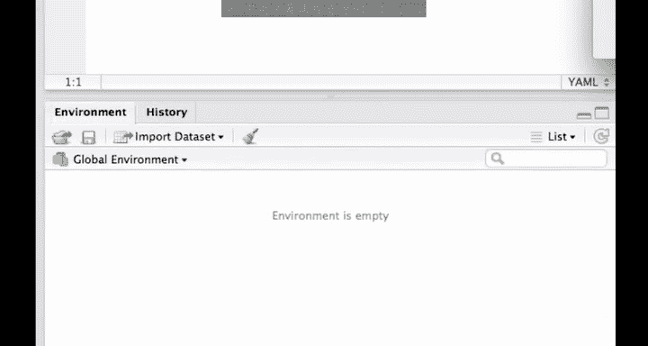

上一节我们设置了工作目录，本节中我们来看看如何创建一个全新的课程和课程单元。

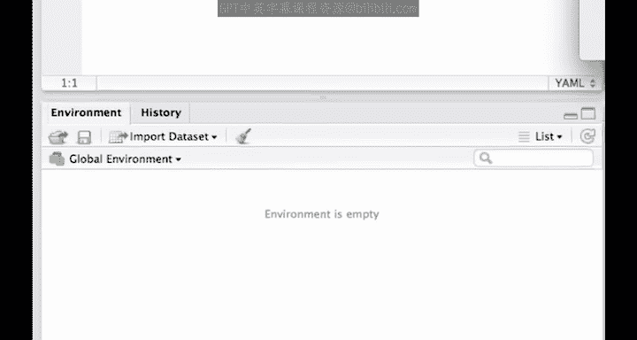

你可以使用 `new_lesson` 函数来开始编写新的 Swirl 课程和课程单元。你需要为课程单元和课程本身命名。

```r
new_lesson(lesson_name = "Lesson1", course_name = "My First Course")
```

执行此函数会完成几项工作。首先，它会打开一个 YAML 文件。所有 Swirl 课程单元都是用 YAML 编写的。YAML 是一种易于理解的标记语言。Swirl 使用的方式是：每个问题（题目）由一个连字符 `-` 分隔，然后是一组键值对，用于指定题目类型和内容。

---

## 3. 课程文件结构解析

执行 `new_lesson` 函数后，它会创建几个文件。让我们进入刚刚创建的课程文件夹查看。

以下是创建的主要文件：

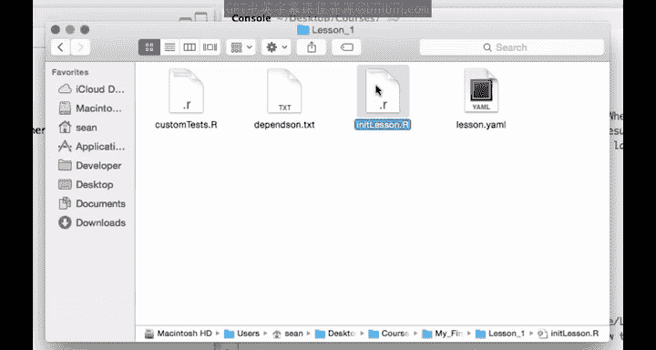

*   **`customTests.R`**：你可以在此文件中指定用于测试题目答案正确性的自定义函数。我们稍后会讨论答案测试。
*   **`dependson.txt`**：这是一个文本文件，用于列出课程开始前 Swirl 需要检查并确保已安装的 R 包名称。
*   **`initLesson.R`**：这是一个 R 脚本。你在此脚本中编写的任何代码都将在课程单元开始前执行。例如，你可以在此加载数据，或创建学生将在课程中使用的函数。
*   **`lesson.yaml`**：这就是我们在 RStudio 中看到的 YAML 文件，是课程内容的核心。

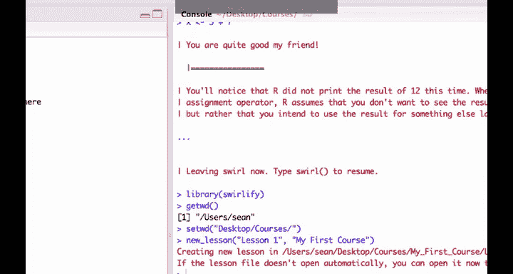

我喜欢使用 RStudio 编写 Swirl 课程，因为将文本编辑器和 R 控制台并排放在同一屏幕上对我很有效。我推荐使用 RStudio，但不同的人有不同的工作流程。

---

## 4. 添加题目：信息类题目

现在新课程单元已设置好，我们可以开始添加题目了。你可以使用 `swirlify` 包附带的 `wq_` 系列函数。

你可以在一节课中包含多种不同类型的题目。最简单的一种是“信息类题目”。

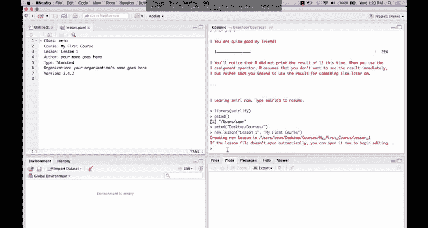

执行 `wq_message()` 函数，然后转到 `lesson.yaml` 文件，你会看到它添加了一个信息类题目的模板。

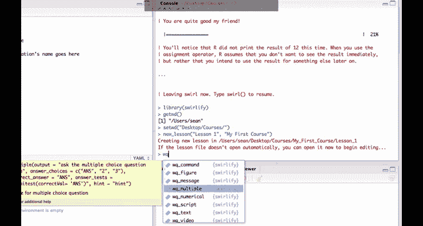

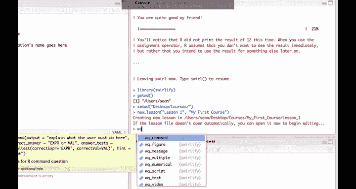

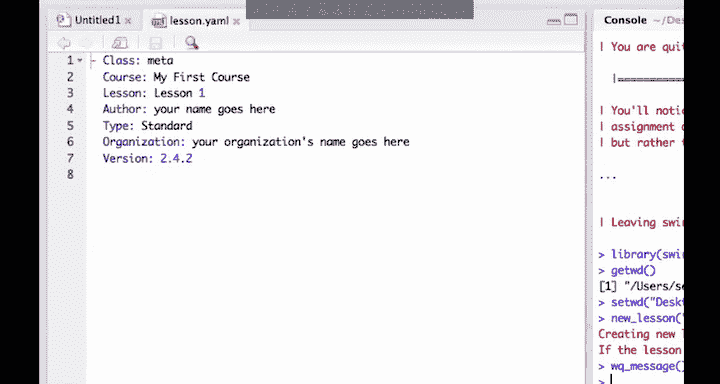

我将编辑这个信息类题目，写上：“欢迎来到课程单元 1”。这样，一个简单的信息类题目就写好了。

---

## 5. 添加题目：命令类题目

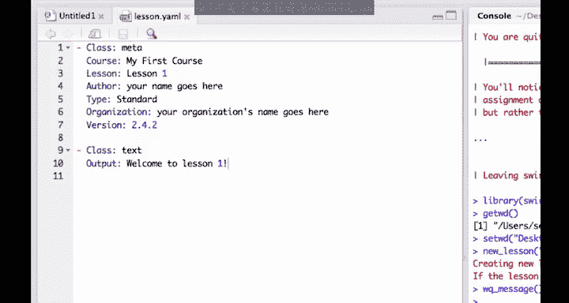

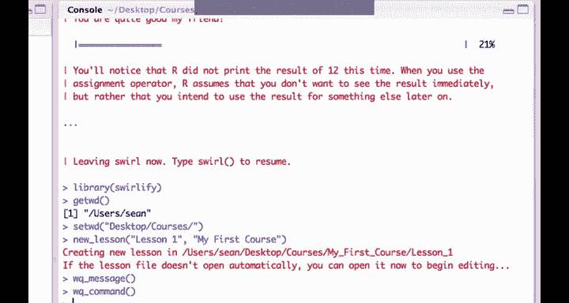

接下来，我将添加另一个题目，这次是一个“命令类题目”。

命令类题目会提示学生实际在 R 控制台中输入一些 R 代码。执行 `wq_command()` 后，题目模板会被添加到 `lesson.yaml` 文件中。

我将问学生一个简单的问题，例如：“使用加号运算符将 2 和 2 相加”。

然后，正确答案是非常简单的 R 表达式：`2 + 2`。

`answer_test` 是一个用于测试学生在控制台中输入内容正确性的函数。`omnitest` 是 Swirl 内置的一个函数，对于你将提出的 80% 到 90% 的问题，你都可以使用 `omnitest`。

因此，在这个例子中，我只需在 `correct_expr` 参数中写入 `2 + 2`。

然后，我将给用户一个非常简单的提示，说：“只需输入 2 + 2”。

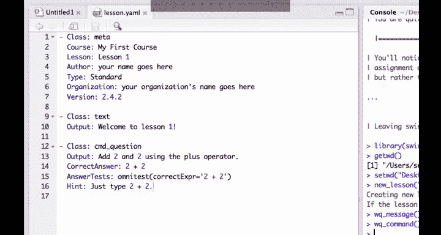

---

## 6. 管理课程清单

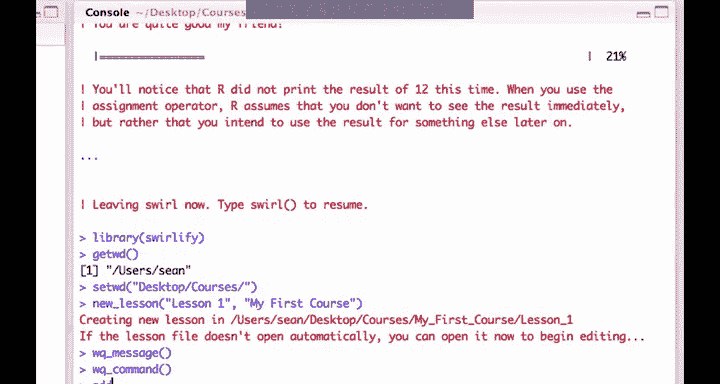

我已经编写了一些题目，现在可以开始测试这个课程单元了。

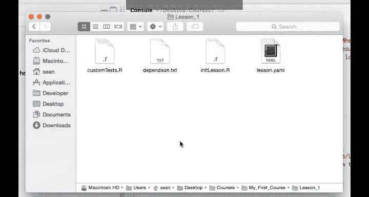

每当你向课程中添加一个课程单元后，都应将其添加到所谓的“课程清单”中。你可以使用 `add_to_manifest()` 函数轻松完成此操作。

这个操作会创建一个 `MANIFEST` 文件。这个文件位于课程目录（即“My First Course”文件夹）中，它用于记录你希望课程单元显示的**顺序**，同时也记录了课程中包含哪些课程单元。这样，如果你想在课程文件夹中放入数据或其他文件，你可以这样做，而这些文件不会作为学生选择学习的课程单元出现。`MANIFEST` 文件有助于保持组织有序。

---

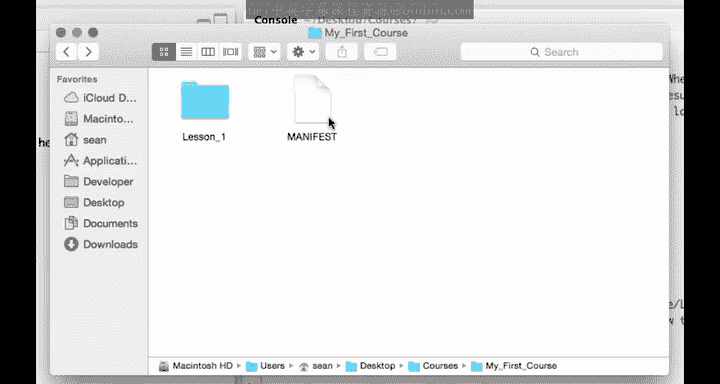

## 7. 测试与运行课程

我已经将此课程单元添加到了清单中。现在让我们来测试这个课程单元。

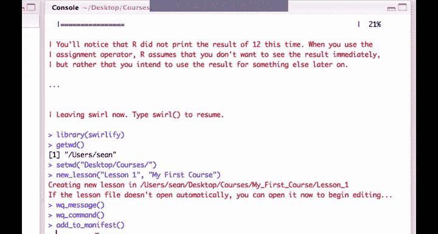

首先，为了检查课程单元的基本格式，我将使用 `test_lesson()` 函数。如果没有收到任何警告或消息，则意味着该课程单元通过了 `swirlify` 附带的一些格式检查。

接着，我想在 Swirl 中实际使用这个课程单元。我将使用 `demo_lesson()` 函数。如你所见，这将直接带我们进入正在编写的课程单元，而无需经过 Swirl 的菜单。

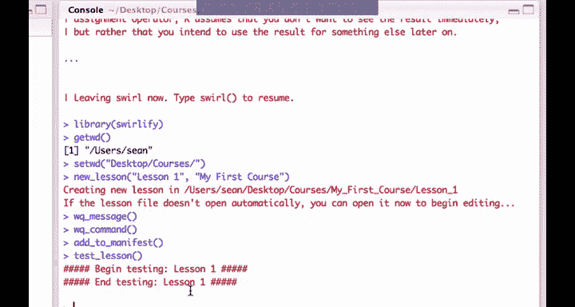

第一题是：“欢迎来到课程单元 1”。第二题是：“使用加号运算符将 2 和 2 相加”。我输入 `2 + 2`，然后课程单元结束。

---

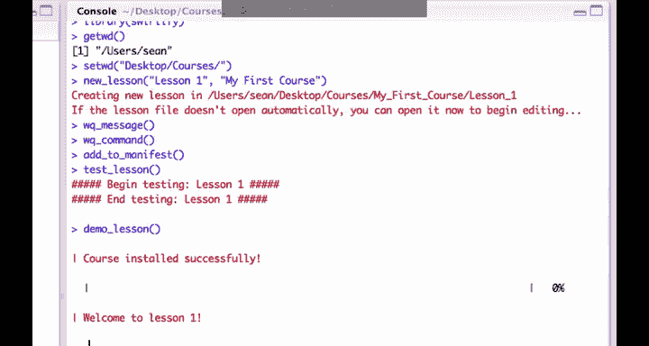

## 总结

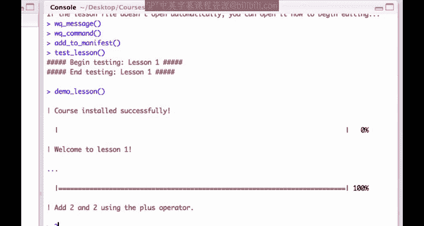

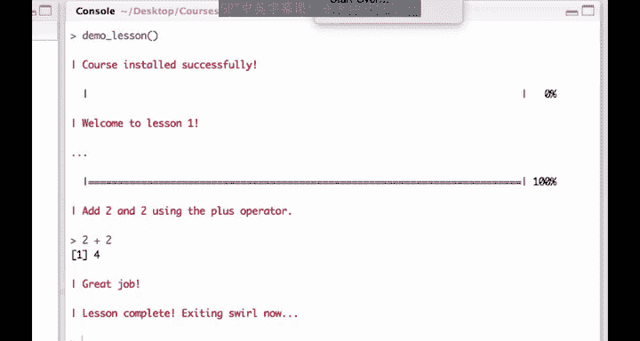

本节课中，我们一起学习了创建 Swirl 交互式教程的完整流程。我们从加载 `swirlify` 包和设置工作目录开始，然后使用 `new_lesson` 函数创建了新的课程和课程单元。我们探讨了课程的文件结构，包括 `lesson.yaml`、`initLesson.R` 等核心文件。接着，我们实践了如何使用 `wq_message()` 和 `wq_command()` 函数来添加信息类和命令类题目，并了解了如何设置答案测试。最后，我们学习了如何使用 `add_to_manifest()` 管理课程清单，以及如何使用 `test_lesson()` 和 `demo_lesson()` 来测试和运行我们创建的课程。