# 课程 P152：创建 Swirl 交互式课程（第二部分）📚

在本节课中，我们将学习如何创建更复杂的 Swirl 课程问题类型，包括多选题和图形题。我们将创建一个新的课程，并探索如何通过代码动态地向学生展示和修改图表。

---

## 概述

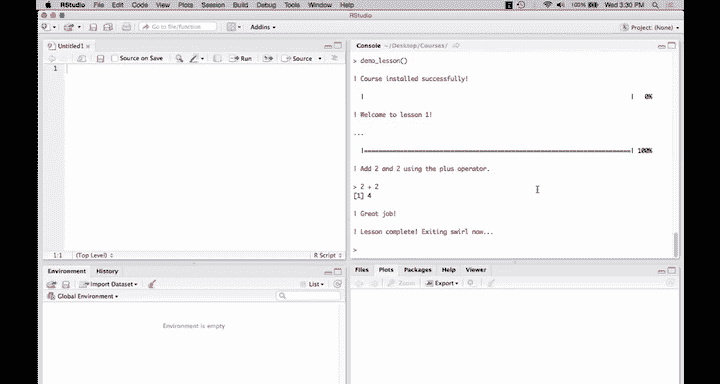

上一节我们创建并测试了第一个简单的 Swirl 课程。本节中，我们将创建一个新的课程，并重点介绍两种更高级的问题类型：多选题和图形题。你将学会如何构建包含多个选项的问题，以及如何通过 R 脚本向学生展示和逐步构建图表。

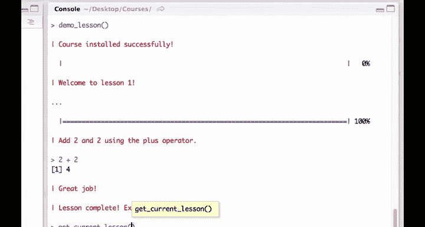

---

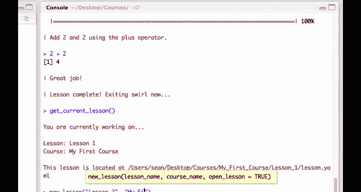

## 创建新课程

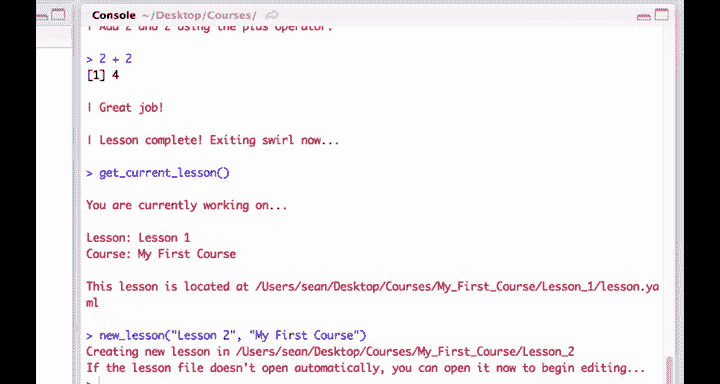

首先，我们需要创建一个新的课程。使用 `get_current_lesson()` 函数可以确认当前正在工作的课程和课程名称。

```r
get_current_lesson()
```

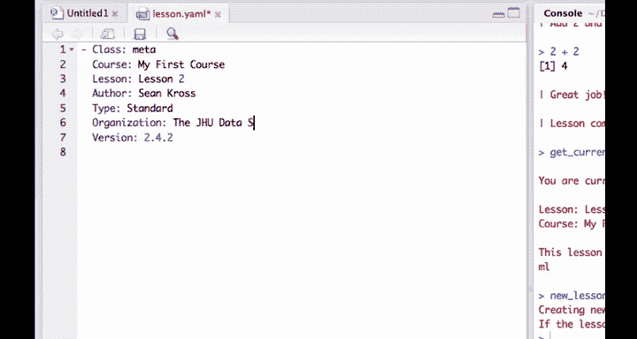

结果显示，当前课程名为 “my first course”。接下来，我们在这个课程下创建一个名为 “Lesson 2” 的新课程。

```r
# 创建新课程
new_lesson("Lesson 2", "my first course")
```

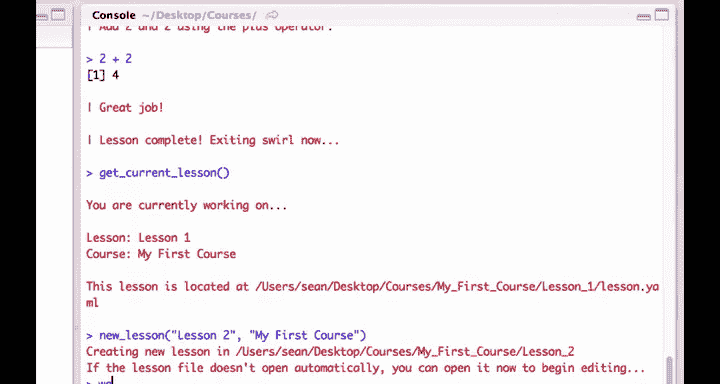

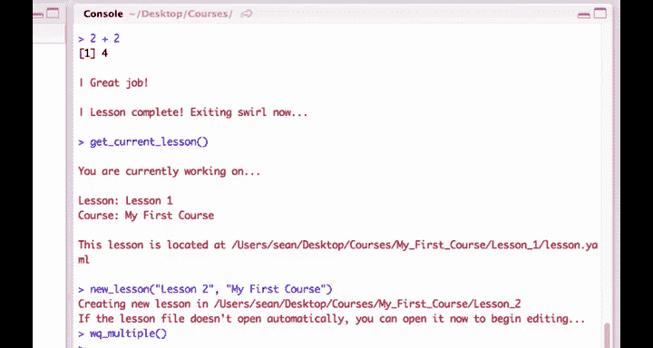

创建成功后，你会看到一个新的课程文件被生成。课程的第一个问题被称为“元问题”，学生不会看到它，但开发者可以在这里填写课程作者和组织等信息。

---

## 构建多选题

以下是创建多选题的步骤。

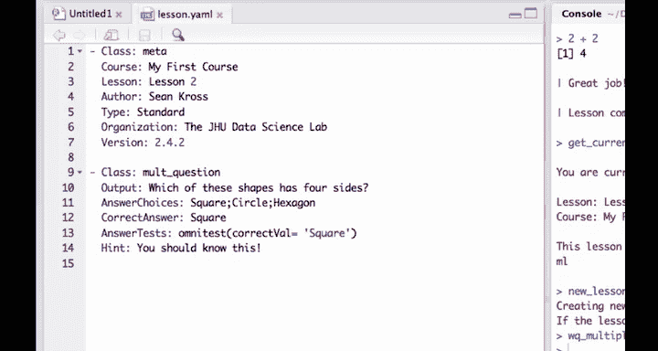

首先，在 R 控制台使用 `wq_multiple()` 函数来为课程添加一个多选题模板。

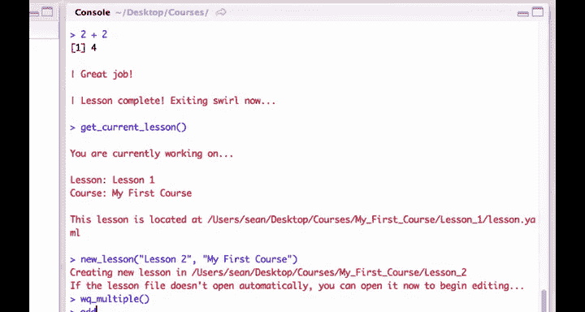

```r
wq_multiple()
```

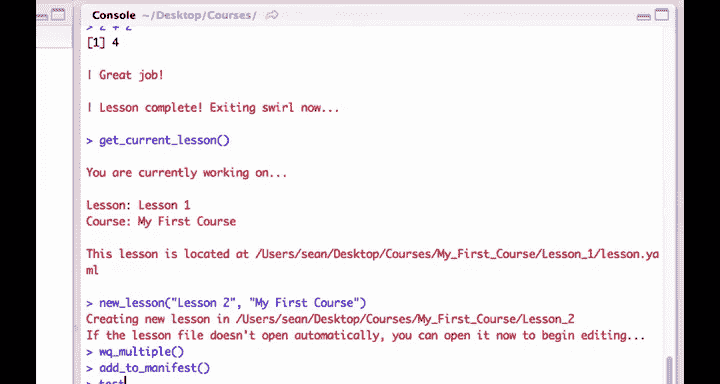

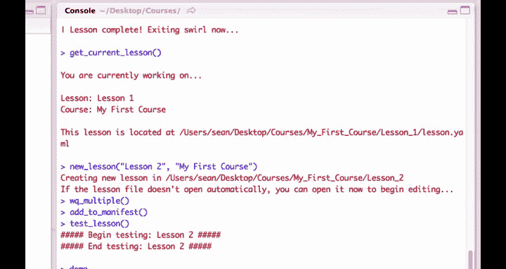

然后，编辑生成的问题文件。一个典型的多选题包含问题文本、用分号分隔的选项、正确答案以及提示信息。

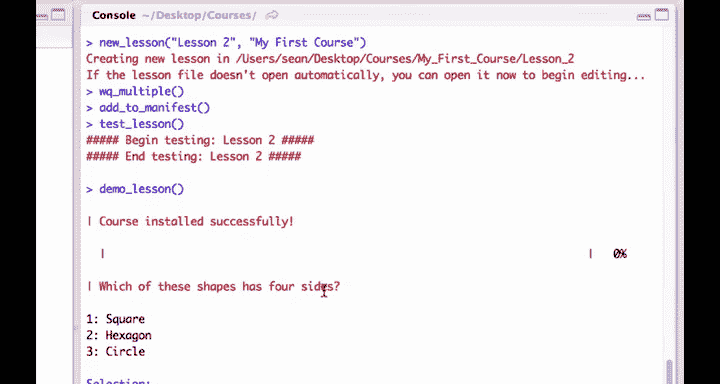

*   **问题**：Which of these shapes has four sides?
*   **选项**：circle; square; triangle
*   **正确答案**：square
*   **提示**：Think about geometry.

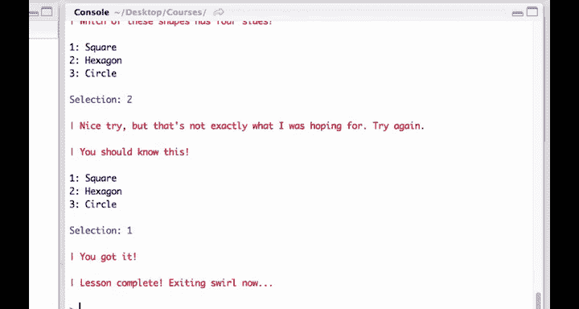

编辑完成后，需要将新课程添加到课程清单中，并进行测试以确保没有错误。

```r
# 添加到清单
add_to_manifest()
# 测试课程
test_lesson()
```

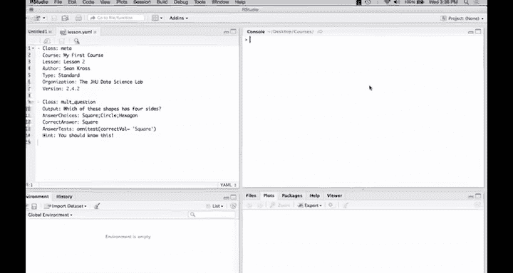

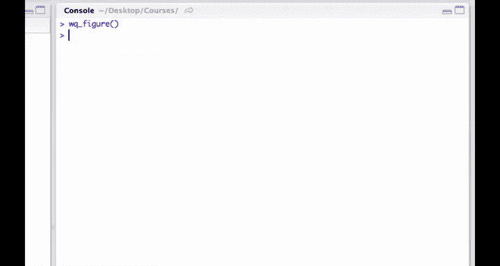

测试无误后，可以运行 `demo_lesson()` 来预览课程效果。学生将看到问题，选择答案，并根据选择得到反馈。

---

## 构建图形题

接下来，我们看看如何创建图形题。图形题允许你向学生展示由 R 代码生成的图表。

首先，使用 `wq_figure()` 函数添加一个图形题模板。

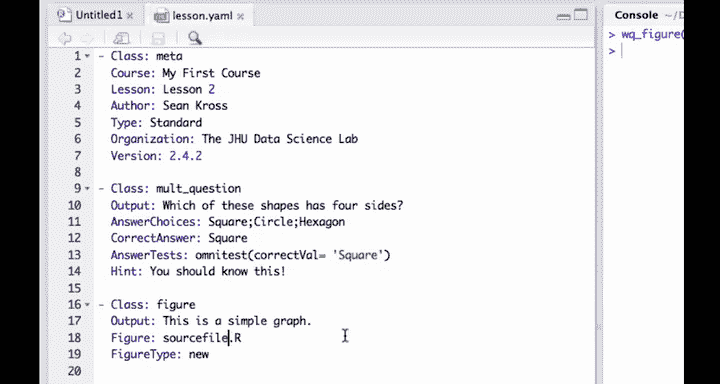

```r
wq_figure()
```

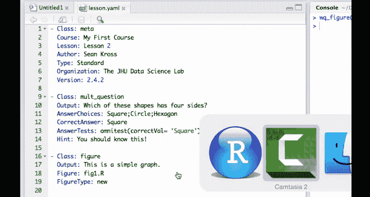

编辑这个问题时，需要关注三个主要部分：
1.  **输出给用户的信息**：例如 “This is a simple graph.”
2.  **图形文件**：指定一个 R 脚本文件（如 `fig1.R`），该文件中的代码将被执行以生成图形。
3.  **图形类型**：对于第一个图形，类型设为 `"new"`，表示创建一个新图。

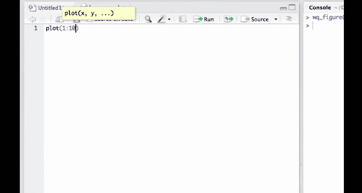

例如，创建一个简单的散点图脚本 `fig1.R`：

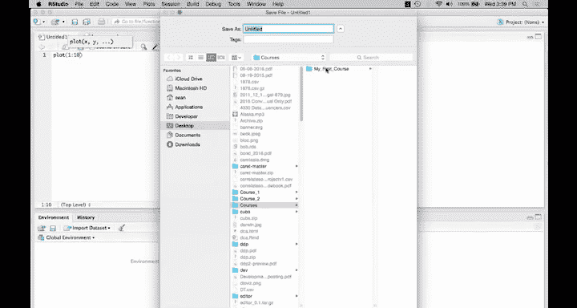

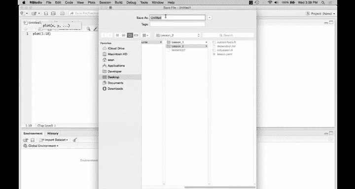

```r
# fig1.R 内容
plot(1:10, 1:10)
```

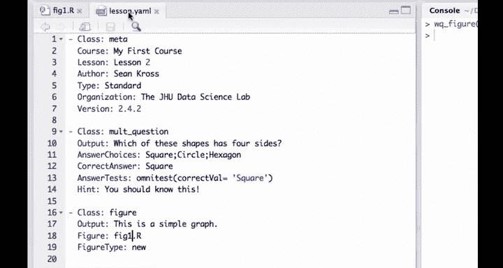

---

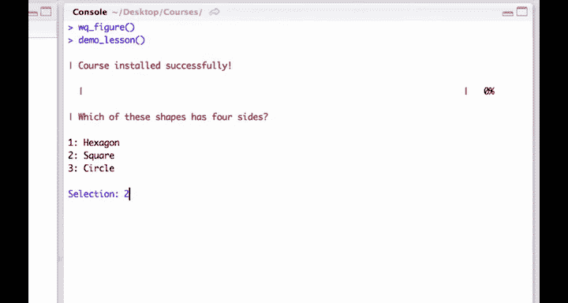

## 在现有图形上添加元素

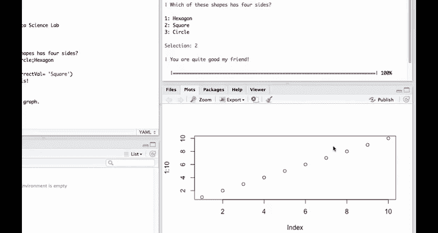

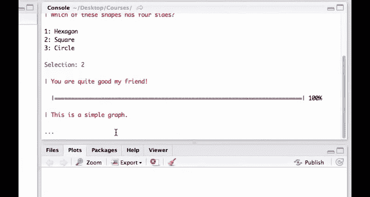

Swirl 允许你在后续问题中，在已显示的图形上添加新元素。

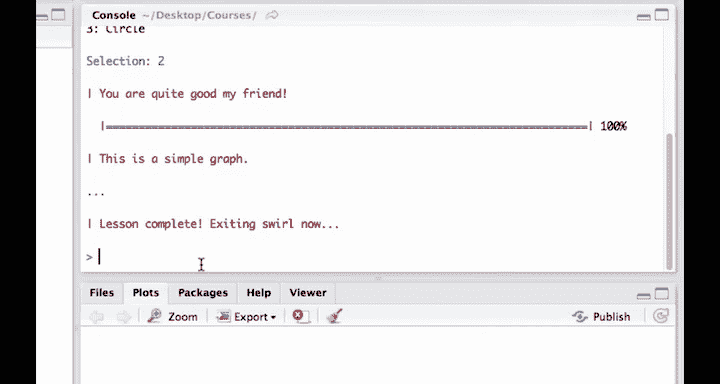

添加另一个图形题，使用相同的 `wq_figure()` 函数。在这个问题中：
*   **输出信息**：例如 “Add a line.”
*   **图形文件**：指定另一个 R 脚本（如 `fig2.R`）。
*   **图形类型**：此时应设为 `"add"`，表示在上一张图的基础上添加。

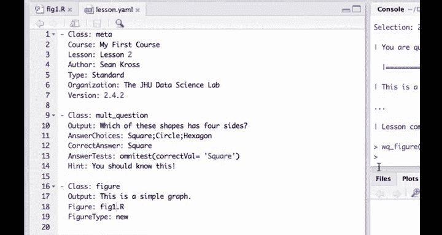

创建 `fig2.R` 脚本，用于在之前的散点图上添加一条水平线：

```r
# fig2.R 内容
abline(h = 5)
```

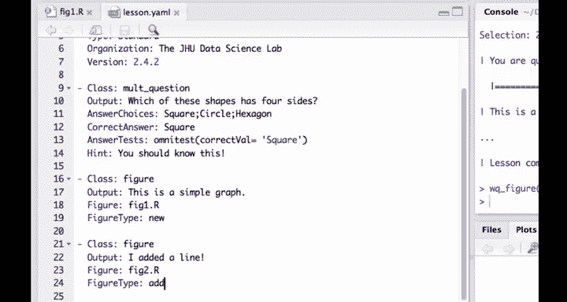

当学生按顺序完成这两个图形题时，他们会先看到基础散点图，然后在下一个问题中看到添加了水平线的同一张图。

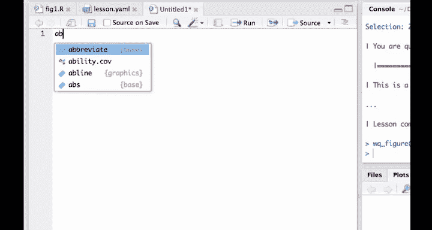

---

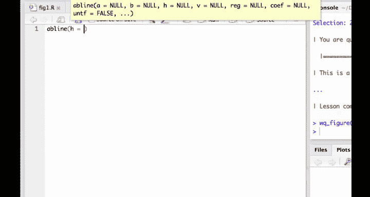

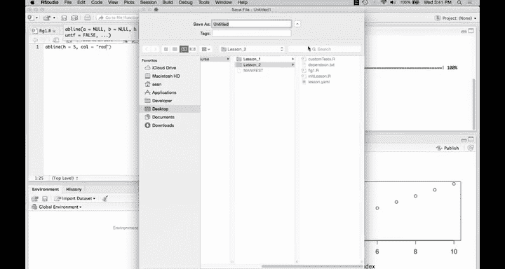

## 总结

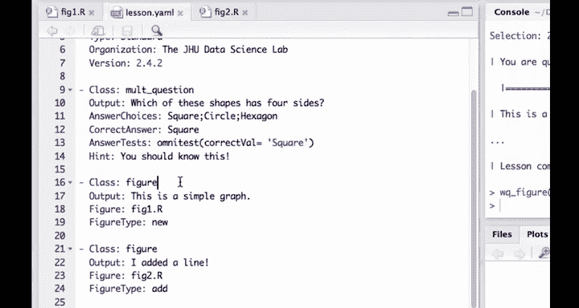

本节课中，我们一起学习了如何扩展 Swirl 课程的功能。我们创建了一个新课程，并实践了构建多选题和图形题这两种复杂问题类型。关键点在于：
*   使用 `wq_multiple()` 创建选择题，并正确设置选项和答案。
*   使用 `wq_figure()` 创建图形题，通过 `"new"` 和 `"add"` 两种类型控制图形的创建与叠加。
*   始终记得使用 `add_to_manifest()`、`test_lesson()` 和 `demo_lesson()` 来管理和测试你的课程。

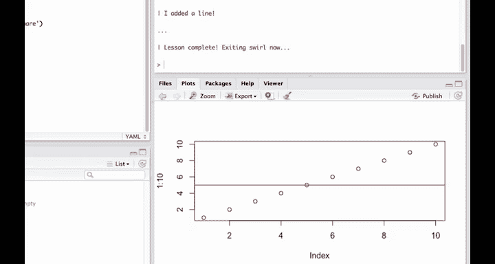

掌握这些技巧后，你就能创建出更具交互性和视觉效果的 R 语言学习课程了。